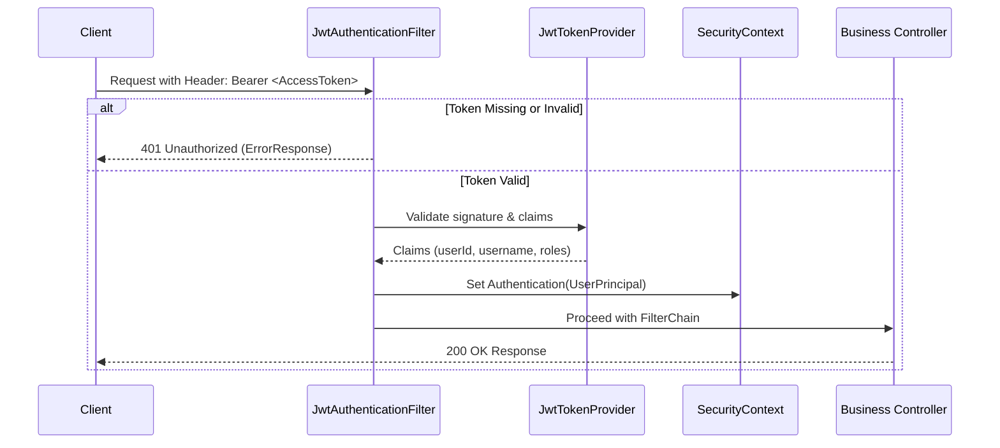

# FINServ — System Architecture Specification

## 1. High-Level Technology Architecture

```mermaid
graph TD
    Client[React 19 + TypeScript SPA (Vite)]
    Gateway[RESTful API Gateway / Reverse Proxy]
    App[Spring Boot 3.x Application Server]
    Sec[Spring Security 6.x + Stateless JWT Filter]
    Subsystems[Module Services: Ledger, Accounts, KYC, Loans, etc.]
    Flyway[Flyway Migration Engine]
    MySQL[(MySQL 8.0 Enterprise Relational DB)]
    
    Client -->|HTTPS / REST / JSON| Gateway
    Gateway --> Sec
    Sec --> App
    App --> Subsystems
    Subsystems --> Flyway
    Subsystems -->|ACID Transactions / Pessimistic Locks| MySQL
```

---

## 2. Backend Architecture & Package Structure

The backend follows an idiomatic, modular domain-driven package organization rooted at `com.finserv`. This avoids monolithic entanglement while preserving direct transactional cohesion across interrelated financial aggregates.

```
com.finserv/
├── FinServApplication.java
├── config/
│   ├── SecurityConfig.java           # Spring Security filter chain & CORS rules
│   ├── OpenApiConfig.java            # Swagger / OpenAPI 3.0 documentation
│   ├── WebMvcConfig.java             # Interceptors, argument resolvers, formatting
│   ├── JpaAuditingConfig.java        # Spring Data JPA @EnableJpaAuditing
│   └── IdempotencyConfig.java        # Filter / Interceptor for X-Idempotency-Key
├── security/
│   ├── JwtTokenProvider.java         # Token issuance, signature verification, claims
│   ├── JwtAuthenticationFilter.java  # Bearer token extraction and SecurityContext binding
│   ├── CustomUserDetailsService.java # UserDetails lookup from database
│   ├── SecurityUtils.java            # Access helper for current authenticated principal
│   └── UserPrincipal.java            # Authenticated user representation
├── common/
│   ├── dto/
│   │   ├── ApiResponse.java          # Standard response envelope
│   │   ├── PageResponse.java         # Standard paginated collection envelope
│   │   ├── ErrorResponse.java        # RFC 7807 compliant error payload
│   │   └── MoneyDto.java             # Immutable amount & currency pair
│   ├── exception/
│   │   ├── BaseApiException.java     # Root checked/unchecked API exception
│   │   ├── ResourceNotFoundException.java
│   │   ├── InsufficientFundsException.java
│   │   ├── ConcurrencyConflictException.java
│   │   ├── AccountFrozenException.java
│   │   ├── DuplicateIdempotencyException.java
│   │   └── GlobalExceptionHandler.java # @ControllerAdvice for centralized error mapping
│   ├── model/
│   │   ├── BaseEntity.java           # Base entity with UUID primary key
│   │   └── AuditableEntity.java      # Base entity with createdAt, updatedAt, createdBy, updatedBy
│   ├── util/
│   │   ├── FinancialMath.java        # Safe BigDecimal calculations (RoundingMode.HALF_EVEN)
│   │   └── DateUtils.java            # UTC zone conversions
│   └── idempotency/
│       ├── IdempotencyRecord.java    # Entity tracking key, status, hash, and cached response
│       ├── IdempotencyRepository.java
│       └── IdempotencyService.java   # Lock acquisition and replay service
└── modules/
    ├── auth/                         # User credentials, JWT login, MFA, password reset
    ├── kyc/                          # Progressive registration & document review
    ├── customer/                     # Customer 360 profiles & address book
    ├── branch/                       # Bank branches, IFSC codes, staff assignment
    ├── account/                      # Savings/current accounts, balances, lifecycle
    ├── ledger/                       # Double-entry general ledger & balance consistency
    ├── transaction/                  # Deposits, withdrawals, internal/external transfers
    ├── beneficiary/                  # Payee management, cooling-off rules, validation
    ├── statement/                    # Transaction search, receipt generation, PDF exports
    ├── deposit/                      # Term deposits (Fixed Deposits, Recurring Deposits)
    ├── loan/                         # Lending products, EMI amortization, repayments
    ├── cheque/                       # Cheque books, leaf clearing, Positive Pay
    ├── billpay/                      # Utility bills, recurring mandates, simulator
    ├── card/                         # Debit/Credit cards, limits, security toggles
    ├── upi/                          # VPA handling, QR codes, instant collect/pay
    ├── investment/                   # Mutual funds, insurance, gold bonds
    ├── reward/                       # Loyalty points, cashback, coupon engine
    ├── risk/                         # Velocity checks, fraud alerts, AML monitoring
    ├── notification/                 # In-app alerts, SMS/email simulated dispatch
    ├── support/                      # Customer dispute & support ticket management
    └── audit/                        # Immutable audit event log reader & reporter
```

---

## 3. Layering & Clean Architecture Principles

Each module strictly respects clear separation of concerns across 4 discrete layers:

1. **Controller Layer (`@RestController`)**:
   - Handles HTTP protocol mechanics, request parameter binding, and response envelope wrapping.
   - Enforces preliminary bean validation (`@Valid`, `@NotNull`, `@Positive`).
   - Annotates endpoints with OpenAPI `@Operation` and `@ApiResponse` documentation.
   - Enforces coarse-grained role permissions via `@PreAuthorize`.
   - Never contains financial business rules or direct DB queries.

2. **Service Layer (`@Service`)**:
   - Implements transactional domain logic inside `@Transactional`.
   - Enforces fine-grained authorization: validates that the authenticated principal owns the resource or possesses verified supervisor overrides.
   - Coordinates pessimistic row locks on accounts before balance alterations.
   - Enforces financial invariants (no negative balances unless overdraft permitted, double-entry ledger balance).
   - Publishes domain audit events.

3. **Repository Layer (`@Repository`)**:
   - Extends `JpaRepository<T, UUID>`.
   - Exposes explicit locking methods:
     ```java
     @Lock(LockModeType.PESSIMISTIC_WRITE)
     @Query("SELECT a FROM Account a WHERE a.id = :id")
     Optional<Account> findByIdWithLock(@Param("id") UUID id);
     ```
   - Utilizes indexed query projections for high-performance statement reads.

4. **Entity / Data Layer (`@Entity`)**:
   - Strictly defines database constraints (`@Column(nullable = false, precision = 15, scale = 2)`).
   - Encapsulates state transitions with domain methods rather than indiscriminate public setters.

---

## 4. API Standards & Conventions

### 4.1 URL & HTTP Method Rules
- **Base Prefix**: `/api/v1`
- **Plural Resources**: `/api/v1/accounts`, `/api/v1/transactions`, `/api/v1/beneficiaries`
- **Idempotent Mutations**: All mutating operations (`POST`, `PUT`, `PATCH`, `DELETE`) require the standard `Idempotency-Key` header (with legacy `X-Idempotency-Key` accepted as a fallback).
  - **Key Format**: RFC 4122 UUID v4.
  - **Generation Policy**: One unique key per submit attempt (regenerated upon distinct user attempts).
  - **Backend Contract**: Scoped per authenticated user (`UNIQUE(user_id, idempotency_key)` in `idempotency_records`). If a duplicate key is submitted within the 24-hour TTL with an identical SHA-256 payload hash, the backend replays the cached HTTP status and body without re-executing transactions or mutating ledger balances. If payload hash differs, the backend rejects with HTTP 422 (`IDEMPOTENCY_KEY_REUSED_WITH_DIFFERENT_PAYLOAD`). If an operation is currently executing, it returns HTTP 409 (`OPERATION_IN_PROGRESS`).
- **Traceability**: All requests accept and propagate `X-Correlation-ID`. If omitted by the client, a UUID is injected by the gateway/filter.

### 4.2 Standard Success Response Envelope
All API endpoints return responses encapsulated in `ApiResponse<T>`:
```json
{
  "success": true,
  "timestamp": "2026-10-13T14:30:00Z",
  "correlationId": "f47ac10b-58cc-4372-a567-0e02b2c3d479",
  "data": {
    "transactionId": "d3b07384-d113-40a2-9b24-9b249b249b24",
    "referenceNumber": "TXN2026101389421",
    "amount": 2500.00,
    "currency": "INR",
    "status": "COMPLETED",
    "timestamp": "2026-10-13T14:30:00Z"
  }
}
```

### 4.3 Standard Error Response Envelope (RFC 7807 Aligned)
Errors return HTTP 4xx or 5xx with a standardized `ErrorResponse`:
```json
{
  "success": false,
  "timestamp": "2026-10-13T14:30:00Z",
  "status": 422,
  "errorCode": "INSUFFICIENT_FUNDS",
  "message": "Account balance of INR 1,200.00 is insufficient for requested debit of INR 5,000.00",
  "path": "/api/v1/transactions/transfers",
  "correlationId": "f47ac10b-58cc-4372-a567-0e02b2c3d479",
  "validationErrors": []
}
```

---

## 5. Authentication, Authorization & Session Model



- **Stateless Bearer JWT**: Zero server-side session stickiness, allowing frictionless horizontal scaling.
- **Short-Lived Access Tokens**: Lifetime configured to 15 minutes.
- **Rotating Refresh Tokens**: Stored hashed in the database. When consumed to issue a new Access Token, the old refresh token is invalidated and a fresh one is issued.
- **RBAC Matrix**:
  - `ROLE_CUSTOMER`: Access only to resources matching their own customer ID.
  - `ROLE_EMPLOYEE`: Access to customer search, cash deposits/withdrawals, KYC verification step-1.
  - `ROLE_MANAGER`: Overrides on transaction limits, loan sanctioning, branch overrides.
  - `ROLE_COMPLIANCE`: Access to frozen accounts, audit reports, SAR filings.
  - `ROLE_ADMIN`: System-level configuration, product creation, staff lifecycle.

---

## 6. Financial Safety & Consistency Architecture

### 6.1 Double-Entry General Ledger
Balances are never altered in isolation. Every monetary event records balanced debits and credits:
$$\sum \text{Debits} = \sum \text{Credits}$$
- **Asset Accounts** (e.g. Cash in Vault, Customer Loans): Debit increases, Credit decreases.
- **Liability Accounts** (e.g. Customer Deposits / Accounts): Credit increases, Debit decreases.
- **Revenue Accounts** (e.g. Transaction Fees, Interest Income): Credit increases.
- **Expense Accounts** (e.g. Deposit Interest Paid): Debit increases.

### 6.2 Row-Level Locking Sequence
To avoid race conditions and deadlocks:
1. Always lock participating accounts in a deterministic order (e.g. sorted by `account_id` ascending).
2. Execute `SELECT ... FOR UPDATE` via `findByIdWithLock`.
3. Check balance and account status (`status == ACTIVE`).
4. Create immutable `journal_entry` rows.
5. Update account balances.
6. Commit transaction.

---

## 7. Database Migration Strategy (Flyway)

- All schema modifications reside in `database/migrations/` and `backend/src/main/resources/db/migration/`.
- File naming pattern: `V<Version>__<Description>.sql` (e.g., `V1__init_core_schema.sql`, `V2__seed_reference_data.sql`).
- Repeatable migrations: `R__<View_or_Proc>.sql`.
- Hibernate DDL auto-generation is disabled (`spring.jpa.hibernate.ddl-auto=validate`) to ensure Flyway remains the single source of truth.

---

## 8. Comprehensive Testing Strategy

| Test Layer | Framework / Tools | Scope |
| :--- | :--- | :--- |
| **Unit Tests** | JUnit 5, Mockito, AssertJ | Domain algorithms, EMI reducing-balance math, interest compound calculations, JWT token issuance, fee calculators |
| **Integration Tests** | Spring Boot Test, MockMvc | Controller validation, Spring Security filters, RBAC boundary enforcement, RFC 7807 exception handling |
| **Data & Concurrency** | Spring Data JPA Tests, Testcontainers / Dedicated Test DB | Pessimistic locking validation, double-entry balance check triggers, idempotency duplicate replay tests |
| **Frontend Component** | Vitest, React Testing Library | Form validation states, progressive KYC wizard step retention, responsive layout rendering, accessibility (a11y) |
| **End-to-End API** | Postman Newman / RestAssured | Multi-step user journeys (Register -> KYC -> Open Account -> Deposit -> Transfer -> Statement) |
