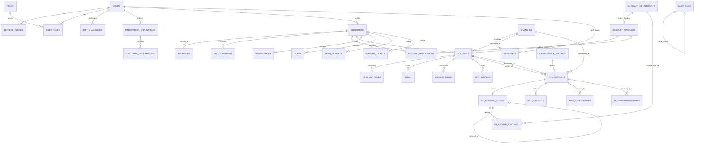

# FINServ — Comprehensive Database Architecture & Schema Specification

## 1. Schema Design Conventions & Invariants

All relational definitions for FINServ enforce strict enterprise financial invariants:
1. **Engine & Charset**: InnoDB storage engine; `utf8mb4` character set with `utf8mb4_unicode_ci` collation.
2. **UUID Storage Standard**: Uniformly stored as `CHAR(36) CHARACTER SET ascii COLLATE ascii_bin` across all tables for cross-platform JPA compatibility and zero byte-endian conversion overhead.
3. **Sequential UUIDv7 Usage**: High-throughput, time-series tables (`transactions`, `gl_journal_entries`, `gl_ledger_postings`, `audit_logs`) use time-ordered **UUIDv7** to guarantee chronological B-Tree index locality, eliminating index fragmentation.
4. **Monetary Precision**: All currency balances and transaction figures use `DECIMAL(15, 2)` or `DECIMAL(19, 4)` for sub-cent interest accrual. **Float and Double are strictly forbidden.**
5. **Time & Audit Invariants**: All timestamps stored in UTC using microsecond precision `DATETIME(6)`.
6. **Optimistic Locking**: State-sensitive entities (e.g., `accounts`) carry a `version BIGINT NOT NULL DEFAULT 0` column.
7. **Strict Referencing (No Cascades on Financial/KYC Data)**: `ON DELETE CASCADE` and `SET NULL` are strictly prohibited on all financial, ledger, KYC, and audit tables. All referential integrity foreign keys enforce `ON DELETE RESTRICT`.
8. **Zero Destructive Deletions**: Financial records, accounts, customer histories, and audit records are never physically deleted. They utilize soft-deletion or status transitions (`CLOSED`, `DEACTIVATED`).
9. **Field-Level PII Encryption**: Sensitive identifiers (`tax_identifier`, `document_number`) are encrypted at rest with authenticated AES-256-GCM. Deterministic blind index HMAC-SHA256 hash columns are used for unique lookups.

---

## 2. Mermaid Entity-Relationship Diagram (ERD)



---

## 3. Detailed Table Specifications

### 3.1 Authentication, Access Control & Registration (Phase 1 Core)

#### `roles`
System authorization roles.
```sql
CREATE TABLE roles (
    id INT AUTO_INCREMENT NOT NULL,
    name VARCHAR(50) NOT NULL,
    description VARCHAR(255) NOT NULL,
    created_at DATETIME(6) NOT NULL DEFAULT CURRENT_TIMESTAMP(6),
    CONSTRAINT pk_roles PRIMARY KEY (id),
    CONSTRAINT uq_roles_name UNIQUE (name),
    CONSTRAINT chk_roles_name CHECK (name IN ('ROLE_CUSTOMER', 'ROLE_EMPLOYEE', 'ROLE_MANAGER', 'ROLE_ADMIN', 'ROLE_COMPLIANCE'))
) ENGINE=InnoDB;
```

#### `users`
Core identity table representing all system actors.
```sql
CREATE TABLE users (
    id CHAR(36) CHARACTER SET ascii COLLATE ascii_bin NOT NULL,
    username VARCHAR(50) NOT NULL,
    email VARCHAR(100) NOT NULL,
    phone_number VARCHAR(20) NOT NULL,
    password_hash VARCHAR(255) NOT NULL,
    status VARCHAR(30) NOT NULL DEFAULT 'PENDING_VERIFICATION',
    failed_login_attempts INT NOT NULL DEFAULT 0,
    email_verified_at DATETIME(6) NULL,
    phone_verified_at DATETIME(6) NULL,
    locked_until DATETIME(6) NULL,
    last_login_at DATETIME(6) NULL,
    created_at DATETIME(6) NOT NULL DEFAULT CURRENT_TIMESTAMP(6),
    updated_at DATETIME(6) NOT NULL DEFAULT CURRENT_TIMESTAMP(6) ON UPDATE CURRENT_TIMESTAMP(6),
    CONSTRAINT pk_users PRIMARY KEY (id),
    CONSTRAINT uq_users_username UNIQUE (username),
    CONSTRAINT uq_users_email UNIQUE (email),
    CONSTRAINT uq_users_phone UNIQUE (phone_number),
    CONSTRAINT chk_users_status CHECK (status IN ('PENDING_VERIFICATION', 'ACTIVE', 'LOCKED', 'SUSPENDED')),
    CONSTRAINT chk_users_failed_attempts CHECK (failed_login_attempts >= 0)
) ENGINE=InnoDB;

CREATE INDEX idx_users_status ON users(status);
```

#### `user_roles`
Mapping table for users to roles (Many-to-Many).
```sql
CREATE TABLE user_roles (
    user_id CHAR(36) CHARACTER SET ascii COLLATE ascii_bin NOT NULL,
    role_id INT NOT NULL,
    assigned_at DATETIME(6) NOT NULL DEFAULT CURRENT_TIMESTAMP(6),
    CONSTRAINT pk_user_roles PRIMARY KEY (user_id, role_id),
    CONSTRAINT fk_user_roles_user FOREIGN KEY (user_id) REFERENCES users(id) ON DELETE RESTRICT,
    CONSTRAINT fk_user_roles_role FOREIGN KEY (role_id) REFERENCES roles(id) ON DELETE RESTRICT
) ENGINE=InnoDB;
```

#### `refresh_tokens`
Rotating refresh tokens for JWT session management.
```sql
CREATE TABLE refresh_tokens (
    id CHAR(36) CHARACTER SET ascii COLLATE ascii_bin NOT NULL,
    user_id CHAR(36) CHARACTER SET ascii COLLATE ascii_bin NOT NULL,
    token_hash VARCHAR(255) NOT NULL,
    expires_at DATETIME(6) NOT NULL,
    revoked BOOLEAN NOT NULL DEFAULT FALSE,
    created_at DATETIME(6) NOT NULL DEFAULT CURRENT_TIMESTAMP(6),
    CONSTRAINT pk_refresh_tokens PRIMARY KEY (id),
    CONSTRAINT uq_refresh_tokens_hash UNIQUE (token_hash),
    CONSTRAINT fk_refresh_tokens_user FOREIGN KEY (user_id) REFERENCES users(id) ON DELETE RESTRICT
) ENGINE=InnoDB;

CREATE INDEX idx_refresh_tokens_user ON refresh_tokens(user_id, revoked);
```

#### `otp_challenges`
Tracks single-use contact verification codes for registration and progressive onboarding.
```sql
CREATE TABLE otp_challenges (
    id CHAR(36) CHARACTER SET ascii COLLATE ascii_bin NOT NULL,
    user_id CHAR(36) CHARACTER SET ascii COLLATE ascii_bin NOT NULL,
    contact_type VARCHAR(10) NOT NULL,
    target_destination VARCHAR(100) NOT NULL,
    otp_hash VARCHAR(255) NOT NULL,
    attempts INT NOT NULL DEFAULT 0,
    max_attempts INT NOT NULL DEFAULT 3,
    status VARCHAR(20) NOT NULL DEFAULT 'PENDING',
    expires_at DATETIME(6) NOT NULL,
    verified_at DATETIME(6) NULL,
    created_at DATETIME(6) NOT NULL DEFAULT CURRENT_TIMESTAMP(6),
    CONSTRAINT pk_otp_challenges PRIMARY KEY (id),
    CONSTRAINT fk_otp_user FOREIGN KEY (user_id) REFERENCES users(id) ON DELETE RESTRICT,
    CONSTRAINT chk_otp_type CHECK (contact_type IN ('EMAIL', 'PHONE')),
    CONSTRAINT chk_otp_status CHECK (status IN ('PENDING', 'VERIFIED', 'EXPIRED', 'FAILED')),
    CONSTRAINT chk_otp_attempts CHECK (attempts >= 0 AND attempts <= max_attempts)
) ENGINE=InnoDB;

CREATE INDEX idx_otp_user ON otp_challenges(user_id, status);
```

---

### 3.2 Progressive Onboarding, Customer Profile & KYC (Phase 1 Core)

#### `onboarding_applications`
Multi-step customer application state machine tracking progress before account activation.
```sql
CREATE TABLE onboarding_applications (
    id CHAR(36) CHARACTER SET ascii COLLATE ascii_bin NOT NULL,
    user_id CHAR(36) CHARACTER SET ascii COLLATE ascii_bin NOT NULL,
    application_reference VARCHAR(40) NOT NULL,
    current_step INT NOT NULL DEFAULT 1,
    status VARCHAR(30) NOT NULL DEFAULT 'DRAFT',
    submitted_at DATETIME(6) NULL,
    reviewed_by_user_id CHAR(36) CHARACTER SET ascii COLLATE ascii_bin NULL,
    reviewed_at DATETIME(6) NULL,
    rejection_reason VARCHAR(255) NULL,
    created_at DATETIME(6) NOT NULL DEFAULT CURRENT_TIMESTAMP(6),
    updated_at DATETIME(6) NOT NULL DEFAULT CURRENT_TIMESTAMP(6) ON UPDATE CURRENT_TIMESTAMP(6),
    CONSTRAINT pk_onboarding_apps PRIMARY KEY (id),
    CONSTRAINT uq_onboarding_ref UNIQUE (application_reference),
    CONSTRAINT fk_onboarding_user FOREIGN KEY (user_id) REFERENCES users(id) ON DELETE RESTRICT,
    CONSTRAINT fk_onboarding_reviewer FOREIGN KEY (reviewed_by_user_id) REFERENCES users(id) ON DELETE RESTRICT,
    CONSTRAINT chk_onboarding_step CHECK (current_step BETWEEN 1 AND 6),
    CONSTRAINT chk_onboarding_status CHECK (status IN ('DRAFT', 'SUBMITTED', 'UNDER_REVIEW', 'APPROVED', 'REJECTED'))
) ENGINE=InnoDB;

CREATE INDEX idx_onboarding_status ON onboarding_applications(status);
```

#### `customers`
Customer 360 personal record. Encrypts tax ID at rest with a SHA-256 HMAC blind index for lookups.
```sql
CREATE TABLE customers (
    id CHAR(36) CHARACTER SET ascii COLLATE ascii_bin NOT NULL,
    user_id CHAR(36) CHARACTER SET ascii COLLATE ascii_bin NOT NULL,
    customer_number VARCHAR(20) NOT NULL,
    first_name VARCHAR(60) NOT NULL,
    middle_name VARCHAR(60) NULL,
    last_name VARCHAR(60) NOT NULL,
    date_of_birth DATE NOT NULL,
    gender VARCHAR(20) NOT NULL,
    marital_status VARCHAR(20) NULL,
    nationality VARCHAR(50) NOT NULL DEFAULT 'INDIAN',
    tax_identifier_encrypted VARCHAR(512) NOT NULL,
    tax_identifier_hash VARCHAR(64) NOT NULL,
    kyc_status VARCHAR(30) NOT NULL DEFAULT 'INITIATED',
    kyc_tier VARCHAR(20) NOT NULL DEFAULT 'TIER_1',
    created_at DATETIME(6) NOT NULL DEFAULT CURRENT_TIMESTAMP(6),
    updated_at DATETIME(6) NOT NULL DEFAULT CURRENT_TIMESTAMP(6) ON UPDATE CURRENT_TIMESTAMP(6),
    CONSTRAINT pk_customers PRIMARY KEY (id),
    CONSTRAINT uq_customers_user UNIQUE (user_id),
    CONSTRAINT uq_customers_number UNIQUE (customer_number),
    CONSTRAINT uq_customers_tax_hash UNIQUE (tax_identifier_hash),
    CONSTRAINT fk_customers_user FOREIGN KEY (user_id) REFERENCES users(id) ON DELETE RESTRICT,
    CONSTRAINT chk_customers_gender CHECK (gender IN ('MALE', 'FEMALE', 'OTHER', 'PREFER_NOT_TO_SAY')),
    CONSTRAINT chk_customers_kyc_status CHECK (kyc_status IN ('INITIATED', 'DOCUMENTS_PENDING', 'SUBMITTED', 'UNDER_REVIEW', 'VERIFIED', 'REJECTED')),
    CONSTRAINT chk_customers_kyc_tier CHECK (kyc_tier IN ('TIER_1', 'TIER_2', 'TIER_3'))
) ENGINE=InnoDB;

CREATE INDEX idx_customers_kyc_status ON customers(kyc_status);
```

#### `customer_declarations`
Auditable regulatory consents and declarations (FATCA, Terms, PEP, Privacy).
```sql
CREATE TABLE customer_declarations (
    id CHAR(36) CHARACTER SET ascii COLLATE ascii_bin NOT NULL,
    customer_id CHAR(36) CHARACTER SET ascii COLLATE ascii_bin NULL,
    application_id CHAR(36) CHARACTER SET ascii COLLATE ascii_bin NULL,
    declaration_type VARCHAR(50) NOT NULL,
    is_accepted BOOLEAN NOT NULL DEFAULT FALSE,
    accepted_at DATETIME(6) NOT NULL,
    ip_address VARCHAR(45) NOT NULL,
    user_agent VARCHAR(255) NULL,
    CONSTRAINT pk_customer_declarations PRIMARY KEY (id),
    CONSTRAINT fk_declarations_customer FOREIGN KEY (customer_id) REFERENCES customers(id) ON DELETE RESTRICT,
    CONSTRAINT fk_declarations_app FOREIGN KEY (application_id) REFERENCES onboarding_applications(id) ON DELETE RESTRICT,
    CONSTRAINT chk_declarations_type CHECK (declaration_type IN ('FATCA', 'TERMS_AND_CONDITIONS', 'PEP', 'DATA_PRIVACY')),
    CONSTRAINT chk_declarations_accepted CHECK (is_accepted = TRUE)
) ENGINE=InnoDB;
```

#### `addresses`
Physical and permanent address records.
```sql
CREATE TABLE addresses (
    id CHAR(36) CHARACTER SET ascii COLLATE ascii_bin NOT NULL,
    customer_id CHAR(36) CHARACTER SET ascii COLLATE ascii_bin NOT NULL,
    address_type VARCHAR(30) NOT NULL,
    street_line_1 VARCHAR(120) NOT NULL,
    street_line_2 VARCHAR(120) NULL,
    city VARCHAR(60) NOT NULL,
    state VARCHAR(60) NOT NULL,
    postal_code VARCHAR(20) NOT NULL,
    country VARCHAR(60) NOT NULL DEFAULT 'India',
    is_primary BOOLEAN NOT NULL DEFAULT FALSE,
    created_at DATETIME(6) NOT NULL DEFAULT CURRENT_TIMESTAMP(6),
    CONSTRAINT pk_addresses PRIMARY KEY (id),
    CONSTRAINT fk_addresses_customer FOREIGN KEY (customer_id) REFERENCES customers(id) ON DELETE RESTRICT,
    CONSTRAINT chk_addresses_type CHECK (address_type IN ('RESIDENTIAL', 'PERMANENT', 'OFFICE'))
) ENGINE=InnoDB;

CREATE INDEX idx_addresses_customer ON addresses(customer_id);
```

#### `kyc_documents`
Customer identity verification documents with encrypted document numbers and hash lookups.
```sql
CREATE TABLE kyc_documents (
    id CHAR(36) CHARACTER SET ascii COLLATE ascii_bin NOT NULL,
    customer_id CHAR(36) CHARACTER SET ascii COLLATE ascii_bin NOT NULL,
    document_type VARCHAR(40) NOT NULL,
    document_number_encrypted VARCHAR(512) NOT NULL,
    document_number_hash VARCHAR(64) NOT NULL,
    file_path VARCHAR(255) NOT NULL,
    mime_type VARCHAR(80) NOT NULL,
    file_size_bytes BIGINT NOT NULL,
    verification_status VARCHAR(30) NOT NULL DEFAULT 'PENDING',
    rejection_reason VARCHAR(255) NULL,
    verified_by_user_id CHAR(36) CHARACTER SET ascii COLLATE ascii_bin NULL,
    verified_at DATETIME(6) NULL,
    created_at DATETIME(6) NOT NULL DEFAULT CURRENT_TIMESTAMP(6),
    CONSTRAINT pk_kyc_documents PRIMARY KEY (id),
    CONSTRAINT fk_kyc_docs_customer FOREIGN KEY (customer_id) REFERENCES customers(id) ON DELETE RESTRICT,
    CONSTRAINT fk_kyc_docs_verifier FOREIGN KEY (verified_by_user_id) REFERENCES users(id) ON DELETE RESTRICT,
    CONSTRAINT chk_kyc_docs_type CHECK (document_type IN ('PASSPORT', 'NATIONAL_ID', 'VOTER_ID', 'DRIVING_LICENSE', 'UTILITY_BILL')),
    CONSTRAINT chk_kyc_docs_status CHECK (verification_status IN ('PENDING', 'VERIFIED', 'REJECTED')),
    CONSTRAINT chk_kyc_docs_size CHECK (file_size_bytes > 0)
) ENGINE=InnoDB;

CREATE INDEX idx_kyc_docs_customer ON kyc_documents(customer_id);
CREATE INDEX idx_kyc_docs_hash ON kyc_documents(document_number_hash);
```

---

### 3.3 Branch Network & Staff Operations (Phase 1 Core)

#### `branches`
Physical and logical banking branch offices.
```sql
CREATE TABLE branches (
    id CHAR(36) CHARACTER SET ascii COLLATE ascii_bin NOT NULL,
    branch_code VARCHAR(20) NOT NULL,
    branch_name VARCHAR(100) NOT NULL,
    ifsc_code VARCHAR(20) NOT NULL,
    routing_number VARCHAR(30) NOT NULL,
    street_address VARCHAR(150) NOT NULL,
    city VARCHAR(60) NOT NULL,
    state VARCHAR(60) NOT NULL,
    postal_code VARCHAR(20) NOT NULL,
    phone_number VARCHAR(20) NOT NULL,
    manager_user_id CHAR(36) CHARACTER SET ascii COLLATE ascii_bin NULL,
    status VARCHAR(20) NOT NULL DEFAULT 'ACTIVE',
    created_at DATETIME(6) NOT NULL DEFAULT CURRENT_TIMESTAMP(6),
    CONSTRAINT pk_branches PRIMARY KEY (id),
    CONSTRAINT uq_branches_code UNIQUE (branch_code),
    CONSTRAINT uq_branches_ifsc UNIQUE (ifsc_code),
    CONSTRAINT fk_branches_manager FOREIGN KEY (manager_user_id) REFERENCES users(id) ON DELETE RESTRICT,
    CONSTRAINT chk_branches_status CHECK (status IN ('ACTIVE', 'INACTIVE', 'CLOSED'))
) ENGINE=InnoDB;
```

#### `employees`
Bank staff profiles and branch affiliations.
```sql
CREATE TABLE employees (
    id CHAR(36) CHARACTER SET ascii COLLATE ascii_bin NOT NULL,
    user_id CHAR(36) CHARACTER SET ascii COLLATE ascii_bin NOT NULL,
    branch_id CHAR(36) CHARACTER SET ascii COLLATE ascii_bin NOT NULL,
    employee_code VARCHAR(30) NOT NULL,
    department VARCHAR(50) NOT NULL,
    designation VARCHAR(50) NOT NULL,
    joining_date DATE NOT NULL,
    status VARCHAR(20) NOT NULL DEFAULT 'ACTIVE',
    created_at DATETIME(6) NOT NULL DEFAULT CURRENT_TIMESTAMP(6),
    CONSTRAINT pk_employees PRIMARY KEY (id),
    CONSTRAINT uq_employees_user UNIQUE (user_id),
    CONSTRAINT uq_employees_code UNIQUE (employee_code),
    CONSTRAINT fk_employees_user FOREIGN KEY (user_id) REFERENCES users(id) ON DELETE RESTRICT,
    CONSTRAINT fk_employees_branch FOREIGN KEY (branch_id) REFERENCES branches(id) ON DELETE RESTRICT,
    CONSTRAINT chk_employees_status CHECK (status IN ('ACTIVE', 'ON_LEAVE', 'TERMINATED'))
) ENGINE=InnoDB;
```

---

### 3.4 General Ledger & Double-Entry Accounting (Phase 1 Core)

#### `gl_chart_of_accounts`
Banking General Ledger chart of accounts.
```sql
CREATE TABLE gl_chart_of_accounts (
    id CHAR(36) CHARACTER SET ascii COLLATE ascii_bin NOT NULL,
    gl_code VARCHAR(30) NOT NULL,
    account_name VARCHAR(100) NOT NULL,
    account_type VARCHAR(20) NOT NULL,
    balance_side VARCHAR(10) NOT NULL,
    description VARCHAR(255) NULL,
    is_active BOOLEAN NOT NULL DEFAULT TRUE,
    created_at DATETIME(6) NOT NULL DEFAULT CURRENT_TIMESTAMP(6),
    CONSTRAINT pk_gl_chart PRIMARY KEY (id),
    CONSTRAINT uq_gl_code UNIQUE (gl_code),
    CONSTRAINT chk_gl_type CHECK (account_type IN ('ASSET', 'LIABILITY', 'EQUITY', 'REVENUE', 'EXPENSE')),
    CONSTRAINT chk_gl_side CHECK (balance_side IN ('DEBIT', 'CREDIT'))
) ENGINE=InnoDB;
```

#### Standard Seed GL Accounts
| GL Code | Account Name | Type | Balance Side | Description |
| :--- | :--- | :--- | :--- | :--- |
| **10100** | Vault Cash | `ASSET` | `DEBIT` | Physical currency in branch vaults / tellers |
| **10200** | Central Bank Reserve / Clearing | `ASSET` | `DEBIT` | Reserve balance held with central clearing institution |
| **10300** | Inter-Bank Settlement Transit | `ASSET` | `DEBIT` | Clearing suspense account for outward/inward settlements |
| **20100** | Customer Savings Deposits | `LIABILITY` | `CREDIT` | Total customer liability for savings accounts |
| **20200** | Customer Current/Checking Deposits | `LIABILITY` | `CREDIT` | Total customer liability for current/checking accounts |
| **20300** | Term / Fixed Deposit Deposits | `LIABILITY` | `CREDIT` | Total liability for customer fixed & recurring deposits |
| **30100** | Bank Equity Capital | `EQUITY` | `CREDIT` | Initial capital and retained bank earnings |
| **40100** | Fee & Commission Income | `REVENUE` | `CREDIT` | Processing charges, maintenance, and wire transfer fees |
| **40200** | Loan Interest Earned | `REVENUE` | `CREDIT` | Invoiced and paid customer loan interest |
| **50100** | Deposit Interest Expense | `EXPENSE` | `DEBIT` | Interest paid out on customer savings and term deposits |

#### `gl_journal_entries`
Immutable header for balanced accounting vouchers. Uses **UUIDv7**.
```sql
CREATE TABLE gl_journal_entries (
    id CHAR(36) CHARACTER SET ascii COLLATE ascii_bin NOT NULL,
    journal_reference VARCHAR(50) NOT NULL,
    transaction_type VARCHAR(40) NOT NULL,
    posting_date DATE NOT NULL,
    description VARCHAR(255) NOT NULL,
    status VARCHAR(20) NOT NULL DEFAULT 'POSTED',
    reversal_of_journal_id CHAR(36) CHARACTER SET ascii COLLATE ascii_bin NULL,
    created_by_user_id CHAR(36) CHARACTER SET ascii COLLATE ascii_bin NOT NULL,
    created_at DATETIME(6) NOT NULL DEFAULT CURRENT_TIMESTAMP(6),
    CONSTRAINT pk_gl_journal PRIMARY KEY (id),
    CONSTRAINT uq_gl_journal_ref UNIQUE (journal_reference),
    CONSTRAINT fk_gl_journal_reversal FOREIGN KEY (reversal_of_journal_id) REFERENCES gl_journal_entries(id) ON DELETE RESTRICT,
    CONSTRAINT fk_gl_journal_user FOREIGN KEY (created_by_user_id) REFERENCES users(id) ON DELETE RESTRICT,
    CONSTRAINT chk_gl_journal_status CHECK (status IN ('POSTED', 'REVERSED'))
) ENGINE=InnoDB;

CREATE INDEX idx_gl_journal_posting_date ON gl_journal_entries(posting_date);
```

#### `gl_ledger_postings`
Individual debit and credit postings forming balanced entries ($\sum \text{Debits} == \sum \text{Credits}$). Uses **UUIDv7**.
*Design Note on Running Balance*: The column `running_balance_after` is explicitly omitted from posting rows. Storing running balances on individual GL posting rows under high concurrent transfer volume forces serial lock contention on GL accounts, severely degrading write throughput. GL account balances are derived from $\sum \text{Credits} - \sum \text{Debits}$ and tracked via scheduled asynchronous balance snapshots.
```sql
CREATE TABLE gl_ledger_postings (
    id CHAR(36) CHARACTER SET ascii COLLATE ascii_bin NOT NULL,
    journal_entry_id CHAR(36) CHARACTER SET ascii COLLATE ascii_bin NOT NULL,
    gl_account_id CHAR(36) CHARACTER SET ascii COLLATE ascii_bin NOT NULL,
    customer_account_id CHAR(36) CHARACTER SET ascii COLLATE ascii_bin NULL,
    entry_type VARCHAR(10) NOT NULL,
    amount DECIMAL(15, 2) NOT NULL,
    created_at DATETIME(6) NOT NULL DEFAULT CURRENT_TIMESTAMP(6),
    CONSTRAINT pk_gl_postings PRIMARY KEY (id),
    CONSTRAINT fk_gl_postings_journal FOREIGN KEY (journal_entry_id) REFERENCES gl_journal_entries(id) ON DELETE RESTRICT,
    CONSTRAINT fk_gl_postings_gl_acc FOREIGN KEY (gl_account_id) REFERENCES gl_chart_of_accounts(id) ON DELETE RESTRICT,
    CONSTRAINT fk_gl_postings_cust_acc FOREIGN KEY (customer_account_id) REFERENCES accounts(id) ON DELETE RESTRICT,
    CONSTRAINT chk_gl_postings_type CHECK (entry_type IN ('DEBIT', 'CREDIT')),
    CONSTRAINT chk_gl_postings_amount CHECK (amount > 0.00)
) ENGINE=InnoDB;

CREATE INDEX idx_gl_postings_journal ON gl_ledger_postings(journal_entry_id);
CREATE INDEX idx_gl_postings_cust_acc ON gl_ledger_postings(customer_account_id);
```

---

### 3.5 Banking Products & Customer Accounts (Phase 1 Core)

#### `account_products`
Product catalog linking each account type directly to its balance-sheet liability GL account.
```sql
CREATE TABLE account_products (
    id CHAR(36) CHARACTER SET ascii COLLATE ascii_bin NOT NULL,
    product_code VARCHAR(20) NOT NULL,
    product_name VARCHAR(80) NOT NULL,
    product_type VARCHAR(30) NOT NULL,
    gl_account_id CHAR(36) CHARACTER SET ascii COLLATE ascii_bin NOT NULL,
    currency VARCHAR(3) NOT NULL DEFAULT 'INR',
    min_balance DECIMAL(15, 2) NOT NULL DEFAULT 0.00,
    interest_rate_percentage DECIMAL(5, 2) NOT NULL DEFAULT 0.00,
    overdraft_allowed BOOLEAN NOT NULL DEFAULT FALSE,
    overdraft_limit DECIMAL(15, 2) NOT NULL DEFAULT 0.00,
    is_active BOOLEAN NOT NULL DEFAULT TRUE,
    created_at DATETIME(6) NOT NULL DEFAULT CURRENT_TIMESTAMP(6),
    CONSTRAINT pk_account_products PRIMARY KEY (id),
    CONSTRAINT uq_products_code UNIQUE (product_code),
    CONSTRAINT fk_products_gl FOREIGN KEY (gl_account_id) REFERENCES gl_chart_of_accounts(id) ON DELETE RESTRICT,
    CONSTRAINT chk_products_type CHECK (product_type IN ('SAVINGS', 'CURRENT', 'SALARY', 'STUDENT')),
    CONSTRAINT chk_products_min_balance CHECK (min_balance >= 0.00),
    CONSTRAINT chk_products_interest CHECK (interest_rate_percentage >= 0.00),
    CONSTRAINT chk_products_overdraft CHECK (overdraft_limit >= 0.00)
) ENGINE=InnoDB;
```

#### `account_applications`
Customer applications for specific deposit/current accounts, reviewed by branch staff before opening.
```sql
CREATE TABLE account_applications (
    id CHAR(36) CHARACTER SET ascii COLLATE ascii_bin NOT NULL,
    customer_id CHAR(36) CHARACTER SET ascii COLLATE ascii_bin NOT NULL,
    product_id CHAR(36) CHARACTER SET ascii COLLATE ascii_bin NOT NULL,
    application_number VARCHAR(30) NOT NULL,
    initial_deposit_amount DECIMAL(15, 2) NOT NULL DEFAULT 0.00,
    application_status VARCHAR(30) NOT NULL DEFAULT 'SUBMITTED',
    reviewed_by_user_id CHAR(36) CHARACTER SET ascii COLLATE ascii_bin NULL,
    reviewed_at DATETIME(6) NULL,
    rejection_reason VARCHAR(255) NULL,
    created_account_id CHAR(36) CHARACTER SET ascii COLLATE ascii_bin NULL,
    created_at DATETIME(6) NOT NULL DEFAULT CURRENT_TIMESTAMP(6),
    CONSTRAINT pk_account_applications PRIMARY KEY (id),
    CONSTRAINT uq_account_app_num UNIQUE (application_number),
    CONSTRAINT fk_account_app_customer FOREIGN KEY (customer_id) REFERENCES customers(id) ON DELETE RESTRICT,
    CONSTRAINT fk_account_app_product FOREIGN KEY (product_id) REFERENCES account_products(id) ON DELETE RESTRICT,
    CONSTRAINT fk_account_app_reviewer FOREIGN KEY (reviewed_by_user_id) REFERENCES users(id) ON DELETE RESTRICT,
    CONSTRAINT fk_account_app_account FOREIGN KEY (created_account_id) REFERENCES accounts(id) ON DELETE RESTRICT,
    CONSTRAINT chk_account_app_status CHECK (application_status IN ('SUBMITTED', 'UNDER_REVIEW', 'APPROVED', 'REJECTED')),
    CONSTRAINT chk_account_app_deposit CHECK (initial_deposit_amount >= 0.00)
) ENGINE=InnoDB;
```

#### `accounts`
Core customer deposit/checking accounts.
```sql
CREATE TABLE accounts (
    id CHAR(36) CHARACTER SET ascii COLLATE ascii_bin NOT NULL,
    customer_id CHAR(36) CHARACTER SET ascii COLLATE ascii_bin NOT NULL,
    branch_id CHAR(36) CHARACTER SET ascii COLLATE ascii_bin NOT NULL,
    product_id CHAR(36) CHARACTER SET ascii COLLATE ascii_bin NOT NULL,
    account_number VARCHAR(24) NOT NULL,
    currency VARCHAR(3) NOT NULL DEFAULT 'INR',
    current_balance DECIMAL(15, 2) NOT NULL DEFAULT 0.00,
    available_balance DECIMAL(15, 2) NOT NULL DEFAULT 0.00,
    hold_balance DECIMAL(15, 2) NOT NULL DEFAULT 0.00,
    status VARCHAR(30) NOT NULL DEFAULT 'APPLICATION_PENDING',
    opened_at DATETIME(6) NULL,
    closed_at DATETIME(6) NULL,
    version BIGINT NOT NULL DEFAULT 0,
    created_at DATETIME(6) NOT NULL DEFAULT CURRENT_TIMESTAMP(6),
    updated_at DATETIME(6) NOT NULL DEFAULT CURRENT_TIMESTAMP(6) ON UPDATE CURRENT_TIMESTAMP(6),
    CONSTRAINT pk_accounts PRIMARY KEY (id),
    CONSTRAINT uq_accounts_number UNIQUE (account_number),
    CONSTRAINT fk_accounts_customer FOREIGN KEY (customer_id) REFERENCES customers(id) ON DELETE RESTRICT,
    CONSTRAINT fk_accounts_branch FOREIGN KEY (branch_id) REFERENCES branches(id) ON DELETE RESTRICT,
    CONSTRAINT fk_accounts_product FOREIGN KEY (product_id) REFERENCES account_products(id) ON DELETE RESTRICT,
    CONSTRAINT chk_accounts_status CHECK (status IN ('APPLICATION_PENDING', 'ACTIVE', 'DORMANT', 'FROZEN', 'CLOSED')),
    CONSTRAINT chk_accounts_holds CHECK (hold_balance >= 0.00),
    CONSTRAINT chk_accounts_avail_calc CHECK (available_balance <= current_balance)
) ENGINE=InnoDB;

CREATE INDEX idx_accounts_customer ON accounts(customer_id);
CREATE INDEX idx_accounts_status ON accounts(status);
```

#### `account_holds`
Funds held/earmarked for pending authorizations or uncleared cheques.
```sql
CREATE TABLE account_holds (
    id CHAR(36) CHARACTER SET ascii COLLATE ascii_bin NOT NULL,
    account_id CHAR(36) CHARACTER SET ascii COLLATE ascii_bin NOT NULL,
    hold_reference VARCHAR(50) NOT NULL,
    amount DECIMAL(15, 2) NOT NULL,
    reason VARCHAR(150) NOT NULL,
    status VARCHAR(20) NOT NULL DEFAULT 'ACTIVE',
    expires_at DATETIME(6) NULL,
    created_at DATETIME(6) NOT NULL DEFAULT CURRENT_TIMESTAMP(6),
    updated_at DATETIME(6) NOT NULL DEFAULT CURRENT_TIMESTAMP(6) ON UPDATE CURRENT_TIMESTAMP(6),
    CONSTRAINT pk_account_holds PRIMARY KEY (id),
    CONSTRAINT uq_account_holds_ref UNIQUE (hold_reference),
    CONSTRAINT fk_account_holds_acc FOREIGN KEY (account_id) REFERENCES accounts(id) ON DELETE RESTRICT,
    CONSTRAINT chk_account_holds_status CHECK (status IN ('ACTIVE', 'RELEASED', 'EXECUTED')),
    CONSTRAINT chk_account_holds_amount CHECK (amount > 0.00)
) ENGINE=InnoDB;

CREATE INDEX idx_account_holds_acc ON account_holds(account_id, status);
```

---

### 3.6 Financial Transactions & Idempotency (Phase 1 Core)

#### `idempotency_records`
Prevents duplicate financial execution by caching mutation results for unique client keys.
```sql
CREATE TABLE idempotency_records (
    id CHAR(36) CHARACTER SET ascii COLLATE ascii_bin NOT NULL,
    idempotency_key VARCHAR(100) NOT NULL,
    user_id CHAR(36) CHARACTER SET ascii COLLATE ascii_bin NOT NULL,
    request_hash VARCHAR(64) NOT NULL,
    request_path VARCHAR(200) NOT NULL,
    http_status_code INT NULL,
    response_payload LONGTEXT NULL,
    status VARCHAR(20) NOT NULL DEFAULT 'IN_PROGRESS',
    created_at DATETIME(6) NOT NULL DEFAULT CURRENT_TIMESTAMP(6),
    expires_at DATETIME(6) NOT NULL,
    CONSTRAINT pk_idempotency PRIMARY KEY (id),
    CONSTRAINT uq_user_idempotency UNIQUE (user_id, idempotency_key),
    CONSTRAINT fk_idempotency_user FOREIGN KEY (user_id) REFERENCES users(id) ON DELETE RESTRICT,
    CONSTRAINT chk_idempotency_status CHECK (status IN ('IN_PROGRESS', 'COMPLETED', 'FAILED'))
) ENGINE=InnoDB;

CREATE INDEX idx_idempotency_expires ON idempotency_records(expires_at);
```
*Idempotency Collision Rule*: If a request arrives with an existing `(user_id, idempotency_key)`:
- If `request_hash` matches: return cached response if `COMPLETED`, or `409 Conflict` if still `IN_PROGRESS`.
- If `request_hash` does not match: return `409 Conflict` with error code `IDEMPOTENCY_PAYLOAD_MISMATCH`.

#### `transactions`
Business financial transactions between accounts or external systems. Uses **UUIDv7**.
```sql
CREATE TABLE transactions (
    id CHAR(36) CHARACTER SET ascii COLLATE ascii_bin NOT NULL,
    transaction_reference VARCHAR(40) NOT NULL,
    from_account_id CHAR(36) CHARACTER SET ascii COLLATE ascii_bin NULL,
    to_account_id CHAR(36) CHARACTER SET ascii COLLATE ascii_bin NULL,
    transaction_type VARCHAR(40) NOT NULL,
    amount DECIMAL(15, 2) NOT NULL,
    fee_amount DECIMAL(15, 2) NOT NULL DEFAULT 0.00,
    currency VARCHAR(3) NOT NULL DEFAULT 'INR',
    from_account_balance_after DECIMAL(15, 2) NULL,
    to_account_balance_after DECIMAL(15, 2) NULL,
    status VARCHAR(20) NOT NULL DEFAULT 'PENDING',
    failure_reason VARCHAR(255) NULL,
    reversal_of_transaction_id CHAR(36) CHARACTER SET ascii COLLATE ascii_bin NULL,
    channel VARCHAR(30) NOT NULL DEFAULT 'WEB',
    initiated_by_user_id CHAR(36) CHARACTER SET ascii COLLATE ascii_bin NULL,
    branch_id CHAR(36) CHARACTER SET ascii COLLATE ascii_bin NULL,
    idempotency_record_id CHAR(36) CHARACTER SET ascii COLLATE ascii_bin NULL,
    journal_entry_id CHAR(36) CHARACTER SET ascii COLLATE ascii_bin NULL,
    description VARCHAR(255) NULL,
    created_at DATETIME(6) NOT NULL DEFAULT CURRENT_TIMESTAMP(6),
    completed_at DATETIME(6) NULL,
    CONSTRAINT pk_transactions PRIMARY KEY (id),
    CONSTRAINT uq_transactions_ref UNIQUE (transaction_reference),
    CONSTRAINT fk_transactions_from_acc FOREIGN KEY (from_account_id) REFERENCES accounts(id) ON DELETE RESTRICT,
    CONSTRAINT fk_transactions_to_acc FOREIGN KEY (to_account_id) REFERENCES accounts(id) ON DELETE RESTRICT,
    CONSTRAINT fk_transactions_reversal FOREIGN KEY (reversal_of_transaction_id) REFERENCES transactions(id) ON DELETE RESTRICT,
    CONSTRAINT fk_transactions_initiator FOREIGN KEY (initiated_by_user_id) REFERENCES users(id) ON DELETE RESTRICT,
    CONSTRAINT fk_transactions_branch FOREIGN KEY (branch_id) REFERENCES branches(id) ON DELETE RESTRICT,
    CONSTRAINT fk_transactions_idempotency FOREIGN KEY (idempotency_record_id) REFERENCES idempotency_records(id) ON DELETE RESTRICT,
    CONSTRAINT fk_transactions_journal FOREIGN KEY (journal_entry_id) REFERENCES gl_journal_entries(id) ON DELETE RESTRICT,
    CONSTRAINT chk_transactions_type CHECK (transaction_type IN ('DEPOSIT', 'WITHDRAWAL', 'TRANSFER_INTERNAL', 'TRANSFER_EXTERNAL', 'FEE', 'INTEREST', 'REVERSAL')),
    CONSTRAINT chk_transactions_status CHECK (status IN ('PENDING', 'COMPLETED', 'FAILED', 'REVERSED')),
    CONSTRAINT chk_transactions_channel CHECK (channel IN ('WEB', 'MOBILE', 'BRANCH', 'ATM')),
    CONSTRAINT chk_transactions_amount CHECK (amount > 0.00),
    CONSTRAINT chk_transactions_fee CHECK (fee_amount >= 0.00),
    CONSTRAINT chk_transactions_distinct_accounts CHECK (from_account_id IS NULL OR to_account_id IS NULL OR from_account_id <> to_account_id),
    CONSTRAINT chk_transactions_account_presence CHECK (from_account_id IS NOT NULL OR to_account_id IS NOT NULL)
) ENGINE=InnoDB;

CREATE INDEX idx_transactions_from_acc ON transactions(from_account_id, created_at);
CREATE INDEX idx_transactions_to_acc ON transactions(to_account_id, created_at);
CREATE INDEX idx_transactions_status ON transactions(status);
```

---

### 3.7 Immutable & Tamper-Evident Audit Logging (Phase 1 Core)

#### `audit_logs`
Tamper-evident audit chain. Uses **UUIDv7** and cryptographic hash chaining (`previous_hash` -> `current_hash`).
```sql
CREATE TABLE audit_logs (
    id CHAR(36) CHARACTER SET ascii COLLATE ascii_bin NOT NULL,
    event_type VARCHAR(60) NOT NULL,
    entity_type VARCHAR(60) NOT NULL,
    entity_id VARCHAR(36) NOT NULL,
    actor_user_id CHAR(36) CHARACTER SET ascii COLLATE ascii_bin NULL,
    actor_role VARCHAR(50) NULL,
    action VARCHAR(20) NOT NULL,
    ip_address VARCHAR(45) NULL,
    user_agent VARCHAR(255) NULL,
    correlation_id VARCHAR(64) NULL,
    old_value_json JSON NULL,
    new_value_json JSON NULL,
    previous_hash VARCHAR(64) NULL,
    current_hash VARCHAR(64) NOT NULL,
    created_at DATETIME(6) NOT NULL DEFAULT CURRENT_TIMESTAMP(6),
    CONSTRAINT pk_audit_logs PRIMARY KEY (id),
    CONSTRAINT fk_audit_actor FOREIGN KEY (actor_user_id) REFERENCES users(id) ON DELETE RESTRICT,
    CONSTRAINT chk_audit_action CHECK (action IN ('CREATE', 'UPDATE', 'DELETE', 'OVERRIDE', 'LOGIN'))
) ENGINE=InnoDB;

CREATE INDEX idx_audit_entity ON audit_logs(entity_type, entity_id);
CREATE INDEX idx_audit_actor ON audit_logs(actor_user_id, created_at);
CREATE INDEX idx_audit_created ON audit_logs(created_at);
```

#### DB-Level Tamper-Evident Security Grants
To enforce immutability at the database engine level, the application user `finserv_app` is denied mutation privileges:
```sql
REVOKE UPDATE, DELETE ON finserv_db.audit_logs FROM 'finserv_app'@'%';
GRANT INSERT, SELECT ON finserv_db.audit_logs TO 'finserv_app'@'%';
```

---

### 3.8 Beneficiaries & Payees (Deferred to Phase 8)

#### `beneficiaries`
Verified transfer recipients.
```sql
CREATE TABLE beneficiaries (
    id CHAR(36) CHARACTER SET ascii COLLATE ascii_bin NOT NULL,
    customer_id CHAR(36) CHARACTER SET ascii COLLATE ascii_bin NOT NULL,
    payee_type VARCHAR(20) NOT NULL,
    nickname VARCHAR(60) NOT NULL,
    beneficiary_name VARCHAR(100) NOT NULL,
    account_number VARCHAR(34) NOT NULL,
    ifsc_code VARCHAR(20) NOT NULL,
    bank_name VARCHAR(100) NOT NULL,
    cooling_off_until DATETIME(6) NULL,
    verification_status VARCHAR(20) NOT NULL DEFAULT 'PENDING_VERIFICATION',
    is_active BOOLEAN NOT NULL DEFAULT TRUE,
    created_at DATETIME(6) NOT NULL DEFAULT CURRENT_TIMESTAMP(6),
    CONSTRAINT pk_beneficiaries PRIMARY KEY (id),
    CONSTRAINT uq_beneficiaries_payee UNIQUE (customer_id, account_number, ifsc_code),
    CONSTRAINT fk_beneficiaries_customer FOREIGN KEY (customer_id) REFERENCES customers(id) ON DELETE RESTRICT,
    CONSTRAINT chk_beneficiaries_type CHECK (payee_type IN ('INTRA_BANK', 'INTER_BANK', 'UPI')),
    CONSTRAINT chk_beneficiaries_vstatus CHECK (verification_status IN ('PENDING_VERIFICATION', 'VERIFIED', 'REJECTED'))
) ENGINE=InnoDB;

CREATE INDEX idx_beneficiaries_customer ON beneficiaries(customer_id, is_active);
```

---

### 3.9 Notifications & Customer Support (Deferred to Phase 14)

#### `notifications`
```sql
CREATE TABLE notifications (
    id CHAR(36) CHARACTER SET ascii COLLATE ascii_bin NOT NULL,
    user_id CHAR(36) CHARACTER SET ascii COLLATE ascii_bin NOT NULL,
    channel VARCHAR(10) NOT NULL,
    notification_type VARCHAR(50) NOT NULL,
    title VARCHAR(120) NOT NULL,
    message TEXT NOT NULL,
    status VARCHAR(20) NOT NULL DEFAULT 'PENDING',
    read_at DATETIME(6) NULL,
    created_at DATETIME(6) NOT NULL DEFAULT CURRENT_TIMESTAMP(6),
    CONSTRAINT pk_notifications PRIMARY KEY (id),
    CONSTRAINT fk_notifications_user FOREIGN KEY (user_id) REFERENCES users(id) ON DELETE RESTRICT,
    CONSTRAINT chk_notif_channel CHECK (channel IN ('IN_APP', 'EMAIL', 'SMS')),
    CONSTRAINT chk_notif_status CHECK (status IN ('PENDING', 'DELIVERED', 'READ', 'FAILED'))
) ENGINE=InnoDB;
```

#### `support_tickets`
```sql
CREATE TABLE support_tickets (
    id CHAR(36) CHARACTER SET ascii COLLATE ascii_bin NOT NULL,
    customer_id CHAR(36) CHARACTER SET ascii COLLATE ascii_bin NOT NULL,
    assigned_staff_id CHAR(36) CHARACTER SET ascii COLLATE ascii_bin NULL,
    category VARCHAR(40) NOT NULL,
    subject VARCHAR(120) NOT NULL,
    description TEXT NOT NULL,
    priority VARCHAR(20) NOT NULL DEFAULT 'MEDIUM',
    status VARCHAR(20) NOT NULL DEFAULT 'OPEN',
    created_at DATETIME(6) NOT NULL DEFAULT CURRENT_TIMESTAMP(6),
    updated_at DATETIME(6) NOT NULL DEFAULT CURRENT_TIMESTAMP(6) ON UPDATE CURRENT_TIMESTAMP(6),
    CONSTRAINT pk_support_tickets PRIMARY KEY (id),
    CONSTRAINT fk_tickets_cust FOREIGN KEY (customer_id) REFERENCES customers(id) ON DELETE RESTRICT,
    CONSTRAINT fk_tickets_staff FOREIGN KEY (assigned_staff_id) REFERENCES users(id) ON DELETE RESTRICT,
    CONSTRAINT chk_tickets_priority CHECK (priority IN ('LOW', 'MEDIUM', 'HIGH', 'URGENT')),
    CONSTRAINT chk_tickets_status CHECK (status IN ('OPEN', 'IN_PROGRESS', 'RESOLVED', 'CLOSED'))
) ENGINE=InnoDB;
```

#### `transaction_disputes`
```sql
CREATE TABLE transaction_disputes (
    id CHAR(36) CHARACTER SET ascii COLLATE ascii_bin NOT NULL,
    ticket_id CHAR(36) CHARACTER SET ascii COLLATE ascii_bin NOT NULL,
    transaction_id CHAR(36) CHARACTER SET ascii COLLATE ascii_bin NOT NULL,
    dispute_reason VARCHAR(100) NOT NULL,
    disputed_amount DECIMAL(15, 2) NOT NULL,
    provisional_credit_issued BOOLEAN NOT NULL DEFAULT FALSE,
    status VARCHAR(30) NOT NULL DEFAULT 'INITIATED',
    created_at DATETIME(6) NOT NULL DEFAULT CURRENT_TIMESTAMP(6),
    CONSTRAINT pk_disputes PRIMARY KEY (id),
    CONSTRAINT fk_disputes_ticket FOREIGN KEY (ticket_id) REFERENCES support_tickets(id) ON DELETE RESTRICT,
    CONSTRAINT fk_disputes_txn FOREIGN KEY (transaction_id) REFERENCES transactions(id) ON DELETE RESTRICT,
    CONSTRAINT chk_disputes_amount CHECK (disputed_amount > 0.00),
    CONSTRAINT chk_disputes_status CHECK (status IN ('INITIATED', 'UNDER_REVIEW', 'CHARGEBACK_WON', 'CHARGEBACK_LOST'))
) ENGINE=InnoDB;
```

---

### 3.10 Term Deposits (Deferred to Phase 15)

#### `term_deposits`
```sql
CREATE TABLE term_deposits (
    id CHAR(36) CHARACTER SET ascii COLLATE ascii_bin NOT NULL,
    customer_id CHAR(36) CHARACTER SET ascii COLLATE ascii_bin NOT NULL,
    linked_account_id CHAR(36) CHARACTER SET ascii COLLATE ascii_bin NOT NULL,
    deposit_type VARCHAR(20) NOT NULL,
    deposit_number VARCHAR(30) NOT NULL,
    principal_amount DECIMAL(15, 2) NOT NULL,
    monthly_installment DECIMAL(15, 2) NULL,
    interest_rate_percentage DECIMAL(5, 2) NOT NULL,
    tenure_months INT NOT NULL,
    compounding_frequency VARCHAR(20) NOT NULL DEFAULT 'QUARTERLY',
    start_date DATE NOT NULL,
    maturity_date DATE NOT NULL,
    maturity_amount DECIMAL(15, 2) NOT NULL,
    status VARCHAR(25) NOT NULL DEFAULT 'ACTIVE',
    created_at DATETIME(6) NOT NULL DEFAULT CURRENT_TIMESTAMP(6),
    CONSTRAINT pk_term_deposits PRIMARY KEY (id),
    CONSTRAINT uq_term_deposits_num UNIQUE (deposit_number),
    CONSTRAINT fk_term_deposits_cust FOREIGN KEY (customer_id) REFERENCES customers(id) ON DELETE RESTRICT,
    CONSTRAINT fk_term_deposits_acc FOREIGN KEY (linked_account_id) REFERENCES accounts(id) ON DELETE RESTRICT,
    CONSTRAINT chk_term_dep_type CHECK (deposit_type IN ('FIXED_DEPOSIT', 'RECURRING_DEPOSIT')),
    CONSTRAINT chk_term_dep_status CHECK (status IN ('ACTIVE', 'MATURED', 'PREMATURE_CLOSED')),
    CONSTRAINT chk_term_dep_principal CHECK (principal_amount > 0.00),
    CONSTRAINT chk_term_dep_interest CHECK (interest_rate_percentage >= 0.00),
    CONSTRAINT chk_term_dep_tenure CHECK (tenure_months > 0)
) ENGINE=InnoDB;
```

---

### 3.11 Lending & Loans Engine (Deferred to Phase 16)

#### `loan_products`
```sql
CREATE TABLE loan_products (
    id CHAR(36) CHARACTER SET ascii COLLATE ascii_bin NOT NULL,
    product_code VARCHAR(20) NOT NULL,
    loan_name VARCHAR(80) NOT NULL,
    loan_type VARCHAR(30) NOT NULL,
    min_amount DECIMAL(15, 2) NOT NULL,
    max_amount DECIMAL(15, 2) NOT NULL,
    interest_rate_percentage DECIMAL(5, 2) NOT NULL,
    min_tenure_months INT NOT NULL,
    max_tenure_months INT NOT NULL,
    created_at DATETIME(6) NOT NULL DEFAULT CURRENT_TIMESTAMP(6),
    CONSTRAINT pk_loan_products PRIMARY KEY (id),
    CONSTRAINT uq_loan_products_code UNIQUE (product_code),
    CONSTRAINT chk_loan_products_type CHECK (loan_type IN ('PERSONAL', 'HOME', 'AUTO', 'EDUCATION')),
    CONSTRAINT chk_loan_products_amounts CHECK (min_amount > 0.00 AND max_amount >= min_amount),
    CONSTRAINT chk_loan_products_interest CHECK (interest_rate_percentage >= 0.00),
    CONSTRAINT chk_loan_products_tenure CHECK (min_tenure_months > 0 AND max_tenure_months >= min_tenure_months)
) ENGINE=InnoDB;
```

#### `loans`
```sql
CREATE TABLE loans (
    id CHAR(36) CHARACTER SET ascii COLLATE ascii_bin NOT NULL,
    customer_id CHAR(36) CHARACTER SET ascii COLLATE ascii_bin NOT NULL,
    loan_product_id CHAR(36) CHARACTER SET ascii COLLATE ascii_bin NOT NULL,
    disbursement_account_id CHAR(36) CHARACTER SET ascii COLLATE ascii_bin NOT NULL,
    loan_account_number VARCHAR(30) NOT NULL,
    principal_amount DECIMAL(15, 2) NOT NULL,
    interest_rate_percentage DECIMAL(5, 2) NOT NULL,
    tenure_months INT NOT NULL,
    emi_amount DECIMAL(15, 2) NOT NULL,
    outstanding_principal DECIMAL(15, 2) NOT NULL,
    status VARCHAR(25) NOT NULL DEFAULT 'APPLIED',
    sanctioned_at DATETIME(6) NULL,
    created_at DATETIME(6) NOT NULL DEFAULT CURRENT_TIMESTAMP(6),
    CONSTRAINT pk_loans PRIMARY KEY (id),
    CONSTRAINT uq_loans_acc_num UNIQUE (loan_account_number),
    CONSTRAINT fk_loans_cust FOREIGN KEY (customer_id) REFERENCES customers(id) ON DELETE RESTRICT,
    CONSTRAINT fk_loans_prod FOREIGN KEY (loan_product_id) REFERENCES loan_products(id) ON DELETE RESTRICT,
    CONSTRAINT fk_loans_acc FOREIGN KEY (disbursement_account_id) REFERENCES accounts(id) ON DELETE RESTRICT,
    CONSTRAINT chk_loans_status CHECK (status IN ('APPLIED', 'APPROVED', 'SANCTIONED', 'ACTIVE', 'DELINQUENT', 'CLOSED')),
    CONSTRAINT chk_loans_principal CHECK (principal_amount > 0.00),
    CONSTRAINT chk_loans_emi CHECK (emi_amount > 0.00),
    CONSTRAINT chk_loans_outstanding CHECK (outstanding_principal >= 0.00)
) ENGINE=InnoDB;
```

#### `loan_amortization_schedules`
```sql
CREATE TABLE loan_amortization_schedules (
    id CHAR(36) CHARACTER SET ascii COLLATE ascii_bin NOT NULL,
    loan_id CHAR(36) CHARACTER SET ascii COLLATE ascii_bin NOT NULL,
    installment_number INT NOT NULL,
    due_date DATE NOT NULL,
    emi_amount DECIMAL(15, 2) NOT NULL,
    principal_component DECIMAL(15, 2) NOT NULL,
    interest_component DECIMAL(15, 2) NOT NULL,
    remaining_principal DECIMAL(15, 2) NOT NULL,
    status VARCHAR(20) NOT NULL DEFAULT 'PENDING',
    paid_at DATETIME(6) NULL,
    CONSTRAINT pk_loan_schedule PRIMARY KEY (id),
    CONSTRAINT uq_loan_schedule UNIQUE (loan_id, installment_number),
    CONSTRAINT fk_loan_schedule_loan FOREIGN KEY (loan_id) REFERENCES loans(id) ON DELETE RESTRICT,
    CONSTRAINT chk_loan_schedule_status CHECK (status IN ('PENDING', 'PAID', 'OVERDUE')),
    CONSTRAINT chk_loan_schedule_emi CHECK (emi_amount > 0.00),
    CONSTRAINT chk_loan_schedule_components CHECK (principal_component >= 0.00 AND interest_component >= 0.00)
) ENGINE=InnoDB;

CREATE INDEX idx_loan_schedule_due ON loan_amortization_schedules(loan_id, due_date, status);
```

---

### 3.12 Cheques & Positive Pay (Deferred to Phase 17)

#### `cheque_books`
```sql
CREATE TABLE cheque_books (
    id CHAR(36) CHARACTER SET ascii COLLATE ascii_bin NOT NULL,
    account_id CHAR(36) CHARACTER SET ascii COLLATE ascii_bin NOT NULL,
    book_number VARCHAR(30) NOT NULL,
    starting_leaf_number INT NOT NULL,
    ending_leaf_number INT NOT NULL,
    total_leaves INT NOT NULL,
    status VARCHAR(20) NOT NULL DEFAULT 'REQUESTED',
    requested_at DATETIME(6) NOT NULL DEFAULT CURRENT_TIMESTAMP(6),
    issued_at DATETIME(6) NULL,
    CONSTRAINT pk_cheque_books PRIMARY KEY (id),
    CONSTRAINT uq_cheque_books_num UNIQUE (account_id, book_number),
    CONSTRAINT fk_cheque_books_acc FOREIGN KEY (account_id) REFERENCES accounts(id) ON DELETE RESTRICT,
    CONSTRAINT chk_cheque_books_status CHECK (status IN ('REQUESTED', 'ISSUED', 'DELIVERED', 'EXHAUSTED')),
    CONSTRAINT chk_cheque_leaves_count CHECK (total_leaves > 0)
) ENGINE=InnoDB;
```

#### `cheque_leaves`
```sql
CREATE TABLE cheque_leaves (
    id CHAR(36) CHARACTER SET ascii COLLATE ascii_bin NOT NULL,
    cheque_book_id CHAR(36) CHARACTER SET ascii COLLATE ascii_bin NOT NULL,
    account_id CHAR(36) CHARACTER SET ascii COLLATE ascii_bin NOT NULL,
    leaf_number INT NOT NULL,
    status VARCHAR(25) NOT NULL DEFAULT 'AVAILABLE',
    payee_name VARCHAR(100) NULL,
    amount DECIMAL(15, 2) NULL,
    cleared_at DATETIME(6) NULL,
    bounce_reason VARCHAR(255) NULL,
    CONSTRAINT pk_cheque_leaves PRIMARY KEY (id),
    CONSTRAINT uq_cheque_leaf UNIQUE (account_id, leaf_number),
    CONSTRAINT fk_cheque_leaves_book FOREIGN KEY (cheque_book_id) REFERENCES cheque_books(id) ON DELETE RESTRICT,
    CONSTRAINT fk_cheque_leaves_acc FOREIGN KEY (account_id) REFERENCES accounts(id) ON DELETE RESTRICT,
    CONSTRAINT chk_cheque_leaves_status CHECK (status IN ('AVAILABLE', 'PRESENTED', 'CLEARED', 'BOUNCED', 'STOPPED'))
) ENGINE=InnoDB;
```

#### `positive_pay_records`
```sql
CREATE TABLE positive_pay_records (
    id CHAR(36) CHARACTER SET ascii COLLATE ascii_bin NOT NULL,
    account_id CHAR(36) CHARACTER SET ascii COLLATE ascii_bin NOT NULL,
    cheque_leaf_number INT NOT NULL,
    payee_name VARCHAR(100) NOT NULL,
    amount DECIMAL(15, 2) NOT NULL,
    issue_date DATE NOT NULL,
    status VARCHAR(20) NOT NULL DEFAULT 'REGISTERED',
    created_at DATETIME(6) NOT NULL DEFAULT CURRENT_TIMESTAMP(6),
    CONSTRAINT pk_positive_pay PRIMARY KEY (id),
    CONSTRAINT uq_pos_pay UNIQUE (account_id, cheque_leaf_number),
    CONSTRAINT fk_pos_pay_acc FOREIGN KEY (account_id) REFERENCES accounts(id) ON DELETE RESTRICT,
    CONSTRAINT chk_positive_pay_status CHECK (status IN ('REGISTERED', 'MATCHED', 'DISCREPANT')),
    CONSTRAINT chk_positive_pay_amount CHECK (amount > 0.00)
) ENGINE=InnoDB;
```

---

### 3.13 Bill Payments & Utility Simulators (Deferred to Phase 18)

#### `billers`
```sql
CREATE TABLE billers (
    id CHAR(36) CHARACTER SET ascii COLLATE ascii_bin NOT NULL,
    biller_code VARCHAR(30) NOT NULL,
    biller_name VARCHAR(100) NOT NULL,
    category VARCHAR(40) NOT NULL,
    logo_url VARCHAR(255) NULL,
    is_active BOOLEAN NOT NULL DEFAULT TRUE,
    CONSTRAINT pk_billers PRIMARY KEY (id),
    CONSTRAINT uq_billers_code UNIQUE (biller_code),
    CONSTRAINT chk_billers_category CHECK (category IN ('ELECTRICITY', 'WATER', 'GAS', 'TELECOM', 'FASTAG'))
) ENGINE=InnoDB;
```

#### `bill_payments`
Linked explicitly to the underlying core ledger transaction.
```sql
CREATE TABLE bill_payments (
    id CHAR(36) CHARACTER SET ascii COLLATE ascii_bin NOT NULL,
    customer_id CHAR(36) CHARACTER SET ascii COLLATE ascii_bin NOT NULL,
    from_account_id CHAR(36) CHARACTER SET ascii COLLATE ascii_bin NOT NULL,
    biller_id CHAR(36) CHARACTER SET ascii COLLATE ascii_bin NOT NULL,
    transaction_id CHAR(36) CHARACTER SET ascii COLLATE ascii_bin NOT NULL,
    consumer_number VARCHAR(60) NOT NULL,
    bill_amount DECIMAL(15, 2) NOT NULL,
    convenience_fee DECIMAL(15, 2) NOT NULL DEFAULT 0.00,
    payment_reference VARCHAR(40) NOT NULL,
    status VARCHAR(20) NOT NULL DEFAULT 'PENDING',
    paid_at DATETIME(6) NOT NULL DEFAULT CURRENT_TIMESTAMP(6),
    CONSTRAINT pk_bill_payments PRIMARY KEY (id),
    CONSTRAINT uq_bill_pay_ref UNIQUE (payment_reference),
    CONSTRAINT fk_bill_pay_cust FOREIGN KEY (customer_id) REFERENCES customers(id) ON DELETE RESTRICT,
    CONSTRAINT fk_bill_pay_acc FOREIGN KEY (from_account_id) REFERENCES accounts(id) ON DELETE RESTRICT,
    CONSTRAINT fk_bill_pay_biller FOREIGN KEY (biller_id) REFERENCES billers(id) ON DELETE RESTRICT,
    CONSTRAINT fk_bill_pay_txn FOREIGN KEY (transaction_id) REFERENCES transactions(id) ON DELETE RESTRICT,
    CONSTRAINT chk_bill_pay_status CHECK (status IN ('PENDING', 'SUCCESS', 'FAILED')),
    CONSTRAINT chk_bill_pay_amount CHECK (bill_amount > 0.00),
    CONSTRAINT chk_bill_pay_fee CHECK (convenience_fee >= 0.00)
) ENGINE=InnoDB;
```

---

### 3.14 Cards & Instant UPI Payments (Simulated / Tokenized, Deferred to Phase 19)

*Note on Cards & UPI*: Card operations and UPI payment flows are simulated in FINServ via tokenized state tables without connecting to live bank switches. No CVV hashes or cleartext PANs are persisted.

#### `cards`
```sql
CREATE TABLE cards (
    id CHAR(36) CHARACTER SET ascii COLLATE ascii_bin NOT NULL,
    account_id CHAR(36) CHARACTER SET ascii COLLATE ascii_bin NOT NULL,
    customer_id CHAR(36) CHARACTER SET ascii COLLATE ascii_bin NOT NULL,
    card_number_last_four VARCHAR(4) NOT NULL,
    token_reference VARCHAR(100) NOT NULL,
    card_type VARCHAR(20) NOT NULL,
    card_network VARCHAR(20) NOT NULL DEFAULT 'VISA',
    expiry_month INT NOT NULL,
    expiry_year INT NOT NULL,
    pin_hash VARCHAR(255) NOT NULL,
    status VARCHAR(25) NOT NULL DEFAULT 'INACTIVE',
    is_online_enabled BOOLEAN NOT NULL DEFAULT TRUE,
    is_international_enabled BOOLEAN NOT NULL DEFAULT FALSE,
    is_contactless_enabled BOOLEAN NOT NULL DEFAULT TRUE,
    daily_spending_limit DECIMAL(15, 2) NOT NULL DEFAULT 50000.00,
    daily_atm_limit DECIMAL(15, 2) NOT NULL DEFAULT 25000.00,
    created_at DATETIME(6) NOT NULL DEFAULT CURRENT_TIMESTAMP(6),
    CONSTRAINT pk_cards PRIMARY KEY (id),
    CONSTRAINT uq_cards_token UNIQUE (token_reference),
    CONSTRAINT fk_cards_acc FOREIGN KEY (account_id) REFERENCES accounts(id) ON DELETE RESTRICT,
    CONSTRAINT fk_cards_cust FOREIGN KEY (customer_id) REFERENCES customers(id) ON DELETE RESTRICT,
    CONSTRAINT chk_cards_type CHECK (card_type IN ('DEBIT', 'CREDIT')),
    CONSTRAINT chk_cards_network CHECK (card_network IN ('VISA', 'MASTERCARD', 'RUPAY')),
    CONSTRAINT chk_cards_status CHECK (status IN ('INACTIVE', 'ACTIVE', 'BLOCKED', 'PERMANENTLY_CANCELLED')),
    CONSTRAINT chk_cards_expiry_m CHECK (expiry_month BETWEEN 1 AND 12),
    CONSTRAINT chk_cards_limits CHECK (daily_spending_limit >= 0.00 AND daily_atm_limit >= 0.00)
) ENGINE=InnoDB;

CREATE INDEX idx_cards_acc ON cards(account_id);
```

#### `upi_profiles`
```sql
CREATE TABLE upi_profiles (
    id CHAR(36) CHARACTER SET ascii COLLATE ascii_bin NOT NULL,
    customer_id CHAR(36) CHARACTER SET ascii COLLATE ascii_bin NOT NULL,
    account_id CHAR(36) CHARACTER SET ascii COLLATE ascii_bin NOT NULL,
    vpa_address VARCHAR(80) NOT NULL,
    upi_pin_hash VARCHAR(255) NOT NULL,
    status VARCHAR(20) NOT NULL DEFAULT 'ACTIVE',
    created_at DATETIME(6) NOT NULL DEFAULT CURRENT_TIMESTAMP(6),
    CONSTRAINT pk_upi_profiles PRIMARY KEY (id),
    CONSTRAINT uq_upi_vpa UNIQUE (vpa_address),
    CONSTRAINT fk_upi_cust FOREIGN KEY (customer_id) REFERENCES customers(id) ON DELETE RESTRICT,
    CONSTRAINT fk_upi_acc FOREIGN KEY (account_id) REFERENCES accounts(id) ON DELETE RESTRICT,
    CONSTRAINT chk_upi_status CHECK (status IN ('ACTIVE', 'DORMANT', 'BLOCKED'))
) ENGINE=InnoDB;
```

---

### 3.15 Risk Controls, Fraud & Compliance (Deferred to Phase 21)

#### `risk_assessments`
```sql
CREATE TABLE risk_assessments (
    id CHAR(36) CHARACTER SET ascii COLLATE ascii_bin NOT NULL,
    transaction_id CHAR(36) CHARACTER SET ascii COLLATE ascii_bin NOT NULL,
    customer_id CHAR(36) CHARACTER SET ascii COLLATE ascii_bin NOT NULL,
    risk_score INT NOT NULL,
    risk_level VARCHAR(20) NOT NULL,
    rules_triggered VARCHAR(255) NULL,
    action_taken VARCHAR(30) NOT NULL,
    evaluated_at DATETIME(6) NOT NULL DEFAULT CURRENT_TIMESTAMP(6),
    CONSTRAINT pk_risk_assessments PRIMARY KEY (id),
    CONSTRAINT fk_risk_txn FOREIGN KEY (transaction_id) REFERENCES transactions(id) ON DELETE RESTRICT,
    CONSTRAINT fk_risk_cust FOREIGN KEY (customer_id) REFERENCES customers(id) ON DELETE RESTRICT,
    CONSTRAINT chk_risk_score CHECK (risk_score BETWEEN 0 AND 100),
    CONSTRAINT chk_risk_level CHECK (risk_level IN ('LOW', 'MEDIUM', 'HIGH', 'CRITICAL')),
    CONSTRAINT chk_risk_action CHECK (action_taken IN ('ALLOWED', 'CHALLENGED', 'FLAGGED', 'BLOCKED'))
) ENGINE=InnoDB;

CREATE INDEX idx_risk_eval ON risk_assessments(customer_id, risk_level);
```

#### `aml_alerts`
```sql
CREATE TABLE aml_alerts (
    id CHAR(36) CHARACTER SET ascii COLLATE ascii_bin NOT NULL,
    customer_id CHAR(36) CHARACTER SET ascii COLLATE ascii_bin NOT NULL,
    transaction_id CHAR(36) CHARACTER SET ascii COLLATE ascii_bin NULL,
    alert_type VARCHAR(60) NOT NULL,
    alert_severity VARCHAR(20) NOT NULL,
    status VARCHAR(30) NOT NULL DEFAULT 'OPEN',
    investigator_user_id CHAR(36) CHARACTER SET ascii COLLATE ascii_bin NULL,
    investigation_notes TEXT NULL,
    created_at DATETIME(6) NOT NULL DEFAULT CURRENT_TIMESTAMP(6),
    CONSTRAINT pk_aml_alerts PRIMARY KEY (id),
    CONSTRAINT fk_aml_cust FOREIGN KEY (customer_id) REFERENCES customers(id) ON DELETE RESTRICT,
    CONSTRAINT fk_aml_txn FOREIGN KEY (transaction_id) REFERENCES transactions(id) ON DELETE RESTRICT,
    CONSTRAINT fk_aml_investigator FOREIGN KEY (investigator_user_id) REFERENCES users(id) ON DELETE RESTRICT,
    CONSTRAINT chk_aml_severity CHECK (alert_severity IN ('LOW', 'MEDIUM', 'HIGH', 'URGENT')),
    CONSTRAINT chk_aml_status CHECK (status IN ('OPEN', 'INVESTIGATING', 'ESCALATED_SAR', 'CLOSED_FALSE_POSITIVE'))
) ENGINE=InnoDB;
```

---

## 4. Account & Customer Number Generation Strategy

### 4.1 Customer Number (CIF) Algorithm
- **Format**: 10-digit numerical identifier `YYYYSSSSSCD`
  - `YYYY`: 4-digit customer registration year (e.g. `2026`).
  - `SSSSS`: 5-digit sequential unique sequence counter padded with leading zeros (`00001` - `99999`).
  - `CD`: 1 Luhn algorithm (Mod-10) check-digit calculated over the leading 9 digits.
- **Collision Protection**: Checked against `customers.customer_number` unique index with transactional sequence reservation.

### 4.2 Account Number Algorithm
- **Format**: 14-digit numerical account number `BBBBPPSSSSSSCD`
  - `BBBB`: 4-digit numeric branch identification code derived from the branch's IFSC routing number.
  - `PP`: 2-digit product code (`01` = Regular Savings, `02` = Current/Checking, `03` = Salary, `04` = Student).
  - `SSSSSS`: 7-digit sequential unique account counter per product branch partition.
  - `CD`: 1 ISO 7064 Mod 97-10 check-digit preventing transposition and single-digit transmission errors.

---

## 5. Scope Governance & Architectural Boundaries

### 5.1 Joint Accounts Scope
- **Status in v1**: **OUT OF SCOPE**.
- **Rationale**: Core banking baseline enforces a single primary customer identity (`customer_id NOT NULL`) per account to maintain uncompromised KYC ownership, single-sign-on validation, and tax reporting clarity.
- **Extensibility Path**: Schema is forward-compatible. A future milestone can introduce an `account_holders` bridge table (`account_id`, `customer_id`, `ownership_type: PRIMARY | SECONDARY`, `operating_instruction: EITHER_OR_SURVIVOR | JOINTLY`) without altering primary account ledger bindings.

### 5.2 Maker-Checker Approval Workflow
- **Status in v1**: **IN SCOPE**.
- **Enforcement**: Mandatory dual-authorization workflow for all high-risk operational and financial events:
  1. Manual GL journal vouchers and balance adjustments (`created_by_user_id` != reviewer).
  2. Single transaction overrides exceeding branch threshold (e.g., transfers > ₹1,00,000 / $1,500).
  3. Customer KYC approval (`reviewed_by_user_id` on onboarding).
  4. Account freeze, unfreeze, and closure actions.
  5. Loan sanctioning and disbursements (`sanctioned_at` and manager reviewer).
- **Control**: Actions initiated by staff cannot be approved by the same `user_id`.

---

## 6. Phase-by-Phase Database Creation Roadmap

| Phase | Category | Tables Introduced | Migration File Target |
| :---: | :--- | :--- | :--- |
| **Phase 1** | **Core Foundation (Baseline)** | `roles`, `users`, `user_roles`, `refresh_tokens`, `otp_challenges`, `onboarding_applications`, `customers`, `customer_declarations`, `addresses`, `kyc_documents`, `branches`, `employees`, `gl_chart_of_accounts`, `account_products`, `account_applications`, `accounts`, `account_holds`, `gl_journal_entries`, `gl_ledger_postings`, `idempotency_records`, `transactions`, `audit_logs` (22 tables) | `V1__init_core_schema.sql`, `V2__seed_reference_data.sql` |
| **Phase 8** | Beneficiaries & Payees | `beneficiaries` | `V8__create_beneficiaries.sql` |
| **Phase 14**| Notifications & Support | `notifications`, `support_tickets`, `transaction_disputes` | `V14__create_notifications_and_support.sql` |
| **Phase 15**| Term Deposits | `term_deposits` | `V15__create_term_deposits.sql` |
| **Phase 16**| Loans & Lending | `loan_products`, `loans`, `loan_amortization_schedules` | `V16__create_loan_engine.sql` |
| **Phase 17**| Cheques & Positive Pay | `cheque_books`, `cheque_leaves`, `positive_pay_records` | `V17__create_cheque_management.sql` |
| **Phase 18**| Bill Payments | `billers`, `bill_payments` | `V18__create_bill_payments.sql` |
| **Phase 19**| Cards & UPI (Simulated) | `cards`, `upi_profiles` | `V19__create_cards_and_upi.sql` |
| **Phase 21**| Risk, Fraud & AML | `risk_assessments`, `aml_alerts` | `V21__create_risk_and_aml.sql` |
