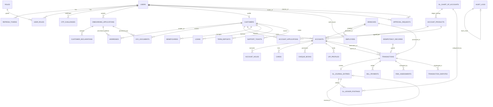

# FINServ — Comprehensive Database Architecture & Schema Specification

## 1. Schema Design Conventions & Invariants

All relational definitions for FINServ enforce strict enterprise financial invariants:
1. **Engine & Charset**: InnoDB storage engine; `utf8mb4` character set with `utf8mb4_unicode_ci` collation.
2. **Timezone Invariants (Strict UTC)**:
   - MySQL Server: Server must be configured with `default_time_zone = '+00:00'`.
   - JDBC Connection URL: `jdbc:mysql://localhost:3306/finserv_db?useSSL=false&serverTimezone=UTC&connectionTimeZone=UTC&allowPublicKeyRetrieval=true&createDatabaseIfNotExist=true`.
   - Spring Boot / Hibernate: `spring.jpa.properties.hibernate.jdbc.time_zone=UTC`.
   - All schema timestamp columns use microsecond-precision `DATETIME(6)`.
3. **UUID Storage Standard**: Uniformly stored as `CHAR(36) CHARACTER SET ascii COLLATE ascii_bin` across all tables for cross-platform JPA compatibility and zero byte-endian conversion overhead.
4. **Sequential UUIDv7 Strategy**:
   - High-throughput, time-series tables (`transactions`, `gl_journal_entries`, `gl_ledger_postings`, `audit_logs`) use time-ordered **UUIDv7** (RFC 9562).
   - Generated at the application layer using `com.fasterxml.uuid:java-uuid-generator:5.1.0` via `Generators.timeBasedEpochGenerator()` (Hibernate 6.x native `TIME` style generates legacy UUIDv1; `java-uuid-generator` guarantees standard 128-bit epoch-millisecond UUIDv7).
   - Guarantees sequential B-Tree clustering and eliminates indexing page splits under continuous insert loads.
5. **Monetary Precision & Rounding**:
   - Precision: All currency balances and transaction figures use `DECIMAL(15, 2)` or `DECIMAL(19, 4)` for sub-cent interest accrual. **Float and Double are strictly forbidden.**
   - Rounding Mode: Java domain math exclusively uses `RoundingMode.HALF_EVEN` (Banker's Rounding) to eliminate cumulative rounding drift.
6. **Optimistic Locking**: State-sensitive entities (`accounts`) carry a `version BIGINT NOT NULL DEFAULT 0` column.
7. **Strict Referencing (No Cascades on Financial/KYC Data)**: `ON DELETE CASCADE` and `SET NULL` are strictly prohibited on all financial, ledger, KYC, and audit tables. All referential integrity foreign keys enforce `ON DELETE RESTRICT`.
8. **Zero Destructive Deletions**: Financial records, accounts, customer histories, and audit records are never physically deleted. They utilize soft-deletion or status transitions (`CLOSED`, `DEACTIVATED`).
9. **Field-Level PII & Draft Encryption at Rest**:
   - Sensitive identifiers (`tax_identifier`, `document_number`) and in-flight onboarding draft payloads (`draft_data_encrypted`) are encrypted using authenticated AES-256-GCM.
   - Master encryption keys are sourced exclusively from environment variables / KMS (`APP_ENCRYPTION_KEY`), never stored in database or code.
   - Tables carry a `key_version INT NOT NULL DEFAULT 1` to support zero-downtime key rotation.
   - Deterministic blind index HMAC-SHA256 hash columns are used for exact-match uniqueness queries.
10. **Dual Database Users Security Model & Defense-in-Depth Triggers**:
    - **Migration User (`finserv_migration`@'localhost')**: Possesses DDL privileges (`CREATE`, `ALTER`, `DROP`, `INDEX`, `REFERENCES`) and DML for executing Flyway migrations. Configured in Spring Boot via `spring.flyway.user` and `spring.flyway.password`.
    - **Application User (`finserv_app`@'localhost')**: Possesses restricted runtime DML (`SELECT`, `INSERT`, `UPDATE` on operational tables; `DELETE` granted only on `idempotency_records` and `otp_challenges` for TTL maintenance). Configured in Spring Boot via `spring.datasource.username` and `spring.datasource.password`.
    - **Per-Table Grants**: Because MySQL does not support revoking table-level privileges from a wildcard database-level grant, explicit per-table grants are applied by an administrative script (`database/admin/01_init_users_and_permissions.sql`) **after** migrations run.
    - **Database Triggers**: `BEFORE UPDATE` and `BEFORE DELETE` triggers with `SIGNAL SQLSTATE '45000'` block mutations on `audit_logs`, `gl_journal_entries`, and `gl_ledger_postings` at the database engine level.
11. **Non-Transactional MySQL DDL Awareness**: MySQL DDL statements execute an implicit transaction commit. Schema changes are broken into discrete, ordered Flyway migration scripts that respect foreign key dependencies and prevent partial migration inconsistencies.

---

## 2. Mermaid Entity-Relationship Diagram (ERD)



---

## 3. Detailed Table Specifications

### 3.1 Authentication, Access Control & Registration (Phase 1 Core — `V1_1`)

#### `roles`
System authorization roles.
```sql
CREATE TABLE roles (
    id INT AUTO_INCREMENT NOT NULL,
    name VARCHAR(50) NOT NULL,
    description VARCHAR(255) NOT NULL,
    created_at DATETIME(6) NOT NULL DEFAULT CURRENT_TIMESTAMP(6),
    CONSTRAINT pk_roles PRIMARY KEY (id),
    CONSTRAINT uq_roles_name UNIQUE (name),
    CONSTRAINT chk_roles_name CHECK (name IN ('ROLE_CUSTOMER', 'ROLE_EMPLOYEE', 'ROLE_MANAGER', 'ROLE_ADMIN', 'ROLE_COMPLIANCE'))
) ENGINE=InnoDB;
```

#### `users`
Core identity table representing all system actors (including the seeded internal system account).
```sql
CREATE TABLE users (
    id CHAR(36) CHARACTER SET ascii COLLATE ascii_bin NOT NULL,
    username VARCHAR(50) NOT NULL,
    email VARCHAR(100) NOT NULL,
    phone_number VARCHAR(20) NOT NULL,
    password_hash VARCHAR(255) NOT NULL,
    status VARCHAR(30) NOT NULL DEFAULT 'PENDING_VERIFICATION',
    failed_login_attempts INT NOT NULL DEFAULT 0,
    email_verified_at DATETIME(6) NULL,
    phone_verified_at DATETIME(6) NULL,
    locked_until DATETIME(6) NULL,
    last_login_at DATETIME(6) NULL,
    created_at DATETIME(6) NOT NULL DEFAULT CURRENT_TIMESTAMP(6),
    updated_at DATETIME(6) NOT NULL DEFAULT CURRENT_TIMESTAMP(6) ON UPDATE CURRENT_TIMESTAMP(6),
    CONSTRAINT pk_users PRIMARY KEY (id),
    CONSTRAINT uq_users_username UNIQUE (username),
    CONSTRAINT uq_users_email UNIQUE (email),
    CONSTRAINT uq_users_phone UNIQUE (phone_number),
    CONSTRAINT chk_users_status CHECK (status IN ('PENDING_VERIFICATION', 'ACTIVE', 'LOCKED', 'SUSPENDED')),
    CONSTRAINT chk_users_failed_attempts CHECK (failed_login_attempts >= 0)
) ENGINE=InnoDB;

CREATE INDEX idx_users_status ON users(status);
```

#### `user_roles`
Mapping table for users to roles (Many-to-Many).
```sql
CREATE TABLE user_roles (
    user_id CHAR(36) CHARACTER SET ascii COLLATE ascii_bin NOT NULL,
    role_id INT NOT NULL,
    assigned_at DATETIME(6) NOT NULL DEFAULT CURRENT_TIMESTAMP(6),
    CONSTRAINT pk_user_roles PRIMARY KEY (user_id, role_id),
    CONSTRAINT fk_user_roles_user FOREIGN KEY (user_id) REFERENCES users(id) ON DELETE RESTRICT,
    CONSTRAINT fk_user_roles_role FOREIGN KEY (role_id) REFERENCES roles(id) ON DELETE RESTRICT
) ENGINE=InnoDB;
```

#### `refresh_tokens`
Rotating refresh tokens supporting token families and replay compromise revocation.
```sql
CREATE TABLE refresh_tokens (
    id CHAR(36) CHARACTER SET ascii COLLATE ascii_bin NOT NULL,
    user_id CHAR(36) CHARACTER SET ascii COLLATE ascii_bin NOT NULL,
    token_family_id CHAR(36) CHARACTER SET ascii COLLATE ascii_bin NOT NULL,
    token_hash VARCHAR(255) NOT NULL,
    replaced_by_token_id CHAR(36) CHARACTER SET ascii COLLATE ascii_bin NULL,
    expires_at DATETIME(6) NOT NULL,
    revoked BOOLEAN NOT NULL DEFAULT FALSE,
    created_at DATETIME(6) NOT NULL DEFAULT CURRENT_TIMESTAMP(6),
    CONSTRAINT pk_refresh_tokens PRIMARY KEY (id),
    CONSTRAINT uq_refresh_tokens_hash UNIQUE (token_hash),
    CONSTRAINT fk_refresh_tokens_user FOREIGN KEY (user_id) REFERENCES users(id) ON DELETE RESTRICT,
    CONSTRAINT fk_refresh_tokens_replaced FOREIGN KEY (replaced_by_token_id) REFERENCES refresh_tokens(id) ON DELETE RESTRICT
) ENGINE=InnoDB;

CREATE INDEX idx_refresh_tokens_user ON refresh_tokens(user_id, revoked);
CREATE INDEX idx_refresh_tokens_family ON refresh_tokens(token_family_id);
```

#### `otp_challenges`
Tracks single-use contact verification codes with purpose tagging.
```sql
CREATE TABLE otp_challenges (
    id CHAR(36) CHARACTER SET ascii COLLATE ascii_bin NOT NULL,
    user_id CHAR(36) CHARACTER SET ascii COLLATE ascii_bin NOT NULL,
    purpose VARCHAR(30) NOT NULL DEFAULT 'REGISTRATION',
    contact_type VARCHAR(10) NOT NULL,
    target_destination VARCHAR(100) NOT NULL,
    otp_hash VARCHAR(255) NOT NULL,
    attempts INT NOT NULL DEFAULT 0,
    max_attempts INT NOT NULL DEFAULT 3,
    status VARCHAR(20) NOT NULL DEFAULT 'PENDING',
    expires_at DATETIME(6) NOT NULL,
    verified_at DATETIME(6) NULL,
    created_at DATETIME(6) NOT NULL DEFAULT CURRENT_TIMESTAMP(6),
    CONSTRAINT pk_otp_challenges PRIMARY KEY (id),
    CONSTRAINT fk_otp_user FOREIGN KEY (user_id) REFERENCES users(id) ON DELETE RESTRICT,
    CONSTRAINT chk_otp_purpose CHECK (purpose IN ('REGISTRATION', 'LOGIN_2FA', 'PASSWORD_RESET', 'BENEFICIARY_ADDITION', 'HIGH_VALUE_TXN')),
    CONSTRAINT chk_otp_type CHECK (contact_type IN ('EMAIL', 'PHONE')),
    CONSTRAINT chk_otp_status CHECK (status IN ('PENDING', 'VERIFIED', 'EXPIRED', 'FAILED')),
    CONSTRAINT chk_otp_attempts CHECK (attempts >= 0 AND attempts <= max_attempts)
) ENGINE=InnoDB;

CREATE INDEX idx_otp_user ON otp_challenges(user_id, status);
```

---

### 3.2 Progressive Onboarding, Customer Profile & KYC (Phase 1 Core — `V1_2`)

#### `onboarding_applications`
Multi-step customer application state machine tracking progress before customer profile creation.
*Unique Active Rule*: Enforced at the database level via a generated column `active_app_marker`. Since MySQL permits multiple NULLs in unique indexes, indexing `active_app_marker` allows multiple terminal records (`APPROVED`, `REJECTED`) but strictly restricts each user to **at most one open application** (`DRAFT`, `SUBMITTED`, `UNDER_REVIEW`).
*Maker-Checker*: Verifier and approver are separated (`CHECK (approved_by_user_id IS NULL OR verified_by_user_id <> approved_by_user_id)`).
```sql
CREATE TABLE onboarding_applications (
    id CHAR(36) CHARACTER SET ascii COLLATE ascii_bin NOT NULL,
    user_id CHAR(36) CHARACTER SET ascii COLLATE ascii_bin NOT NULL,
    application_reference VARCHAR(40) NOT NULL,
    current_step INT NOT NULL DEFAULT 1,
    status VARCHAR(30) NOT NULL DEFAULT 'DRAFT',
    draft_data_encrypted VARCHAR(4096) NULL,
    key_version INT NOT NULL DEFAULT 1,
    submitted_at DATETIME(6) NULL,
    verified_by_user_id CHAR(36) CHARACTER SET ascii COLLATE ascii_bin NULL,
    verified_at DATETIME(6) NULL,
    approved_by_user_id CHAR(36) CHARACTER SET ascii COLLATE ascii_bin NULL,
    approved_at DATETIME(6) NULL,
    rejection_reason VARCHAR(255) NULL,
    active_app_marker VARCHAR(36) GENERATED ALWAYS AS (
        CASE WHEN status IN ('DRAFT', 'SUBMITTED', 'UNDER_REVIEW') THEN user_id ELSE NULL END
    ) STORED,
    created_at DATETIME(6) NOT NULL DEFAULT CURRENT_TIMESTAMP(6),
    updated_at DATETIME(6) NOT NULL DEFAULT CURRENT_TIMESTAMP(6) ON UPDATE CURRENT_TIMESTAMP(6),
    CONSTRAINT pk_onboarding_apps PRIMARY KEY (id),
    CONSTRAINT uq_onboarding_ref UNIQUE (application_reference),
    CONSTRAINT uq_one_open_app_per_user UNIQUE (active_app_marker),
    CONSTRAINT fk_onboarding_user FOREIGN KEY (user_id) REFERENCES users(id) ON DELETE RESTRICT,
    CONSTRAINT fk_onboarding_verifier FOREIGN KEY (verified_by_user_id) REFERENCES users(id) ON DELETE RESTRICT,
    CONSTRAINT fk_onboarding_approver FOREIGN KEY (approved_by_user_id) REFERENCES users(id) ON DELETE RESTRICT,
    CONSTRAINT chk_onboarding_step CHECK (current_step BETWEEN 1 AND 6),
    CONSTRAINT chk_onboarding_status CHECK (status IN ('DRAFT', 'SUBMITTED', 'UNDER_REVIEW', 'APPROVED', 'REJECTED')),
    CONSTRAINT chk_onboarding_maker_checker CHECK (approved_by_user_id IS NULL OR verified_by_user_id <> approved_by_user_id)
) ENGINE=InnoDB;
```

#### `customers`
Customer 360 record, created **only** upon final verification and approval of an onboarding application. Preliminary onboarding statuses do not exist on this table.
```sql
CREATE TABLE customers (
    id CHAR(36) CHARACTER SET ascii COLLATE ascii_bin NOT NULL,
    user_id CHAR(36) CHARACTER SET ascii COLLATE ascii_bin NOT NULL,
    customer_number VARCHAR(20) NOT NULL,
    first_name VARCHAR(60) NOT NULL,
    middle_name VARCHAR(60) NULL,
    last_name VARCHAR(60) NOT NULL,
    date_of_birth DATE NOT NULL,
    gender VARCHAR(20) NOT NULL,
    marital_status VARCHAR(20) NULL,
    nationality VARCHAR(50) NOT NULL DEFAULT 'INDIAN',
    tax_identifier_encrypted VARCHAR(512) NOT NULL,
    tax_identifier_hash VARCHAR(64) NOT NULL,
    key_version INT NOT NULL DEFAULT 1,
    kyc_status VARCHAR(30) NOT NULL DEFAULT 'VERIFIED',
    kyc_tier VARCHAR(20) NOT NULL DEFAULT 'TIER_1',
    created_at DATETIME(6) NOT NULL DEFAULT CURRENT_TIMESTAMP(6),
    updated_at DATETIME(6) NOT NULL DEFAULT CURRENT_TIMESTAMP(6) ON UPDATE CURRENT_TIMESTAMP(6),
    CONSTRAINT pk_customers PRIMARY KEY (id),
    CONSTRAINT uq_customers_user UNIQUE (user_id),
    CONSTRAINT uq_customers_number UNIQUE (customer_number),
    CONSTRAINT uq_customers_tax_hash UNIQUE (tax_identifier_hash),
    CONSTRAINT fk_customers_user FOREIGN KEY (user_id) REFERENCES users(id) ON DELETE RESTRICT,
    CONSTRAINT chk_customers_gender CHECK (gender IN ('MALE', 'FEMALE', 'OTHER', 'PREFER_NOT_TO_SAY')),
    CONSTRAINT chk_customers_kyc_status CHECK (kyc_status IN ('VERIFIED', 'RE_KYC_REQUIRED', 'SUSPENDED')),
    CONSTRAINT chk_customers_kyc_tier CHECK (kyc_tier IN ('TIER_1', 'TIER_2', 'TIER_3'))
) ENGINE=InnoDB;

CREATE INDEX idx_customers_kyc_status ON customers(kyc_status);
```

#### `customer_declarations`
Auditable regulatory consents and declarations (FATCA, Terms, PEP, Privacy) linked to either application or customer.
```sql
CREATE TABLE customer_declarations (
    id CHAR(36) CHARACTER SET ascii COLLATE ascii_bin NOT NULL,
    customer_id CHAR(36) CHARACTER SET ascii COLLATE ascii_bin NULL,
    application_id CHAR(36) CHARACTER SET ascii COLLATE ascii_bin NULL,
    declaration_type VARCHAR(50) NOT NULL,
    terms_version VARCHAR(20) NOT NULL DEFAULT 'v1.0',
    is_accepted BOOLEAN NOT NULL DEFAULT FALSE,
    accepted_at DATETIME(6) NOT NULL,
    ip_address VARCHAR(45) NOT NULL,
    user_agent VARCHAR(255) NULL,
    CONSTRAINT pk_customer_declarations PRIMARY KEY (id),
    CONSTRAINT fk_declarations_customer FOREIGN KEY (customer_id) REFERENCES customers(id) ON DELETE RESTRICT,
    CONSTRAINT fk_declarations_app FOREIGN KEY (application_id) REFERENCES onboarding_applications(id) ON DELETE RESTRICT,
    CONSTRAINT chk_declarations_binding CHECK (customer_id IS NOT NULL OR application_id IS NOT NULL),
    CONSTRAINT chk_declarations_type CHECK (declaration_type IN ('FATCA', 'TERMS_AND_CONDITIONS', 'PEP', 'DATA_PRIVACY')),
    CONSTRAINT chk_declarations_accepted CHECK (is_accepted = TRUE)
) ENGINE=InnoDB;
```

#### `addresses`
Physical and permanent address records. Collected during onboarding against `application_id` and backfilled with `customer_id` upon approval.
```sql
CREATE TABLE addresses (
    id CHAR(36) CHARACTER SET ascii COLLATE ascii_bin NOT NULL,
    customer_id CHAR(36) CHARACTER SET ascii COLLATE ascii_bin NULL,
    application_id CHAR(36) CHARACTER SET ascii COLLATE ascii_bin NULL,
    address_type VARCHAR(30) NOT NULL,
    street_line_1 VARCHAR(120) NOT NULL,
    street_line_2 VARCHAR(120) NULL,
    city VARCHAR(60) NOT NULL,
    state VARCHAR(60) NOT NULL,
    postal_code VARCHAR(20) NOT NULL,
    country VARCHAR(60) NOT NULL DEFAULT 'India',
    is_primary BOOLEAN NOT NULL DEFAULT FALSE,
    created_at DATETIME(6) NOT NULL DEFAULT CURRENT_TIMESTAMP(6),
    CONSTRAINT pk_addresses PRIMARY KEY (id),
    CONSTRAINT fk_addresses_customer FOREIGN KEY (customer_id) REFERENCES customers(id) ON DELETE RESTRICT,
    CONSTRAINT fk_addresses_app FOREIGN KEY (application_id) REFERENCES onboarding_applications(id) ON DELETE RESTRICT,
    CONSTRAINT chk_addresses_binding CHECK (customer_id IS NOT NULL OR application_id IS NOT NULL),
    CONSTRAINT chk_addresses_type CHECK (address_type IN ('RESIDENTIAL', 'PERMANENT', 'OFFICE'))
) ENGINE=InnoDB;

CREATE INDEX idx_addresses_customer ON addresses(customer_id);
CREATE INDEX idx_addresses_app ON addresses(application_id);
```

#### `kyc_documents`
Customer identity verification documents. Uploaded initially against `application_id`, backfilled with `customer_id` upon approval.
```sql
CREATE TABLE kyc_documents (
    id CHAR(36) CHARACTER SET ascii COLLATE ascii_bin NOT NULL,
    customer_id CHAR(36) CHARACTER SET ascii COLLATE ascii_bin NULL,
    application_id CHAR(36) CHARACTER SET ascii COLLATE ascii_bin NULL,
    document_type VARCHAR(40) NOT NULL,
    document_number_encrypted VARCHAR(512) NOT NULL,
    document_number_hash VARCHAR(64) NOT NULL,
    key_version INT NOT NULL DEFAULT 1,
    file_path VARCHAR(255) NOT NULL,
    mime_type VARCHAR(80) NOT NULL,
    file_size_bytes BIGINT NOT NULL,
    verification_status VARCHAR(30) NOT NULL DEFAULT 'PENDING',
    rejection_reason VARCHAR(255) NULL,
    verified_by_user_id CHAR(36) CHARACTER SET ascii COLLATE ascii_bin NULL,
    verified_at DATETIME(6) NULL,
    created_at DATETIME(6) NOT NULL DEFAULT CURRENT_TIMESTAMP(6),
    CONSTRAINT pk_kyc_documents PRIMARY KEY (id),
    CONSTRAINT fk_kyc_docs_customer FOREIGN KEY (customer_id) REFERENCES customers(id) ON DELETE RESTRICT,
    CONSTRAINT fk_kyc_docs_app FOREIGN KEY (application_id) REFERENCES onboarding_applications(id) ON DELETE RESTRICT,
    CONSTRAINT fk_kyc_docs_verifier FOREIGN KEY (verified_by_user_id) REFERENCES users(id) ON DELETE RESTRICT,
    CONSTRAINT chk_kyc_docs_binding CHECK (customer_id IS NOT NULL OR application_id IS NOT NULL),
    CONSTRAINT chk_kyc_docs_type CHECK (document_type IN ('PASSPORT', 'NATIONAL_ID', 'VOTER_ID', 'DRIVING_LICENSE', 'UTILITY_BILL')),
    CONSTRAINT chk_kyc_docs_status CHECK (verification_status IN ('PENDING', 'VERIFIED', 'REJECTED')),
    CONSTRAINT chk_kyc_docs_size CHECK (file_size_bytes > 0)
) ENGINE=InnoDB;

CREATE INDEX idx_kyc_docs_customer ON kyc_documents(customer_id);
CREATE INDEX idx_kyc_docs_app ON kyc_documents(application_id);
CREATE INDEX idx_kyc_docs_hash ON kyc_documents(document_number_hash);
```

---

### 3.3 Branch Network & Staff Operations (Phase 1 Core — `V1_3`)

#### `branches`
Physical and logical banking branch offices with 4-digit numeric branch codes.
```sql
CREATE TABLE branches (
    id CHAR(36) CHARACTER SET ascii COLLATE ascii_bin NOT NULL,
    branch_code VARCHAR(4) NOT NULL,
    branch_name VARCHAR(100) NOT NULL,
    ifsc_code VARCHAR(20) NOT NULL,
    routing_number VARCHAR(30) NOT NULL,
    street_address VARCHAR(150) NOT NULL,
    city VARCHAR(60) NOT NULL,
    state VARCHAR(60) NOT NULL,
    postal_code VARCHAR(20) NOT NULL,
    phone_number VARCHAR(20) NOT NULL,
    manager_user_id CHAR(36) CHARACTER SET ascii COLLATE ascii_bin NULL,
    status VARCHAR(20) NOT NULL DEFAULT 'ACTIVE',
    created_at DATETIME(6) NOT NULL DEFAULT CURRENT_TIMESTAMP(6),
    CONSTRAINT pk_branches PRIMARY KEY (id),
    CONSTRAINT uq_branches_code UNIQUE (branch_code),
    CONSTRAINT uq_branches_ifsc UNIQUE (ifsc_code),
    CONSTRAINT fk_branches_manager FOREIGN KEY (manager_user_id) REFERENCES users(id) ON DELETE RESTRICT,
    CONSTRAINT chk_branches_code_format CHECK (branch_code REGEXP '^[0-9]{4}$'),
    CONSTRAINT chk_branches_status CHECK (status IN ('ACTIVE', 'INACTIVE', 'CLOSED'))
) ENGINE=InnoDB;
```

#### `employees`
Bank staff profiles and branch affiliations.
```sql
CREATE TABLE employees (
    id CHAR(36) CHARACTER SET ascii COLLATE ascii_bin NOT NULL,
    user_id CHAR(36) CHARACTER SET ascii COLLATE ascii_bin NOT NULL,
    branch_id CHAR(36) CHARACTER SET ascii COLLATE ascii_bin NOT NULL,
    employee_code VARCHAR(30) NOT NULL,
    department VARCHAR(50) NOT NULL,
    designation VARCHAR(50) NOT NULL,
    joining_date DATE NOT NULL,
    status VARCHAR(20) NOT NULL DEFAULT 'ACTIVE',
    created_at DATETIME(6) NOT NULL DEFAULT CURRENT_TIMESTAMP(6),
    CONSTRAINT pk_employees PRIMARY KEY (id),
    CONSTRAINT uq_employees_user UNIQUE (user_id),
    CONSTRAINT uq_employees_code UNIQUE (employee_code),
    CONSTRAINT fk_employees_user FOREIGN KEY (user_id) REFERENCES users(id) ON DELETE RESTRICT,
    CONSTRAINT fk_employees_branch FOREIGN KEY (branch_id) REFERENCES branches(id) ON DELETE RESTRICT,
    CONSTRAINT chk_employees_status CHECK (status IN ('ACTIVE', 'ON_LEAVE', 'TERMINATED'))
) ENGINE=InnoDB;
```

---

### 3.4 General Ledger & Products (Phase 1 Core — `V1_4` & `V1_5`)

#### `gl_chart_of_accounts`
Banking General Ledger chart of accounts.
```sql
CREATE TABLE gl_chart_of_accounts (
    id CHAR(36) CHARACTER SET ascii COLLATE ascii_bin NOT NULL,
    gl_code VARCHAR(30) NOT NULL,
    account_name VARCHAR(100) NOT NULL,
    account_type VARCHAR(20) NOT NULL,
    balance_side VARCHAR(10) NOT NULL,
    description VARCHAR(255) NULL,
    is_active BOOLEAN NOT NULL DEFAULT TRUE,
    created_at DATETIME(6) NOT NULL DEFAULT CURRENT_TIMESTAMP(6),
    CONSTRAINT pk_gl_chart PRIMARY KEY (id),
    CONSTRAINT uq_gl_code UNIQUE (gl_code),
    CONSTRAINT chk_gl_type CHECK (account_type IN ('ASSET', 'LIABILITY', 'EQUITY', 'REVENUE', 'EXPENSE')),
    CONSTRAINT chk_gl_side CHECK (balance_side IN ('DEBIT', 'CREDIT'))
) ENGINE=InnoDB;
```

#### Standard Seed GL Accounts
| GL Code | Account Name | Type | Balance Side | Description |
| :--- | :--- | :--- | :--- | :--- |
| **10100** | Vault Cash | `ASSET` | `DEBIT` | Physical currency in branch vaults / tellers |
| **10200** | Central Bank Reserve / Clearing | `ASSET` | `DEBIT` | Reserve balance held with central clearing institution |
| **10300** | Inter-Bank Settlement Transit | `ASSET` | `DEBIT` | Clearing suspense account for outward/inward settlements |
| **20100** | Customer Savings Deposits | `LIABILITY` | `CREDIT` | Total customer liability for savings accounts |
| **20200** | Customer Current/Checking Deposits | `LIABILITY` | `CREDIT` | Total customer liability for current/checking accounts |
| **20300** | Term / Fixed Deposit Deposits | `LIABILITY` | `CREDIT` | Total liability for customer fixed & recurring deposits |
| **30100** | Bank Equity Capital | `EQUITY` | `CREDIT` | Initial capital and retained bank earnings |
| **40100** | Fee & Commission Income | `REVENUE` | `CREDIT` | Processing charges, maintenance, and wire transfer fees |
| **40200** | Loan Interest Earned | `REVENUE` | `CREDIT` | Invoiced and paid customer loan interest |
| **50100** | Deposit Interest Expense | `EXPENSE` | `DEBIT` | Interest paid out on customer savings and term deposits |

#### `account_products`
Product catalog linking each account type directly to its balance-sheet liability GL account.
```sql
CREATE TABLE account_products (
    id CHAR(36) CHARACTER SET ascii COLLATE ascii_bin NOT NULL,
    product_code VARCHAR(2) NOT NULL,
    product_name VARCHAR(80) NOT NULL,
    product_type VARCHAR(30) NOT NULL,
    gl_account_id CHAR(36) CHARACTER SET ascii COLLATE ascii_bin NOT NULL,
    currency VARCHAR(3) NOT NULL DEFAULT 'INR',
    min_balance DECIMAL(15, 2) NOT NULL DEFAULT 0.00,
    interest_rate_percentage DECIMAL(5, 2) NOT NULL DEFAULT 0.00,
    overdraft_allowed BOOLEAN NOT NULL DEFAULT FALSE,
    overdraft_limit DECIMAL(15, 2) NOT NULL DEFAULT 0.00,
    is_active BOOLEAN NOT NULL DEFAULT TRUE,
    created_at DATETIME(6) NOT NULL DEFAULT CURRENT_TIMESTAMP(6),
    CONSTRAINT pk_account_products PRIMARY KEY (id),
    CONSTRAINT uq_products_code UNIQUE (product_code),
    CONSTRAINT fk_products_gl FOREIGN KEY (gl_account_id) REFERENCES gl_chart_of_accounts(id) ON DELETE RESTRICT,
    CONSTRAINT chk_products_code_format CHECK (product_code REGEXP '^[0-9]{2}$'),
    CONSTRAINT chk_products_type CHECK (product_type IN ('SAVINGS', 'CURRENT', 'SALARY', 'STUDENT')),
    CONSTRAINT chk_products_min_balance CHECK (min_balance >= 0.00),
    CONSTRAINT chk_products_interest CHECK (interest_rate_percentage >= 0.00),
    CONSTRAINT chk_products_overdraft CHECK (overdraft_limit >= 0.00)
) ENGINE=InnoDB;
```

#### `account_applications`
Customer applications for specific deposit/current accounts, reviewed by branch staff before opening.
```sql
CREATE TABLE account_applications (
    id CHAR(36) CHARACTER SET ascii COLLATE ascii_bin NOT NULL,
    customer_id CHAR(36) CHARACTER SET ascii COLLATE ascii_bin NOT NULL,
    product_id CHAR(36) CHARACTER SET ascii COLLATE ascii_bin NOT NULL,
    application_number VARCHAR(30) NOT NULL,
    initial_deposit_amount DECIMAL(15, 2) NOT NULL DEFAULT 0.00,
    application_status VARCHAR(30) NOT NULL DEFAULT 'SUBMITTED',
    reviewed_by_user_id CHAR(36) CHARACTER SET ascii COLLATE ascii_bin NULL,
    reviewed_at DATETIME(6) NULL,
    rejection_reason VARCHAR(255) NULL,
    created_account_id CHAR(36) CHARACTER SET ascii COLLATE ascii_bin NULL,
    created_at DATETIME(6) NOT NULL DEFAULT CURRENT_TIMESTAMP(6),
    CONSTRAINT pk_account_applications PRIMARY KEY (id),
    CONSTRAINT uq_account_app_num UNIQUE (application_number),
    CONSTRAINT fk_account_app_customer FOREIGN KEY (customer_id) REFERENCES customers(id) ON DELETE RESTRICT,
    CONSTRAINT fk_account_app_product FOREIGN KEY (product_id) REFERENCES account_products(id) ON DELETE RESTRICT,
    CONSTRAINT fk_account_app_reviewer FOREIGN KEY (reviewed_by_user_id) REFERENCES users(id) ON DELETE RESTRICT,
    CONSTRAINT fk_account_app_account FOREIGN KEY (created_account_id) REFERENCES accounts(id) ON DELETE RESTRICT,
    CONSTRAINT chk_account_app_status CHECK (application_status IN ('SUBMITTED', 'UNDER_REVIEW', 'APPROVED', 'REJECTED')),
    CONSTRAINT chk_account_app_deposit CHECK (initial_deposit_amount >= 0.00)
) ENGINE=InnoDB;
```

#### `accounts`
Core customer deposit/checking accounts. Created only when approved.
*Balance Invariants*: `CHECK (current_balance >= 0.00)` enforces non-negative balance in v1 (overdraft deferred). `CHECK (available_balance = current_balance - hold_balance)` enforces exact earmarked fund calculations.
```sql
CREATE TABLE accounts (
    id CHAR(36) CHARACTER SET ascii COLLATE ascii_bin NOT NULL,
    customer_id CHAR(36) CHARACTER SET ascii COLLATE ascii_bin NOT NULL,
    branch_id CHAR(36) CHARACTER SET ascii COLLATE ascii_bin NOT NULL,
    product_id CHAR(36) CHARACTER SET ascii COLLATE ascii_bin NOT NULL,
    account_number VARCHAR(14) NOT NULL,
    currency VARCHAR(3) NOT NULL DEFAULT 'INR',
    current_balance DECIMAL(15, 2) NOT NULL DEFAULT 0.00,
    available_balance DECIMAL(15, 2) NOT NULL DEFAULT 0.00,
    hold_balance DECIMAL(15, 2) NOT NULL DEFAULT 0.00,
    status VARCHAR(30) NOT NULL DEFAULT 'ACTIVE',
    opened_at DATETIME(6) NOT NULL DEFAULT CURRENT_TIMESTAMP(6),
    closed_at DATETIME(6) NULL,
    version BIGINT NOT NULL DEFAULT 0,
    created_at DATETIME(6) NOT NULL DEFAULT CURRENT_TIMESTAMP(6),
    updated_at DATETIME(6) NOT NULL DEFAULT CURRENT_TIMESTAMP(6) ON UPDATE CURRENT_TIMESTAMP(6),
    CONSTRAINT pk_accounts PRIMARY KEY (id),
    CONSTRAINT uq_accounts_number UNIQUE (account_number),
    CONSTRAINT fk_accounts_customer FOREIGN KEY (customer_id) REFERENCES customers(id) ON DELETE RESTRICT,
    CONSTRAINT fk_accounts_branch FOREIGN KEY (branch_id) REFERENCES branches(id) ON DELETE RESTRICT,
    CONSTRAINT fk_accounts_product FOREIGN KEY (product_id) REFERENCES account_products(id) ON DELETE RESTRICT,
    CONSTRAINT chk_accounts_number_format CHECK (account_number REGEXP '^[0-9]{14}$'),
    CONSTRAINT chk_accounts_status CHECK (status IN ('ACTIVE', 'DORMANT', 'FROZEN', 'CLOSED')),
    CONSTRAINT chk_accounts_current_nonneg CHECK (current_balance >= 0.00),
    CONSTRAINT chk_accounts_holds CHECK (hold_balance >= 0.00),
    CONSTRAINT chk_accounts_avail_balance CHECK (available_balance = current_balance - hold_balance)
) ENGINE=InnoDB;

CREATE INDEX idx_accounts_customer ON accounts(customer_id);
CREATE INDEX idx_accounts_status ON accounts(status);
```

#### `account_holds`
Funds held/earmarked for pending authorizations or uncleared cheques.
```sql
CREATE TABLE account_holds (
    id CHAR(36) CHARACTER SET ascii COLLATE ascii_bin NOT NULL,
    account_id CHAR(36) CHARACTER SET ascii COLLATE ascii_bin NOT NULL,
    hold_reference VARCHAR(50) NOT NULL,
    amount DECIMAL(15, 2) NOT NULL,
    reason VARCHAR(150) NOT NULL,
    status VARCHAR(20) NOT NULL DEFAULT 'ACTIVE',
    expires_at DATETIME(6) NULL,
    created_at DATETIME(6) NOT NULL DEFAULT CURRENT_TIMESTAMP(6),
    updated_at DATETIME(6) NOT NULL DEFAULT CURRENT_TIMESTAMP(6) ON UPDATE CURRENT_TIMESTAMP(6),
    CONSTRAINT pk_account_holds PRIMARY KEY (id),
    CONSTRAINT uq_account_holds_ref UNIQUE (hold_reference),
    CONSTRAINT fk_account_holds_acc FOREIGN KEY (account_id) REFERENCES accounts(id) ON DELETE RESTRICT,
    CONSTRAINT chk_account_holds_status CHECK (status IN ('ACTIVE', 'RELEASED', 'EXECUTED')),
    CONSTRAINT chk_account_holds_amount CHECK (amount > 0.00)
) ENGINE=InnoDB;

CREATE INDEX idx_account_holds_acc ON account_holds(account_id, status);
```

#### `gl_journal_entries`
Immutable header for balanced accounting vouchers. Uses **UUIDv7**.
*Reversal Derivation*: Status column is eliminated. A journal is derived as an explicit reversal if `reversal_of_journal_id IS NOT NULL`. Each original journal can be reversed at most once (`UNIQUE(reversal_of_journal_id)`).
```sql
CREATE TABLE gl_journal_entries (
    id CHAR(36) CHARACTER SET ascii COLLATE ascii_bin NOT NULL,
    journal_reference VARCHAR(50) NOT NULL,
    transaction_type VARCHAR(40) NOT NULL,
    posting_date DATE NOT NULL,
    description VARCHAR(255) NOT NULL,
    reversal_of_journal_id CHAR(36) CHARACTER SET ascii COLLATE ascii_bin NULL,
    created_by_user_id CHAR(36) CHARACTER SET ascii COLLATE ascii_bin NOT NULL,
    created_at DATETIME(6) NOT NULL DEFAULT CURRENT_TIMESTAMP(6),
    CONSTRAINT pk_gl_journal PRIMARY KEY (id),
    CONSTRAINT uq_gl_journal_ref UNIQUE (journal_reference),
    CONSTRAINT uq_gl_reversal UNIQUE (reversal_of_journal_id),
    CONSTRAINT fk_gl_journal_reversal FOREIGN KEY (reversal_of_journal_id) REFERENCES gl_journal_entries(id) ON DELETE RESTRICT,
    CONSTRAINT fk_gl_journal_user FOREIGN KEY (created_by_user_id) REFERENCES users(id) ON DELETE RESTRICT
) ENGINE=InnoDB;

CREATE INDEX idx_gl_journal_posting_date ON gl_journal_entries(posting_date);
```

#### `gl_ledger_postings`
Individual debit and credit postings forming balanced entries ($\sum \text{Debits} == \sum \text{Credits}$). Uses **UUIDv7**.
```sql
CREATE TABLE gl_ledger_postings (
    id CHAR(36) CHARACTER SET ascii COLLATE ascii_bin NOT NULL,
    journal_entry_id CHAR(36) CHARACTER SET ascii COLLATE ascii_bin NOT NULL,
    gl_account_id CHAR(36) CHARACTER SET ascii COLLATE ascii_bin NOT NULL,
    customer_account_id CHAR(36) CHARACTER SET ascii COLLATE ascii_bin NULL,
    entry_type VARCHAR(10) NOT NULL,
    amount DECIMAL(15, 2) NOT NULL,
    created_at DATETIME(6) NOT NULL DEFAULT CURRENT_TIMESTAMP(6),
    CONSTRAINT pk_gl_postings PRIMARY KEY (id),
    CONSTRAINT fk_gl_postings_journal FOREIGN KEY (journal_entry_id) REFERENCES gl_journal_entries(id) ON DELETE RESTRICT,
    CONSTRAINT fk_gl_postings_gl_acc FOREIGN KEY (gl_account_id) REFERENCES gl_chart_of_accounts(id) ON DELETE RESTRICT,
    CONSTRAINT fk_gl_postings_cust_acc FOREIGN KEY (customer_account_id) REFERENCES accounts(id) ON DELETE RESTRICT,
    CONSTRAINT chk_gl_postings_type CHECK (entry_type IN ('DEBIT', 'CREDIT')),
    CONSTRAINT chk_gl_postings_amount CHECK (amount > 0.00)
) ENGINE=InnoDB;

CREATE INDEX idx_gl_postings_journal ON gl_ledger_postings(journal_entry_id);
CREATE INDEX idx_gl_postings_cust_acc ON gl_ledger_postings(customer_account_id);
```

#### Double-Entry Invariants & Reconciliation Query
1. **Single Database Transaction**: Verified within `LedgerPostingService` inside `@Transactional(isolation = Isolation.READ_COMMITTED)`. In-flight sum validation ensures $\sum \text{Debits} == \sum \text{Credits}$, throwing `UnbalancedLedgerException` on any discrepancy.
2. **Account Balance vs. Ledger Postings Reconciliation Query**:
   ```sql
   SELECT a.id AS account_id,
          a.account_number,
          a.current_balance,
          COALESCE(SUM(CASE 
              WHEN p.entry_type = 'CREDIT' THEN p.amount 
              WHEN p.entry_type = 'DEBIT' THEN -p.amount 
              ELSE 0 
          END), 0.00) AS ledger_calculated_balance,
          (a.current_balance - COALESCE(SUM(CASE 
              WHEN p.entry_type = 'CREDIT' THEN p.amount 
              WHEN p.entry_type = 'DEBIT' THEN -p.amount 
              ELSE 0 
          END), 0.00)) AS balance_drift
   FROM accounts a
   LEFT JOIN gl_ledger_postings p ON a.id = p.customer_account_id
   GROUP BY a.id, a.account_number, a.current_balance
   HAVING balance_drift <> 0.00;
   ```

---

### 3.5 Financial Transactions & Idempotency (Phase 1 Core — `V1_6`)

#### `idempotency_records`
Prevents duplicate financial execution by caching mutation results for unique client keys.
```sql
CREATE TABLE idempotency_records (
    id CHAR(36) CHARACTER SET ascii COLLATE ascii_bin NOT NULL,
    idempotency_key VARCHAR(100) NOT NULL,
    user_id CHAR(36) CHARACTER SET ascii COLLATE ascii_bin NOT NULL,
    request_hash VARCHAR(64) NOT NULL,
    request_path VARCHAR(200) NOT NULL,
    http_status_code INT NULL,
    response_payload LONGTEXT NULL,
    status VARCHAR(20) NOT NULL DEFAULT 'IN_PROGRESS',
    created_at DATETIME(6) NOT NULL DEFAULT CURRENT_TIMESTAMP(6),
    expires_at DATETIME(6) NOT NULL,
    CONSTRAINT pk_idempotency PRIMARY KEY (id),
    CONSTRAINT uq_user_idempotency UNIQUE (user_id, idempotency_key),
    CONSTRAINT fk_idempotency_user FOREIGN KEY (user_id) REFERENCES users(id) ON DELETE RESTRICT,
    CONSTRAINT chk_idempotency_status CHECK (status IN ('IN_PROGRESS', 'COMPLETED', 'FAILED'))
) ENGINE=InnoDB;

CREATE INDEX idx_idempotency_expires ON idempotency_records(expires_at);
```

#### `transactions`
Business financial transactions between accounts or external systems. Uses **UUIDv7**.
*Fee & Idempotency Invariant*: One idempotent request maps strictly to **one `transactions` row**. Processing fees are recorded directly in `fee_amount` rather than creating separate transaction rows.
```sql
CREATE TABLE transactions (
    id CHAR(36) CHARACTER SET ascii COLLATE ascii_bin NOT NULL,
    transaction_reference VARCHAR(40) NOT NULL,
    from_account_id CHAR(36) CHARACTER SET ascii COLLATE ascii_bin NULL,
    to_account_id CHAR(36) CHARACTER SET ascii COLLATE ascii_bin NULL,
    transaction_type VARCHAR(40) NOT NULL,
    amount DECIMAL(15, 2) NOT NULL,
    fee_amount DECIMAL(15, 2) NOT NULL DEFAULT 0.00,
    currency VARCHAR(3) NOT NULL DEFAULT 'INR',
    from_account_balance_after DECIMAL(15, 2) NULL,
    to_account_balance_after DECIMAL(15, 2) NULL,
    status VARCHAR(20) NOT NULL DEFAULT 'PENDING',
    failure_reason VARCHAR(255) NULL,
    reversal_of_transaction_id CHAR(36) CHARACTER SET ascii COLLATE ascii_bin NULL,
    channel VARCHAR(30) NOT NULL DEFAULT 'WEB',
    initiated_by_user_id CHAR(36) CHARACTER SET ascii COLLATE ascii_bin NULL,
    branch_id CHAR(36) CHARACTER SET ascii COLLATE ascii_bin NULL,
    idempotency_record_id CHAR(36) CHARACTER SET ascii COLLATE ascii_bin NULL,
    journal_entry_id CHAR(36) CHARACTER SET ascii COLLATE ascii_bin NULL,
    description VARCHAR(255) NULL,
    created_at DATETIME(6) NOT NULL DEFAULT CURRENT_TIMESTAMP(6),
    completed_at DATETIME(6) NULL,
    CONSTRAINT pk_transactions PRIMARY KEY (id),
    CONSTRAINT uq_transactions_ref UNIQUE (transaction_reference),
    CONSTRAINT uq_transactions_reversal UNIQUE (reversal_of_transaction_id),
    CONSTRAINT uq_transactions_idempotency UNIQUE (idempotency_record_id),
    CONSTRAINT fk_transactions_from_acc FOREIGN KEY (from_account_id) REFERENCES accounts(id) ON DELETE RESTRICT,
    CONSTRAINT fk_transactions_to_acc FOREIGN KEY (to_account_id) REFERENCES accounts(id) ON DELETE RESTRICT,
    CONSTRAINT fk_transactions_reversal FOREIGN KEY (reversal_of_transaction_id) REFERENCES transactions(id) ON DELETE RESTRICT,
    CONSTRAINT fk_transactions_initiator FOREIGN KEY (initiated_by_user_id) REFERENCES users(id) ON DELETE RESTRICT,
    CONSTRAINT fk_transactions_branch FOREIGN KEY (branch_id) REFERENCES branches(id) ON DELETE RESTRICT,
    CONSTRAINT fk_transactions_idempotency FOREIGN KEY (idempotency_record_id) REFERENCES idempotency_records(id) ON DELETE RESTRICT,
    CONSTRAINT fk_transactions_journal FOREIGN KEY (journal_entry_id) REFERENCES gl_journal_entries(id) ON DELETE RESTRICT,
    CONSTRAINT chk_transactions_type CHECK (transaction_type IN ('DEPOSIT', 'WITHDRAWAL', 'TRANSFER_INTERNAL', 'TRANSFER_EXTERNAL', 'FEE', 'INTEREST', 'REVERSAL')),
    CONSTRAINT chk_transactions_status CHECK (status IN ('PENDING', 'COMPLETED', 'FAILED', 'REVERSED')),
    CONSTRAINT chk_transactions_channel CHECK (channel IN ('WEB', 'MOBILE', 'BRANCH', 'ATM')),
    CONSTRAINT chk_transactions_amount CHECK (amount > 0.00),
    CONSTRAINT chk_transactions_fee CHECK (fee_amount >= 0.00),
    CONSTRAINT chk_transactions_distinct_accounts CHECK (from_account_id IS NULL OR to_account_id IS NULL OR from_account_id <> to_account_id),
    CONSTRAINT chk_transactions_account_presence CHECK (
        (transaction_type = 'DEPOSIT' AND from_account_id IS NULL AND to_account_id IS NOT NULL) OR
        (transaction_type = 'WITHDRAWAL' AND from_account_id IS NOT NULL AND to_account_id IS NULL) OR
        (transaction_type = 'TRANSFER_INTERNAL' AND from_account_id IS NOT NULL AND to_account_id IS NOT NULL) OR
        (transaction_type = 'TRANSFER_EXTERNAL' AND ((from_account_id IS NOT NULL AND to_account_id IS NULL) OR (from_account_id IS NULL AND to_account_id IS NOT NULL))) OR
        (transaction_type = 'FEE' AND from_account_id IS NOT NULL AND to_account_id IS NULL) OR
        (transaction_type = 'INTEREST' AND from_account_id IS NULL AND to_account_id IS NOT NULL) OR
        (transaction_type = 'REVERSAL' AND (from_account_id IS NOT NULL OR to_account_id IS NOT NULL))
    )
) ENGINE=InnoDB;

CREATE INDEX idx_transactions_from_acc ON transactions(from_account_id, created_at);
CREATE INDEX idx_transactions_to_acc ON transactions(to_account_id, created_at);
CREATE INDEX idx_transactions_status ON transactions(status);
```

---

### 3.6 Dual-Authorization, Sequence Counters & Audit (Phase 1 Core — `V1_7` & `V1_8`)

#### `approval_requests`
Maker-Checker dual authorization queue for high-risk operations.
```sql
CREATE TABLE approval_requests (
    id CHAR(36) CHARACTER SET ascii COLLATE ascii_bin NOT NULL,
    maker_user_id CHAR(36) CHARACTER SET ascii COLLATE ascii_bin NOT NULL,
    checker_user_id CHAR(36) CHARACTER SET ascii COLLATE ascii_bin NULL,
    entity_type VARCHAR(50) NOT NULL,
    entity_id VARCHAR(36) NOT NULL,
    action_type VARCHAR(40) NOT NULL,
    payload_json JSON NOT NULL,
    status VARCHAR(20) NOT NULL DEFAULT 'PENDING',
    rejection_reason VARCHAR(255) NULL,
    decided_at DATETIME(6) NULL,
    created_at DATETIME(6) NOT NULL DEFAULT CURRENT_TIMESTAMP(6),
    CONSTRAINT pk_approval_requests PRIMARY KEY (id),
    CONSTRAINT fk_approvals_maker FOREIGN KEY (maker_user_id) REFERENCES users(id) ON DELETE RESTRICT,
    CONSTRAINT fk_approvals_checker FOREIGN KEY (checker_user_id) REFERENCES users(id) ON DELETE RESTRICT,
    CONSTRAINT chk_approvals_maker_checker CHECK (checker_user_id IS NULL OR maker_user_id <> checker_user_id),
    CONSTRAINT chk_approvals_status CHECK (status IN ('PENDING', 'APPROVED', 'REJECTED', 'CANCELLED'))
) ENGINE=InnoDB;

CREATE INDEX idx_approvals_status ON approval_requests(status);
CREATE INDEX idx_approvals_entity ON approval_requests(entity_type, entity_id);
```

#### `number_sequences`
Row-locked atomic counters guaranteeing gapless, sequential numbering.
```sql
CREATE TABLE number_sequences (
    name VARCHAR(50) NOT NULL,
    current_value BIGINT NOT NULL DEFAULT 0,
    updated_at DATETIME(6) NOT NULL DEFAULT CURRENT_TIMESTAMP(6) ON UPDATE CURRENT_TIMESTAMP(6),
    CONSTRAINT pk_number_sequences PRIMARY KEY (name)
) ENGINE=InnoDB;
```
*Configured Sequences*:
- `account_num_seq`: Global sequence for 14-digit account numbers.
- `customer_cif_seq_2026`: Annual partition sequence for customer CIF numbers.
- `audit_chain_seq`: Global sequence for audit log hash-chain serialization.

#### `audit_logs`
Tamper-evident cryptographic audit chain. Uses **UUIDv7** and gapless sequence `chain_seq`.
*Security Policy*: Password hashes, decrypted PII, and raw secret keys are **strictly forbidden** from appearing in `old_value_json` and `new_value_json`.
```sql
CREATE TABLE audit_logs (
    id CHAR(36) CHARACTER SET ascii COLLATE ascii_bin NOT NULL,
    chain_seq BIGINT NOT NULL,
    event_type VARCHAR(60) NOT NULL,
    entity_type VARCHAR(60) NOT NULL,
    entity_id VARCHAR(36) NOT NULL,
    actor_user_id CHAR(36) CHARACTER SET ascii COLLATE ascii_bin NULL,
    actor_role VARCHAR(50) NULL,
    action VARCHAR(20) NOT NULL,
    ip_address VARCHAR(45) NULL,
    user_agent VARCHAR(255) NULL,
    correlation_id VARCHAR(64) NULL,
    old_value_json JSON NULL,
    new_value_json JSON NULL,
    previous_hash VARCHAR(64) NULL,
    current_hash VARCHAR(64) NOT NULL,
    created_at DATETIME(6) NOT NULL,
    CONSTRAINT pk_audit_logs PRIMARY KEY (id),
    CONSTRAINT uq_audit_chain_seq UNIQUE (chain_seq),
    CONSTRAINT fk_audit_actor FOREIGN KEY (actor_user_id) REFERENCES users(id) ON DELETE RESTRICT,
    CONSTRAINT chk_audit_action CHECK (action IN ('CREATE', 'UPDATE', 'DELETE', 'OVERRIDE', 'LOGIN', 'LOGOUT', 'LOGIN_FAILED', 'APPROVE', 'REJECT'))
) ENGINE=InnoDB;

CREATE INDEX idx_audit_entity ON audit_logs(entity_type, entity_id);
CREATE INDEX idx_audit_actor ON audit_logs(actor_user_id, created_at);
CREATE INDEX idx_audit_created ON audit_logs(created_at);
```

#### Hash Chain Serialization & Transaction Boundary
1. **Serialization**: The audit service acquires an exclusive lock on `audit_chain_seq` in `number_sequences` (`SELECT current_value FROM number_sequences WHERE name = 'audit_chain_seq' FOR UPDATE`).
2. **Canonical Hash Calculation**: The application sets `created_at = Instant.now()`, serializes an ordered canonical JSON payload:
   $$\text{current\_hash} = \text{SHA-256}(\text{id} \parallel \text{chain\_seq} \parallel \text{created\_at} \parallel \text{actor\_user\_id} \parallel \text{action} \parallel \text{canonical\_payload\_json} \parallel \text{previous\_hash})$$
3. **Transaction Placement**:
   - Standard business transactions: The audit row is written within the **same transactional boundary** right before commit. If the business mutation rolls back, the audit rollbacks with it.
   - Security / Failed attempts / Rollback audits: Written in an isolated `@Transactional(propagation = Propagation.REQUIRES_NEW)` boundary so failed login attempts and unauthorized attempts are permanently captured.
4. **Throughput Trade-off**: Synchronous row-locking on `audit_chain_seq` serializes commits to ~500–1,500 operations/sec on MySQL. This deliberate trade-off guarantees immediate cryptographic tamper-evidence without batch gaps.

#### Immutability Triggers (`V1_8__init_immutability_triggers.sql`)
```sql
DELIMITER //

CREATE TRIGGER trg_audit_logs_no_update BEFORE UPDATE ON audit_logs
FOR EACH ROW BEGIN
    SIGNAL SQLSTATE '45000' SET MESSAGE_TEXT = 'Immutable table: UPDATE not permitted on audit_logs';
END //

CREATE TRIGGER trg_audit_logs_no_delete BEFORE DELETE ON audit_logs
FOR EACH ROW BEGIN
    SIGNAL SQLSTATE '45000' SET MESSAGE_TEXT = 'Immutable table: DELETE not permitted on audit_logs';
END //

CREATE TRIGGER trg_gl_journal_no_update BEFORE UPDATE ON gl_journal_entries
FOR EACH ROW BEGIN
    SIGNAL SQLSTATE '45000' SET MESSAGE_TEXT = 'Immutable table: UPDATE not permitted on gl_journal_entries';
END //

CREATE TRIGGER trg_gl_journal_no_delete BEFORE DELETE ON gl_journal_entries
FOR EACH ROW BEGIN
    SIGNAL SQLSTATE '45000' SET MESSAGE_TEXT = 'Immutable table: DELETE not permitted on gl_journal_entries';
END //

CREATE TRIGGER trg_gl_postings_no_update BEFORE UPDATE ON gl_ledger_postings
FOR EACH ROW BEGIN
    SIGNAL SQLSTATE '45000' SET MESSAGE_TEXT = 'Immutable table: UPDATE not permitted on gl_ledger_postings';
END //

CREATE TRIGGER trg_gl_postings_no_delete BEFORE DELETE ON gl_ledger_postings
FOR EACH ROW BEGIN
    SIGNAL SQLSTATE '45000' SET MESSAGE_TEXT = 'Immutable table: DELETE not permitted on gl_ledger_postings';
END //

DELIMITER ;
```

---

### 3.7 Later Phase Tables (Phases 8 to 21)

#### `beneficiaries` (Phase 8)
```sql
CREATE TABLE beneficiaries (
    id CHAR(36) CHARACTER SET ascii COLLATE ascii_bin NOT NULL,
    customer_id CHAR(36) CHARACTER SET ascii COLLATE ascii_bin NOT NULL,
    payee_type VARCHAR(20) NOT NULL,
    nickname VARCHAR(60) NOT NULL,
    beneficiary_name VARCHAR(100) NOT NULL,
    account_number VARCHAR(34) NOT NULL,
    ifsc_code VARCHAR(20) NOT NULL,
    bank_name VARCHAR(100) NOT NULL,
    cooling_off_until DATETIME(6) NULL,
    verification_status VARCHAR(20) NOT NULL DEFAULT 'PENDING_VERIFICATION',
    is_active BOOLEAN NOT NULL DEFAULT TRUE,
    created_at DATETIME(6) NOT NULL DEFAULT CURRENT_TIMESTAMP(6),
    CONSTRAINT pk_beneficiaries PRIMARY KEY (id),
    CONSTRAINT uq_beneficiaries_payee UNIQUE (customer_id, account_number, ifsc_code),
    CONSTRAINT fk_beneficiaries_customer FOREIGN KEY (customer_id) REFERENCES customers(id) ON DELETE RESTRICT,
    CONSTRAINT chk_beneficiaries_type CHECK (payee_type IN ('INTRA_BANK', 'INTER_BANK', 'UPI')),
    CONSTRAINT chk_beneficiaries_vstatus CHECK (verification_status IN ('PENDING_VERIFICATION', 'VERIFIED', 'REJECTED'))
) ENGINE=InnoDB;
```

#### `notifications` (Phase 14)
```sql
CREATE TABLE notifications (
    id CHAR(36) CHARACTER SET ascii COLLATE ascii_bin NOT NULL,
    user_id CHAR(36) CHARACTER SET ascii COLLATE ascii_bin NOT NULL,
    channel VARCHAR(10) NOT NULL,
    notification_type VARCHAR(50) NOT NULL,
    title VARCHAR(120) NOT NULL,
    message TEXT NOT NULL,
    status VARCHAR(20) NOT NULL DEFAULT 'PENDING',
    read_at DATETIME(6) NULL,
    created_at DATETIME(6) NOT NULL DEFAULT CURRENT_TIMESTAMP(6),
    CONSTRAINT pk_notifications PRIMARY KEY (id),
    CONSTRAINT fk_notifications_user FOREIGN KEY (user_id) REFERENCES users(id) ON DELETE RESTRICT,
    CONSTRAINT chk_notif_channel CHECK (channel IN ('IN_APP', 'EMAIL', 'SMS')),
    CONSTRAINT chk_notif_status CHECK (status IN ('PENDING', 'DELIVERED', 'READ', 'FAILED'))
) ENGINE=InnoDB;
```

#### `support_tickets` (Phase 14)
```sql
CREATE TABLE support_tickets (
    id CHAR(36) CHARACTER SET ascii COLLATE ascii_bin NOT NULL,
    customer_id CHAR(36) CHARACTER SET ascii COLLATE ascii_bin NOT NULL,
    assigned_staff_id CHAR(36) CHARACTER SET ascii COLLATE ascii_bin NULL,
    category VARCHAR(40) NOT NULL,
    subject VARCHAR(120) NOT NULL,
    description TEXT NOT NULL,
    priority VARCHAR(20) NOT NULL DEFAULT 'MEDIUM',
    status VARCHAR(20) NOT NULL DEFAULT 'OPEN',
    created_at DATETIME(6) NOT NULL DEFAULT CURRENT_TIMESTAMP(6),
    updated_at DATETIME(6) NOT NULL DEFAULT CURRENT_TIMESTAMP(6) ON UPDATE CURRENT_TIMESTAMP(6),
    CONSTRAINT pk_support_tickets PRIMARY KEY (id),
    CONSTRAINT fk_tickets_cust FOREIGN KEY (customer_id) REFERENCES customers(id) ON DELETE RESTRICT,
    CONSTRAINT fk_tickets_staff FOREIGN KEY (assigned_staff_id) REFERENCES users(id) ON DELETE RESTRICT,
    CONSTRAINT chk_tickets_priority CHECK (priority IN ('LOW', 'MEDIUM', 'HIGH', 'URGENT')),
    CONSTRAINT chk_tickets_status CHECK (status IN ('OPEN', 'IN_PROGRESS', 'RESOLVED', 'CLOSED'))
) ENGINE=InnoDB;
```

#### `transaction_disputes` (Phase 14)
```sql
CREATE TABLE transaction_disputes (
    id CHAR(36) CHARACTER SET ascii COLLATE ascii_bin NOT NULL,
    ticket_id CHAR(36) CHARACTER SET ascii COLLATE ascii_bin NOT NULL,
    transaction_id CHAR(36) CHARACTER SET ascii COLLATE ascii_bin NOT NULL,
    dispute_reason VARCHAR(100) NOT NULL,
    disputed_amount DECIMAL(15, 2) NOT NULL,
    provisional_credit_issued BOOLEAN NOT NULL DEFAULT FALSE,
    status VARCHAR(30) NOT NULL DEFAULT 'INITIATED',
    created_at DATETIME(6) NOT NULL DEFAULT CURRENT_TIMESTAMP(6),
    CONSTRAINT pk_disputes PRIMARY KEY (id),
    CONSTRAINT fk_disputes_ticket FOREIGN KEY (ticket_id) REFERENCES support_tickets(id) ON DELETE RESTRICT,
    CONSTRAINT fk_disputes_txn FOREIGN KEY (transaction_id) REFERENCES transactions(id) ON DELETE RESTRICT,
    CONSTRAINT chk_disputes_amount CHECK (disputed_amount > 0.00),
    CONSTRAINT chk_disputes_status CHECK (status IN ('INITIATED', 'UNDER_REVIEW', 'CHARGEBACK_WON', 'CHARGEBACK_LOST'))
) ENGINE=InnoDB;
```

#### `term_deposits` (Phase 15)
```sql
CREATE TABLE term_deposits (
    id CHAR(36) CHARACTER SET ascii COLLATE ascii_bin NOT NULL,
    customer_id CHAR(36) CHARACTER SET ascii COLLATE ascii_bin NOT NULL,
    linked_account_id CHAR(36) CHARACTER SET ascii COLLATE ascii_bin NOT NULL,
    deposit_type VARCHAR(20) NOT NULL,
    deposit_number VARCHAR(30) NOT NULL,
    principal_amount DECIMAL(15, 2) NOT NULL,
    monthly_installment DECIMAL(15, 2) NULL,
    interest_rate_percentage DECIMAL(5, 2) NOT NULL,
    tenure_months INT NOT NULL,
    compounding_frequency VARCHAR(20) NOT NULL DEFAULT 'QUARTERLY',
    start_date DATE NOT NULL,
    maturity_date DATE NOT NULL,
    maturity_amount DECIMAL(15, 2) NOT NULL,
    status VARCHAR(25) NOT NULL DEFAULT 'ACTIVE',
    created_at DATETIME(6) NOT NULL DEFAULT CURRENT_TIMESTAMP(6),
    CONSTRAINT pk_term_deposits PRIMARY KEY (id),
    CONSTRAINT uq_term_deposits_num UNIQUE (deposit_number),
    CONSTRAINT fk_term_deposits_cust FOREIGN KEY (customer_id) REFERENCES customers(id) ON DELETE RESTRICT,
    CONSTRAINT fk_term_deposits_acc FOREIGN KEY (linked_account_id) REFERENCES accounts(id) ON DELETE RESTRICT,
    CONSTRAINT chk_term_dep_type CHECK (deposit_type IN ('FIXED_DEPOSIT', 'RECURRING_DEPOSIT')),
    CONSTRAINT chk_term_dep_status CHECK (status IN ('ACTIVE', 'MATURED', 'PREMATURE_CLOSED')),
    CONSTRAINT chk_term_dep_principal CHECK (principal_amount > 0.00),
    CONSTRAINT chk_term_dep_interest CHECK (interest_rate_percentage >= 0.00),
    CONSTRAINT chk_term_dep_tenure CHECK (tenure_months > 0)
) ENGINE=InnoDB;
```

#### `loan_products` (Phase 16)
```sql
CREATE TABLE loan_products (
    id CHAR(36) CHARACTER SET ascii COLLATE ascii_bin NOT NULL,
    product_code VARCHAR(20) NOT NULL,
    loan_name VARCHAR(80) NOT NULL,
    loan_type VARCHAR(30) NOT NULL,
    min_amount DECIMAL(15, 2) NOT NULL,
    max_amount DECIMAL(15, 2) NOT NULL,
    interest_rate_percentage DECIMAL(5, 2) NOT NULL,
    min_tenure_months INT NOT NULL,
    max_tenure_months INT NOT NULL,
    created_at DATETIME(6) NOT NULL DEFAULT CURRENT_TIMESTAMP(6),
    CONSTRAINT pk_loan_products PRIMARY KEY (id),
    CONSTRAINT uq_loan_products_code UNIQUE (product_code),
    CONSTRAINT chk_loan_products_type CHECK (loan_type IN ('PERSONAL', 'HOME', 'AUTO', 'EDUCATION')),
    CONSTRAINT chk_loan_products_amounts CHECK (min_amount > 0.00 AND max_amount >= min_amount),
    CONSTRAINT chk_loan_products_interest CHECK (interest_rate_percentage >= 0.00),
    CONSTRAINT chk_loan_products_tenure CHECK (min_tenure_months > 0 AND max_tenure_months >= min_tenure_months)
) ENGINE=InnoDB;
```

#### `loans` (Phase 16)
```sql
CREATE TABLE loans (
    id CHAR(36) CHARACTER SET ascii COLLATE ascii_bin NOT NULL,
    customer_id CHAR(36) CHARACTER SET ascii COLLATE ascii_bin NOT NULL,
    loan_product_id CHAR(36) CHARACTER SET ascii COLLATE ascii_bin NOT NULL,
    disbursement_account_id CHAR(36) CHARACTER SET ascii COLLATE ascii_bin NOT NULL,
    loan_account_number VARCHAR(30) NOT NULL,
    principal_amount DECIMAL(15, 2) NOT NULL,
    interest_rate_percentage DECIMAL(5, 2) NOT NULL,
    tenure_months INT NOT NULL,
    emi_amount DECIMAL(15, 2) NOT NULL,
    outstanding_principal DECIMAL(15, 2) NOT NULL,
    status VARCHAR(25) NOT NULL DEFAULT 'APPLIED',
    sanctioned_at DATETIME(6) NULL,
    created_at DATETIME(6) NOT NULL DEFAULT CURRENT_TIMESTAMP(6),
    CONSTRAINT pk_loans PRIMARY KEY (id),
    CONSTRAINT uq_loans_acc_num UNIQUE (loan_account_number),
    CONSTRAINT fk_loans_cust FOREIGN KEY (customer_id) REFERENCES customers(id) ON DELETE RESTRICT,
    CONSTRAINT fk_loans_prod FOREIGN KEY (loan_product_id) REFERENCES loan_products(id) ON DELETE RESTRICT,
    CONSTRAINT fk_loans_acc FOREIGN KEY (disbursement_account_id) REFERENCES accounts(id) ON DELETE RESTRICT,
    CONSTRAINT chk_loans_status CHECK (status IN ('APPLIED', 'APPROVED', 'SANCTIONED', 'ACTIVE', 'DELINQUENT', 'CLOSED')),
    CONSTRAINT chk_loans_principal CHECK (principal_amount > 0.00),
    CONSTRAINT chk_loans_emi CHECK (emi_amount > 0.00),
    CONSTRAINT chk_loans_outstanding CHECK (outstanding_principal >= 0.00)
) ENGINE=InnoDB;
```

#### `loan_amortization_schedules` (Phase 16)
```sql
CREATE TABLE loan_amortization_schedules (
    id CHAR(36) CHARACTER SET ascii COLLATE ascii_bin NOT NULL,
    loan_id CHAR(36) CHARACTER SET ascii COLLATE ascii_bin NOT NULL,
    installment_number INT NOT NULL,
    due_date DATE NOT NULL,
    emi_amount DECIMAL(15, 2) NOT NULL,
    principal_component DECIMAL(15, 2) NOT NULL,
    interest_component DECIMAL(15, 2) NOT NULL,
    remaining_principal DECIMAL(15, 2) NOT NULL,
    status VARCHAR(20) NOT NULL DEFAULT 'PENDING',
    paid_at DATETIME(6) NULL,
    CONSTRAINT pk_loan_schedule PRIMARY KEY (id),
    CONSTRAINT uq_loan_schedule UNIQUE (loan_id, installment_number),
    CONSTRAINT fk_loan_schedule_loan FOREIGN KEY (loan_id) REFERENCES loans(id) ON DELETE RESTRICT,
    CONSTRAINT chk_loan_schedule_status CHECK (status IN ('PENDING', 'PAID', 'OVERDUE')),
    CONSTRAINT chk_loan_schedule_emi CHECK (emi_amount > 0.00),
    CONSTRAINT chk_loan_schedule_components CHECK (principal_component >= 0.00 AND interest_component >= 0.00)
) ENGINE=InnoDB;

CREATE INDEX idx_loan_schedule_due ON loan_amortization_schedules(loan_id, due_date, status);
```

#### `cheque_books`, `cheque_leaves`, `positive_pay_records` (Phase 17)
```sql
CREATE TABLE cheque_books (
    id CHAR(36) CHARACTER SET ascii COLLATE ascii_bin NOT NULL,
    account_id CHAR(36) CHARACTER SET ascii COLLATE ascii_bin NOT NULL,
    book_number VARCHAR(30) NOT NULL,
    starting_leaf_number INT NOT NULL,
    ending_leaf_number INT NOT NULL,
    total_leaves INT NOT NULL,
    status VARCHAR(20) NOT NULL DEFAULT 'REQUESTED',
    requested_at DATETIME(6) NOT NULL DEFAULT CURRENT_TIMESTAMP(6),
    issued_at DATETIME(6) NULL,
    CONSTRAINT pk_cheque_books PRIMARY KEY (id),
    CONSTRAINT uq_cheque_books_num UNIQUE (account_id, book_number),
    CONSTRAINT fk_cheque_books_acc FOREIGN KEY (account_id) REFERENCES accounts(id) ON DELETE RESTRICT,
    CONSTRAINT chk_cheque_books_status CHECK (status IN ('REQUESTED', 'ISSUED', 'DELIVERED', 'EXHAUSTED')),
    CONSTRAINT chk_cheque_leaves_count CHECK (total_leaves > 0)
) ENGINE=InnoDB;

CREATE TABLE cheque_leaves (
    id CHAR(36) CHARACTER SET ascii COLLATE ascii_bin NOT NULL,
    cheque_book_id CHAR(36) CHARACTER SET ascii COLLATE ascii_bin NOT NULL,
    account_id CHAR(36) CHARACTER SET ascii COLLATE ascii_bin NOT NULL,
    leaf_number INT NOT NULL,
    status VARCHAR(25) NOT NULL DEFAULT 'AVAILABLE',
    payee_name VARCHAR(100) NULL,
    amount DECIMAL(15, 2) NULL,
    cleared_at DATETIME(6) NULL,
    bounce_reason VARCHAR(255) NULL,
    CONSTRAINT pk_cheque_leaves PRIMARY KEY (id),
    CONSTRAINT uq_cheque_leaf UNIQUE (account_id, leaf_number),
    CONSTRAINT fk_cheque_leaves_book FOREIGN KEY (cheque_book_id) REFERENCES cheque_books(id) ON DELETE RESTRICT,
    CONSTRAINT fk_cheque_leaves_acc FOREIGN KEY (account_id) REFERENCES accounts(id) ON DELETE RESTRICT,
    CONSTRAINT chk_cheque_leaves_status CHECK (status IN ('AVAILABLE', 'PRESENTED', 'CLEARED', 'BOUNCED', 'STOPPED'))
) ENGINE=InnoDB;

CREATE TABLE positive_pay_records (
    id CHAR(36) CHARACTER SET ascii COLLATE ascii_bin NOT NULL,
    account_id CHAR(36) CHARACTER SET ascii COLLATE ascii_bin NOT NULL,
    cheque_leaf_number INT NOT NULL,
    payee_name VARCHAR(100) NOT NULL,
    amount DECIMAL(15, 2) NOT NULL,
    issue_date DATE NOT NULL,
    status VARCHAR(20) NOT NULL DEFAULT 'REGISTERED',
    created_at DATETIME(6) NOT NULL DEFAULT CURRENT_TIMESTAMP(6),
    CONSTRAINT pk_positive_pay PRIMARY KEY (id),
    CONSTRAINT uq_pos_pay UNIQUE (account_id, cheque_leaf_number),
    CONSTRAINT fk_pos_pay_acc FOREIGN KEY (account_id) REFERENCES accounts(id) ON DELETE RESTRICT,
    CONSTRAINT chk_positive_pay_status CHECK (status IN ('REGISTERED', 'MATCHED', 'DISCREPANT')),
    CONSTRAINT chk_positive_pay_amount CHECK (amount > 0.00)
) ENGINE=InnoDB;
```

#### `billers` & `bill_payments` (Phase 18)
```sql
CREATE TABLE billers (
    id CHAR(36) CHARACTER SET ascii COLLATE ascii_bin NOT NULL,
    biller_code VARCHAR(30) NOT NULL,
    biller_name VARCHAR(100) NOT NULL,
    category VARCHAR(40) NOT NULL,
    logo_url VARCHAR(255) NULL,
    is_active BOOLEAN NOT NULL DEFAULT TRUE,
    CONSTRAINT pk_billers PRIMARY KEY (id),
    CONSTRAINT uq_billers_code UNIQUE (biller_code),
    CONSTRAINT chk_billers_category CHECK (category IN ('ELECTRICITY', 'WATER', 'GAS', 'TELECOM', 'FASTAG'))
) ENGINE=InnoDB;

CREATE TABLE bill_payments (
    id CHAR(36) CHARACTER SET ascii COLLATE ascii_bin NOT NULL,
    customer_id CHAR(36) CHARACTER SET ascii COLLATE ascii_bin NOT NULL,
    from_account_id CHAR(36) CHARACTER SET ascii COLLATE ascii_bin NOT NULL,
    biller_id CHAR(36) CHARACTER SET ascii COLLATE ascii_bin NOT NULL,
    transaction_id CHAR(36) CHARACTER SET ascii COLLATE ascii_bin NOT NULL,
    consumer_number VARCHAR(60) NOT NULL,
    bill_amount DECIMAL(15, 2) NOT NULL,
    convenience_fee DECIMAL(15, 2) NOT NULL DEFAULT 0.00,
    payment_reference VARCHAR(40) NOT NULL,
    status VARCHAR(20) NOT NULL DEFAULT 'PENDING',
    paid_at DATETIME(6) NOT NULL DEFAULT CURRENT_TIMESTAMP(6),
    CONSTRAINT pk_bill_payments PRIMARY KEY (id),
    CONSTRAINT uq_bill_pay_ref UNIQUE (payment_reference),
    CONSTRAINT fk_bill_pay_cust FOREIGN KEY (customer_id) REFERENCES customers(id) ON DELETE RESTRICT,
    CONSTRAINT fk_bill_pay_acc FOREIGN KEY (from_account_id) REFERENCES accounts(id) ON DELETE RESTRICT,
    CONSTRAINT fk_bill_pay_biller FOREIGN KEY (biller_id) REFERENCES billers(id) ON DELETE RESTRICT,
    CONSTRAINT fk_bill_pay_txn FOREIGN KEY (transaction_id) REFERENCES transactions(id) ON DELETE RESTRICT,
    CONSTRAINT chk_bill_pay_status CHECK (status IN ('PENDING', 'SUCCESS', 'FAILED')),
    CONSTRAINT chk_bill_pay_amount CHECK (bill_amount > 0.00),
    CONSTRAINT chk_bill_pay_fee CHECK (convenience_fee >= 0.00)
) ENGINE=InnoDB;
```

#### `cards` & `upi_profiles` (Phase 19 Simulated / Tokenized)
```sql
CREATE TABLE cards (
    id CHAR(36) CHARACTER SET ascii COLLATE ascii_bin NOT NULL,
    account_id CHAR(36) CHARACTER SET ascii COLLATE ascii_bin NOT NULL,
    customer_id CHAR(36) CHARACTER SET ascii COLLATE ascii_bin NOT NULL,
    card_number_last_four VARCHAR(4) NOT NULL,
    token_reference VARCHAR(100) NOT NULL,
    card_type VARCHAR(20) NOT NULL,
    card_network VARCHAR(20) NOT NULL DEFAULT 'VISA',
    expiry_month INT NOT NULL,
    expiry_year INT NOT NULL,
    pin_hash VARCHAR(255) NOT NULL,
    status VARCHAR(25) NOT NULL DEFAULT 'INACTIVE',
    is_online_enabled BOOLEAN NOT NULL DEFAULT TRUE,
    is_international_enabled BOOLEAN NOT NULL DEFAULT FALSE,
    is_contactless_enabled BOOLEAN NOT NULL DEFAULT TRUE,
    daily_spending_limit DECIMAL(15, 2) NOT NULL DEFAULT 50000.00,
    daily_atm_limit DECIMAL(15, 2) NOT NULL DEFAULT 25000.00,
    created_at DATETIME(6) NOT NULL DEFAULT CURRENT_TIMESTAMP(6),
    CONSTRAINT pk_cards PRIMARY KEY (id),
    CONSTRAINT uq_cards_token UNIQUE (token_reference),
    CONSTRAINT fk_cards_acc FOREIGN KEY (account_id) REFERENCES accounts(id) ON DELETE RESTRICT,
    CONSTRAINT fk_cards_cust FOREIGN KEY (customer_id) REFERENCES customers(id) ON DELETE RESTRICT,
    CONSTRAINT chk_cards_type CHECK (card_type IN ('DEBIT', 'CREDIT')),
    CONSTRAINT chk_cards_network CHECK (card_network IN ('VISA', 'MASTERCARD', 'RUPAY')),
    CONSTRAINT chk_cards_status CHECK (status IN ('INACTIVE', 'ACTIVE', 'BLOCKED', 'PERMANENTLY_CANCELLED')),
    CONSTRAINT chk_cards_expiry_m CHECK (expiry_month BETWEEN 1 AND 12),
    CONSTRAINT chk_cards_limits CHECK (daily_spending_limit >= 0.00 AND daily_atm_limit >= 0.00)
) ENGINE=InnoDB;

CREATE TABLE upi_profiles (
    id CHAR(36) CHARACTER SET ascii COLLATE ascii_bin NOT NULL,
    customer_id CHAR(36) CHARACTER SET ascii COLLATE ascii_bin NOT NULL,
    account_id CHAR(36) CHARACTER SET ascii COLLATE ascii_bin NOT NULL,
    vpa_address VARCHAR(80) NOT NULL,
    upi_pin_hash VARCHAR(255) NOT NULL,
    status VARCHAR(20) NOT NULL DEFAULT 'ACTIVE',
    created_at DATETIME(6) NOT NULL DEFAULT CURRENT_TIMESTAMP(6),
    CONSTRAINT pk_upi_profiles PRIMARY KEY (id),
    CONSTRAINT uq_upi_vpa UNIQUE (vpa_address),
    CONSTRAINT fk_upi_cust FOREIGN KEY (customer_id) REFERENCES customers(id) ON DELETE RESTRICT,
    CONSTRAINT fk_upi_acc FOREIGN KEY (account_id) REFERENCES accounts(id) ON DELETE RESTRICT,
    CONSTRAINT chk_upi_status CHECK (status IN ('ACTIVE', 'DORMANT', 'BLOCKED'))
) ENGINE=InnoDB;
```

#### `risk_assessments` & `aml_alerts` (Phase 21)
```sql
CREATE TABLE risk_assessments (
    id CHAR(36) CHARACTER SET ascii COLLATE ascii_bin NOT NULL,
    transaction_id CHAR(36) CHARACTER SET ascii COLLATE ascii_bin NOT NULL,
    customer_id CHAR(36) CHARACTER SET ascii COLLATE ascii_bin NOT NULL,
    risk_score INT NOT NULL,
    risk_level VARCHAR(20) NOT NULL,
    rules_triggered VARCHAR(255) NULL,
    action_taken VARCHAR(30) NOT NULL,
    evaluated_at DATETIME(6) NOT NULL DEFAULT CURRENT_TIMESTAMP(6),
    CONSTRAINT pk_risk_assessments PRIMARY KEY (id),
    CONSTRAINT fk_risk_txn FOREIGN KEY (transaction_id) REFERENCES transactions(id) ON DELETE RESTRICT,
    CONSTRAINT fk_risk_cust FOREIGN KEY (customer_id) REFERENCES customers(id) ON DELETE RESTRICT,
    CONSTRAINT chk_risk_score CHECK (risk_score BETWEEN 0 AND 100),
    CONSTRAINT chk_risk_level CHECK (risk_level IN ('LOW', 'MEDIUM', 'HIGH', 'CRITICAL')),
    CONSTRAINT chk_risk_action CHECK (action_taken IN ('ALLOWED', 'CHALLENGED', 'FLAGGED', 'BLOCKED'))
) ENGINE=InnoDB;

CREATE TABLE aml_alerts (
    id CHAR(36) CHARACTER SET ascii COLLATE ascii_bin NOT NULL,
    customer_id CHAR(36) CHARACTER SET ascii COLLATE ascii_bin NOT NULL,
    transaction_id CHAR(36) CHARACTER SET ascii COLLATE ascii_bin NULL,
    alert_type VARCHAR(60) NOT NULL,
    alert_severity VARCHAR(20) NOT NULL,
    status VARCHAR(30) NOT NULL DEFAULT 'OPEN',
    investigator_user_id CHAR(36) CHARACTER SET ascii COLLATE ascii_bin NULL,
    investigation_notes TEXT NULL,
    created_at DATETIME(6) NOT NULL DEFAULT CURRENT_TIMESTAMP(6),
    CONSTRAINT pk_aml_alerts PRIMARY KEY (id),
    CONSTRAINT fk_aml_cust FOREIGN KEY (customer_id) REFERENCES customers(id) ON DELETE RESTRICT,
    CONSTRAINT fk_aml_txn FOREIGN KEY (transaction_id) REFERENCES transactions(id) ON DELETE RESTRICT,
    CONSTRAINT fk_aml_investigator FOREIGN KEY (investigator_user_id) REFERENCES users(id) ON DELETE RESTRICT,
    CONSTRAINT chk_aml_severity CHECK (alert_severity IN ('LOW', 'MEDIUM', 'HIGH', 'URGENT')),
    CONSTRAINT chk_aml_status CHECK (status IN ('OPEN', 'INVESTIGATING', 'ESCALATED_SAR', 'CLOSED_FALSE_POSITIVE'))
) ENGINE=InnoDB;
```

---

## 4. Account & Customer Number Generation Strategy

### 4.1 Customer Number (CIF) Algorithm
- **Format**: 12-digit fixed numerical identifier `YYYYSSSSSSSCD`
  - `YYYY`: 4-digit customer registration year (e.g. `2026`).
  - `SSSSSSS`: 7-digit sequential unique sequence counter padded with leading zeros (`0000001` - `9999999`) sourced from annual sequence `customer_cif_seq_YYYY` in `number_sequences`.
  - `CD`: exactly 1 Luhn algorithm (Mod-10) check-digit calculated over the leading 11 digits.
- **Capacity**: Accommodates up to 10,000,000 new customers per calendar year with zero inter-year collision.

### 4.2 Account Number Algorithm
- **Format**: 14-digit fixed numerical account number `BBBBPPSSSSSSCD`
  - `BBBB`: 4-digit numeric branch identification code matching `branches.branch_code` (e.g. `1001`).
  - `PP`: 2-digit numeric product code matching `account_products.product_code` (`01` = Regular Savings, `02` = Current/Checking, `03` = Salary, `04` = Student).
  - `SSSSSS`: 7-digit sequential unique account counter sourced from the global `account_num_seq` in `number_sequences`.
  - `CD`: exactly 1 check-digit calculated using **ISO 7064 Mod 11,10** (or Luhn), guaranteeing single-digit output ($0 \le CD \le 9$) and detecting all single-digit entry errors and adjacent transpositions.
- **Format Validation**: Enforced at the DB level via `CHECK (account_number REGEXP '^[0-9]{14}$')`.

---

## 5. Scope Governance & Architectural Boundaries

### 5.1 Joint Accounts Scope
- **Status in v1**: **OUT OF SCOPE**.
- **Rationale**: Core banking baseline enforces a single primary customer identity (`customer_id NOT NULL`) per account to maintain uncompromised KYC ownership, single-sign-on validation, and tax reporting clarity. Forward-compatible with future `account_holders` bridge table.

### 5.2 Maker-Checker Approval Workflow
- **Status in v1**: **IN SCOPE**.
- **Monetary Threshold**: Configurable via `application.yml` (`finserv.security.maker-checker.threshold-amount-inr: 50000.00`).
- **Enforced Operations**:
  1. Manual GL journal adjustments (`created_by_user_id` != checker).
  2. Single transaction overrides exceeding branch threshold (`approval_requests` queue).
  3. Customer KYC verification & approval (`verified_by_user_id` != `approved_by_user_id`).
  4. Account freeze, unfreeze, and closure actions.
  5. Loan sanctioning and disbursements.

### 5.3 V2 Seed Contents & Superadmin Bootstrapping
- **Flyway Seed Script (`V2__seed_reference_data.sql`)**:
  - 5 System Roles (`ROLE_CUSTOMER`, `ROLE_EMPLOYEE`, `ROLE_MANAGER`, `ROLE_ADMIN`, `ROLE_COMPLIANCE`).
  - 1 Seeded Non-Login System User (`id = '00000000-0000-0000-0000-000000000001'`, `username = 'SYSTEM_INTERNAL'`, `status = 'ACTIVE'`).
  - 10 Core General Ledger accounts (10100 through 50100).
  - 4 Account Products (`01` Savings, `02` Current, `03` Salary, `04` Student) bound to GL liabilities.
  - Head Office Branch (Code: `1001`, IFSC: `FINS0001001`).
  - Baseline counters in `number_sequences` (`account_num_seq`, `customer_cif_seq_2026`, `audit_chain_seq`).
- **Superadmin Bootstrapping**: Handled strictly via an application-level first-run runner (`AdminBootstrapRunner`), injecting superadmin credentials dynamically from `backend/.env` (`ADMIN_USERNAME`, `ADMIN_PASSWORD`, `ADMIN_EMAIL`). No plain-text passwords or hashes exist in Flyway migration scripts.

---

## 6. Phase 1 Migration Structure (24 Core Tables Across Ordered Scripts)

Because MySQL DDL statements cause an implicit commit and are non-transactional, Phase 1 splits the 24 core tables into ordered migration scripts strictly observing foreign key dependencies:

| Script Filename | Subsystem / Scope | Tables Created / Objects Defined |
| :--- | :--- | :--- |
| **`V1_1__init_identity_schema.sql`** | Identity & Session | `roles`, `users`, `user_roles`, `refresh_tokens`, `otp_challenges` |
| **`V1_2__init_onboarding_and_customer_schema.sql`**| Customer & KYC | `onboarding_applications`, `customers`, `customer_declarations`, `addresses`, `kyc_documents` |
| **`V1_3__init_organization_schema.sql`** | Bank Network & Staff | `branches`, `employees` |
| **`V1_4__init_products_and_accounts_schema.sql`**| Accounts & Products | `gl_chart_of_accounts`, `account_products`, `account_applications`, `accounts`, `account_holds` |
| **`V1_5__init_ledger_schema.sql`** | General Ledger | `gl_journal_entries`, `gl_ledger_postings` |
| **`V1_6__init_transactions_and_idempotency_schema.sql`**| Transactions & Replays | `idempotency_records`, `transactions` |
| **`V1_7__init_audit_and_approvals_schema.sql`** | Governance & Counters | `approval_requests`, `number_sequences`, `audit_logs` |
| **`V1_8__init_immutability_triggers.sql`** | Defense-in-Depth | `BEFORE UPDATE/DELETE` triggers blocking mutations on `audit_logs`, `gl_journal_entries`, and `gl_ledger_postings` |
| **`V2__seed_reference_data.sql`** | Reference Fixtures | Seed roles, GL accounts, products, head branch, internal system user, sequence counters |
