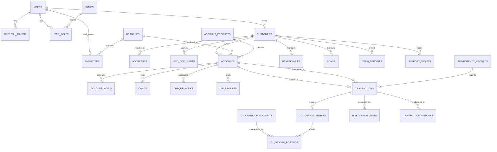

# FINServ — Comprehensive Database Architecture & Schema Specification

## 1. Schema Design Conventions & Invariants

All relational definitions for FINServ enforce strict enterprise financial invariants:
1. **Engine & Charset**: InnoDB storage engine; `utf8mb4` character set with `utf8mb4_unicode_ci` collation.
2. **Primary Keys**: UUID v4 stored as `BINARY(16)` or `VARCHAR(36)` (indexed) for distributed security and non-enumerable resource IDs.
3. **Monetary Precision**: All currency balances and transaction figures use `DECIMAL(15, 2)` or `DECIMAL(19, 4)` for sub-cent interest accrual. **Float and Double are strictly forbidden.**
4. **Time & Audit Invariants**: All timestamps stored in UTC using `TIMESTAMP` with microsecond precision (`TIMESTAMP(6)`) or standard `DATETIME`.
5. **Optimistic Locking**: State-sensitive entities (e.g., `accounts`) carry a `version BIGINT NOT NULL DEFAULT 0` column.
6. **Zero Destructive Deletions**: Financial records, accounts, customer histories, and audit records are never physically deleted. They utilize soft-deletion or status transitions (`CLOSED`, `DEACTIVATED`).

---

## 2. Mermaid Entity-Relationship Diagram (ERD)



---

## 3. Detailed Table Specifications

### 3.1 Authentication, Access Control & User Management

#### `users`
Core identity table representing all system users (customers, tellers, managers, admins).
```sql
CREATE TABLE users (
    id VARCHAR(36) NOT NULL,
    username VARCHAR(50) NOT NULL,
    email VARCHAR(100) NOT NULL,
    phone_number VARCHAR(20) NOT NULL,
    password_hash VARCHAR(255) NOT NULL,
    status VARCHAR(30) NOT NULL DEFAULT 'PENDING_VERIFICATION', -- PENDING_VERIFICATION, ACTIVE, LOCKED, SUSPENDED
    failed_login_attempts INT NOT NULL DEFAULT 0,
    locked_until TIMESTAMP NULL,
    last_login_at TIMESTAMP NULL,
    created_at TIMESTAMP NOT NULL DEFAULT CURRENT_TIMESTAMP,
    updated_at TIMESTAMP NOT NULL DEFAULT CURRENT_TIMESTAMP ON UPDATE CURRENT_TIMESTAMP,
    CONSTRAINT pk_users PRIMARY KEY (id),
    CONSTRAINT uq_users_username UNIQUE (username),
    CONSTRAINT uq_users_email UNIQUE (email),
    CONSTRAINT uq_users_phone UNIQUE (phone_number)
) ENGINE=InnoDB;

CREATE INDEX idx_users_status ON users(status);
```

#### `roles`
System authorization roles.
```sql
CREATE TABLE roles (
    id INT AUTO_INCREMENT NOT NULL,
    name VARCHAR(50) NOT NULL, -- ROLE_CUSTOMER, ROLE_EMPLOYEE, ROLE_MANAGER, ROLE_ADMIN, ROLE_COMPLIANCE
    description VARCHAR(255) NOT NULL,
    created_at TIMESTAMP NOT NULL DEFAULT CURRENT_TIMESTAMP,
    CONSTRAINT pk_roles PRIMARY KEY (id),
    CONSTRAINT uq_roles_name UNIQUE (name)
) ENGINE=InnoDB;
```

#### `user_roles`
Mapping table for users to roles (Many-to-Many).
```sql
CREATE TABLE user_roles (
    user_id VARCHAR(36) NOT NULL,
    role_id INT NOT NULL,
    assigned_at TIMESTAMP NOT NULL DEFAULT CURRENT_TIMESTAMP,
    CONSTRAINT pk_user_roles PRIMARY KEY (user_id, role_id),
    CONSTRAINT fk_user_roles_user FOREIGN KEY (user_id) REFERENCES users(id) ON DELETE RESTRICT,
    CONSTRAINT fk_user_roles_role FOREIGN KEY (role_id) REFERENCES roles(id) ON DELETE RESTRICT
) ENGINE=InnoDB;
```

#### `refresh_tokens`
Rotating refresh tokens for JWT authorization.
```sql
CREATE TABLE refresh_tokens (
    id VARCHAR(36) NOT NULL,
    user_id VARCHAR(36) NOT NULL,
    token_hash VARCHAR(255) NOT NULL,
    expires_at TIMESTAMP NOT NULL,
    revoked BOOLEAN NOT NULL DEFAULT FALSE,
    created_at TIMESTAMP NOT NULL DEFAULT CURRENT_TIMESTAMP,
    CONSTRAINT pk_refresh_tokens PRIMARY KEY (id),
    CONSTRAINT uq_refresh_tokens_hash UNIQUE (token_hash),
    CONSTRAINT fk_refresh_tokens_user FOREIGN KEY (user_id) REFERENCES users(id) ON DELETE CASCADE
) ENGINE=InnoDB;

CREATE INDEX idx_refresh_tokens_user ON refresh_tokens(user_id, revoked);
```

---

### 3.2 Customer Profiles & Progressive KYC

#### `customers`
Detailed personal information linked to a user account.
```sql
CREATE TABLE customers (
    id VARCHAR(36) NOT NULL,
    user_id VARCHAR(36) NOT NULL,
    customer_number VARCHAR(20) NOT NULL,
    first_name VARCHAR(60) NOT NULL,
    middle_name VARCHAR(60) NULL,
    last_name VARCHAR(60) NOT NULL,
    date_of_birth DATE NOT NULL,
    gender VARCHAR(20) NOT NULL,
    marital_status VARCHAR(20) NULL,
    nationality VARCHAR(50) NOT NULL DEFAULT 'INDIAN',
    tax_identifier VARCHAR(50) NOT NULL, -- PAN / SSN / Tax Registration ID
    kyc_status VARCHAR(30) NOT NULL DEFAULT 'INITIATED', -- INITIATED, DOCUMENTS_PENDING, SUBMITTED, UNDER_REVIEW, VERIFIED, REJECTED
    kyc_tier VARCHAR(20) NOT NULL DEFAULT 'TIER_1', -- TIER_1, TIER_2, TIER_3
    created_at TIMESTAMP NOT NULL DEFAULT CURRENT_TIMESTAMP,
    updated_at TIMESTAMP NOT NULL DEFAULT CURRENT_TIMESTAMP ON UPDATE CURRENT_TIMESTAMP,
    CONSTRAINT pk_customers PRIMARY KEY (id),
    CONSTRAINT uq_customers_user UNIQUE (user_id),
    CONSTRAINT uq_customers_number UNIQUE (customer_number),
    CONSTRAINT uq_customers_tax_id UNIQUE (tax_identifier),
    CONSTRAINT fk_customers_user FOREIGN KEY (user_id) REFERENCES users(id) ON DELETE RESTRICT
) ENGINE=InnoDB;

CREATE INDEX idx_customers_kyc_status ON customers(kyc_status);
```

#### `addresses`
Physical and legal customer addresses.
```sql
CREATE TABLE addresses (
    id VARCHAR(36) NOT NULL,
    customer_id VARCHAR(36) NOT NULL,
    address_type VARCHAR(30) NOT NULL, -- RESIDENTIAL, PERMANENT, OFFICE
    street_line_1 VARCHAR(120) NOT NULL,
    street_line_2 VARCHAR(120) NULL,
    city VARCHAR(60) NOT NULL,
    state VARCHAR(60) NOT NULL,
    postal_code VARCHAR(20) NOT NULL,
    country VARCHAR(60) NOT NULL DEFAULT 'India',
    is_primary BOOLEAN NOT NULL DEFAULT FALSE,
    created_at TIMESTAMP NOT NULL DEFAULT CURRENT_TIMESTAMP,
    CONSTRAINT pk_addresses PRIMARY KEY (id),
    CONSTRAINT fk_addresses_customer FOREIGN KEY (customer_id) REFERENCES customers(id) ON DELETE CASCADE
) ENGINE=InnoDB;

CREATE INDEX idx_addresses_customer ON addresses(customer_id);
```

#### `kyc_documents`
Customer submitted verification documents.
```sql
CREATE TABLE kyc_documents (
    id VARCHAR(36) NOT NULL,
    customer_id VARCHAR(36) NOT NULL,
    document_type VARCHAR(40) NOT NULL, -- PASSPORT, NATIONAL_ID, VOTER_ID, DRIVING_LICENSE, UTILITY_BILL
    document_number VARCHAR(80) NOT NULL,
    file_path VARCHAR(255) NOT NULL,
    mime_type VARCHAR(80) NOT NULL,
    file_size_bytes BIGINT NOT NULL,
    verification_status VARCHAR(30) NOT NULL DEFAULT 'PENDING', -- PENDING, VERIFIED, REJECTED
    rejection_reason VARCHAR(255) NULL,
    verified_by_user_id VARCHAR(36) NULL,
    verified_at TIMESTAMP NULL,
    created_at TIMESTAMP NOT NULL DEFAULT CURRENT_TIMESTAMP,
    CONSTRAINT pk_kyc_documents PRIMARY KEY (id),
    CONSTRAINT fk_kyc_docs_customer FOREIGN KEY (customer_id) REFERENCES customers(id) ON DELETE CASCADE,
    CONSTRAINT fk_kyc_docs_verifier FOREIGN KEY (verified_by_user_id) REFERENCES users(id) ON DELETE SET NULL
) ENGINE=InnoDB;

CREATE INDEX idx_kyc_docs_customer ON kyc_documents(customer_id);
```

---

### 3.3 Branch Network & Staff Operations

#### `branches`
Physical and logical banking branch offices.
```sql
CREATE TABLE branches (
    id VARCHAR(36) NOT NULL,
    branch_code VARCHAR(20) NOT NULL,
    branch_name VARCHAR(100) NOT NULL,
    ifsc_code VARCHAR(20) NOT NULL,
    routing_number VARCHAR(30) NOT NULL,
    street_address VARCHAR(150) NOT NULL,
    city VARCHAR(60) NOT NULL,
    state VARCHAR(60) NOT NULL,
    postal_code VARCHAR(20) NOT NULL,
    phone_number VARCHAR(20) NOT NULL,
    manager_user_id VARCHAR(36) NULL,
    status VARCHAR(20) NOT NULL DEFAULT 'ACTIVE',
    created_at TIMESTAMP NOT NULL DEFAULT CURRENT_TIMESTAMP,
    CONSTRAINT pk_branches PRIMARY KEY (id),
    CONSTRAINT uq_branches_code UNIQUE (branch_code),
    CONSTRAINT uq_branches_ifsc UNIQUE (ifsc_code),
    CONSTRAINT fk_branches_manager FOREIGN KEY (manager_user_id) REFERENCES users(id) ON DELETE SET NULL
) ENGINE=InnoDB;
```

#### `employees`
Bank staff profiles and branch affiliations.
```sql
CREATE TABLE employees (
    id VARCHAR(36) NOT NULL,
    user_id VARCHAR(36) NOT NULL,
    branch_id VARCHAR(36) NOT NULL,
    employee_code VARCHAR(30) NOT NULL,
    department VARCHAR(50) NOT NULL,
    designation VARCHAR(50) NOT NULL,
    joining_date DATE NOT NULL,
    status VARCHAR(20) NOT NULL DEFAULT 'ACTIVE',
    created_at TIMESTAMP NOT NULL DEFAULT CURRENT_TIMESTAMP,
    CONSTRAINT pk_employees PRIMARY KEY (id),
    CONSTRAINT uq_employees_user UNIQUE (user_id),
    CONSTRAINT uq_employees_code UNIQUE (employee_code),
    CONSTRAINT fk_employees_user FOREIGN KEY (user_id) REFERENCES users(id) ON DELETE RESTRICT,
    CONSTRAINT fk_employees_branch FOREIGN KEY (branch_id) REFERENCES branches(id) ON DELETE RESTRICT
) ENGINE=InnoDB;
```

---

### 3.4 Banking Products & Accounts

#### `account_products`
Product definitions (Savings, Current, Salary, etc.).
```sql
CREATE TABLE account_products (
    id VARCHAR(36) NOT NULL,
    product_code VARCHAR(20) NOT NULL,
    product_name VARCHAR(80) NOT NULL,
    product_type VARCHAR(30) NOT NULL, -- SAVINGS, CURRENT, SALARY, STUDENT
    currency VARCHAR(3) NOT NULL DEFAULT 'INR',
    min_balance DECIMAL(15, 2) NOT NULL DEFAULT 0.00,
    interest_rate_percentage DECIMAL(5, 2) NOT NULL DEFAULT 0.00,
    overdraft_allowed BOOLEAN NOT NULL DEFAULT FALSE,
    overdraft_limit DECIMAL(15, 2) NOT NULL DEFAULT 0.00,
    is_active BOOLEAN NOT NULL DEFAULT TRUE,
    created_at TIMESTAMP NOT NULL DEFAULT CURRENT_TIMESTAMP,
    CONSTRAINT pk_account_products PRIMARY KEY (id),
    CONSTRAINT uq_products_code UNIQUE (product_code)
) ENGINE=InnoDB;
```

#### `accounts`
Core customer deposit/checking accounts.
```sql
CREATE TABLE accounts (
    id VARCHAR(36) NOT NULL,
    customer_id VARCHAR(36) NOT NULL,
    branch_id VARCHAR(36) NOT NULL,
    product_id VARCHAR(36) NOT NULL,
    account_number VARCHAR(24) NOT NULL,
    currency VARCHAR(3) NOT NULL DEFAULT 'INR',
    current_balance DECIMAL(15, 2) NOT NULL DEFAULT 0.00,
    available_balance DECIMAL(15, 2) NOT NULL DEFAULT 0.00,
    hold_balance DECIMAL(15, 2) NOT NULL DEFAULT 0.00,
    status VARCHAR(30) NOT NULL DEFAULT 'APPLICATION_PENDING', -- APPLICATION_PENDING, ACTIVE, DORMANT, FROZEN, CLOSED
    opened_at TIMESTAMP NULL,
    closed_at TIMESTAMP NULL,
    version BIGINT NOT NULL DEFAULT 0, -- Optimistic locking counter
    created_at TIMESTAMP NOT NULL DEFAULT CURRENT_TIMESTAMP,
    updated_at TIMESTAMP NOT NULL DEFAULT CURRENT_TIMESTAMP ON UPDATE CURRENT_TIMESTAMP,
    CONSTRAINT pk_accounts PRIMARY KEY (id),
    CONSTRAINT uq_accounts_number UNIQUE (account_number),
    CONSTRAINT fk_accounts_customer FOREIGN KEY (customer_id) REFERENCES customers(id) ON DELETE RESTRICT,
    CONSTRAINT fk_accounts_branch FOREIGN KEY (branch_id) REFERENCES branches(id) ON DELETE RESTRICT,
    CONSTRAINT fk_accounts_product FOREIGN KEY (product_id) REFERENCES account_products(id) ON DELETE RESTRICT
) ENGINE=InnoDB;

CREATE INDEX idx_accounts_customer ON accounts(customer_id);
CREATE INDEX idx_accounts_status ON accounts(status);
```

#### `account_holds`
Funds held/earmarked for pending authorizations.
```sql
CREATE TABLE account_holds (
    id VARCHAR(36) NOT NULL,
    account_id VARCHAR(36) NOT NULL,
    hold_reference VARCHAR(50) NOT NULL,
    amount DECIMAL(15, 2) NOT NULL,
    reason VARCHAR(150) NOT NULL,
    status VARCHAR(20) NOT NULL DEFAULT 'ACTIVE', -- ACTIVE, RELEASED, EXECUTED
    expires_at TIMESTAMP NULL,
    created_at TIMESTAMP NOT NULL DEFAULT CURRENT_TIMESTAMP,
    updated_at TIMESTAMP NOT NULL DEFAULT CURRENT_TIMESTAMP ON UPDATE CURRENT_TIMESTAMP,
    CONSTRAINT pk_account_holds PRIMARY KEY (id),
    CONSTRAINT uq_account_holds_ref UNIQUE (hold_reference),
    CONSTRAINT fk_account_holds_acc FOREIGN KEY (account_id) REFERENCES accounts(id) ON DELETE CASCADE
) ENGINE=InnoDB;

CREATE INDEX idx_account_holds_acc ON account_holds(account_id, status);
```

---

### 3.5 General Ledger & Double-Entry Accounting

#### `gl_chart_of_accounts`
Standard banking General Ledger chart of accounts.
```sql
CREATE TABLE gl_chart_of_accounts (
    id VARCHAR(36) NOT NULL,
    gl_code VARCHAR(30) NOT NULL,
    account_name VARCHAR(100) NOT NULL,
    account_type VARCHAR(20) NOT NULL, -- ASSET, LIABILITY, EQUITY, REVENUE, EXPENSE
    balance_side VARCHAR(10) NOT NULL, -- DEBIT, CREDIT
    description VARCHAR(255) NULL,
    is_active BOOLEAN NOT NULL DEFAULT TRUE,
    created_at TIMESTAMP NOT NULL DEFAULT CURRENT_TIMESTAMP,
    CONSTRAINT pk_gl_chart PRIMARY KEY (id),
    CONSTRAINT uq_gl_code UNIQUE (gl_code)
) ENGINE=InnoDB;
```

#### `gl_journal_entries`
Immutable header for balanced accounting journal vouchers.
```sql
CREATE TABLE gl_journal_entries (
    id VARCHAR(36) NOT NULL,
    journal_reference VARCHAR(50) NOT NULL,
    transaction_type VARCHAR(40) NOT NULL,
    posting_date DATE NOT NULL,
    description VARCHAR(255) NOT NULL,
    status VARCHAR(20) NOT NULL DEFAULT 'POSTED', -- POSTED, REVERSED
    created_by_user_id VARCHAR(36) NULL,
    created_at TIMESTAMP NOT NULL DEFAULT CURRENT_TIMESTAMP,
    CONSTRAINT pk_gl_journal PRIMARY KEY (id),
    CONSTRAINT uq_gl_journal_ref UNIQUE (journal_reference),
    CONSTRAINT fk_gl_journal_user FOREIGN KEY (created_by_user_id) REFERENCES users(id) ON DELETE SET NULL
) ENGINE=InnoDB;

CREATE INDEX idx_gl_journal_posting_date ON gl_journal_entries(posting_date);
```

#### `gl_ledger_postings`
Individual debit and credit postings forming balanced entries ($\sum \text{Debits} == \sum \text{Credits}$).
```sql
CREATE TABLE gl_ledger_postings (
    id VARCHAR(36) NOT NULL,
    journal_entry_id VARCHAR(36) NOT NULL,
    gl_account_id VARCHAR(36) NOT NULL,
    customer_account_id VARCHAR(36) NULL, -- Optional mapping to customer account
    entry_type VARCHAR(10) NOT NULL, -- DEBIT, CREDIT
    amount DECIMAL(15, 2) NOT NULL,
    running_balance_after DECIMAL(15, 2) NOT NULL,
    created_at TIMESTAMP NOT NULL DEFAULT CURRENT_TIMESTAMP,
    CONSTRAINT pk_gl_postings PRIMARY KEY (id),
    CONSTRAINT fk_gl_postings_journal FOREIGN KEY (journal_entry_id) REFERENCES gl_journal_entries(id) ON DELETE CASCADE,
    CONSTRAINT fk_gl_postings_gl_acc FOREIGN KEY (gl_account_id) REFERENCES gl_chart_of_accounts(id) ON DELETE RESTRICT,
    CONSTRAINT fk_gl_postings_cust_acc FOREIGN KEY (customer_account_id) REFERENCES accounts(id) ON DELETE SET NULL
) ENGINE=InnoDB;

CREATE INDEX idx_gl_postings_journal ON gl_ledger_postings(journal_entry_id);
CREATE INDEX idx_gl_postings_cust_acc ON gl_ledger_postings(customer_account_id);
```

---

### 3.6 Financial Transactions & Idempotency

#### `idempotency_records`
Prevents duplicate financial execution by caching mutation results for unique client keys.
```sql
CREATE TABLE idempotency_records (
    id VARCHAR(36) NOT NULL,
    idempotency_key VARCHAR(100) NOT NULL,
    user_id VARCHAR(36) NOT NULL,
    request_hash VARCHAR(64) NOT NULL, -- SHA-256 hash of payload
    request_path VARCHAR(200) NOT NULL,
    http_status_code INT NULL,
    response_payload LONGTEXT NULL,
    status VARCHAR(20) NOT NULL DEFAULT 'IN_PROGRESS', -- IN_PROGRESS, COMPLETED, FAILED
    created_at TIMESTAMP NOT NULL DEFAULT CURRENT_TIMESTAMP,
    expires_at TIMESTAMP NOT NULL,
    CONSTRAINT pk_idempotency PRIMARY KEY (id),
    CONSTRAINT uq_idempotency_key UNIQUE (idempotency_key),
    CONSTRAINT fk_idempotency_user FOREIGN KEY (user_id) REFERENCES users(id) ON DELETE CASCADE
) ENGINE=InnoDB;

CREATE INDEX idx_idempotency_expires ON idempotency_records(expires_at);
```

#### `transactions`
Business financial transactions between accounts or external systems.
```sql
CREATE TABLE transactions (
    id VARCHAR(36) NOT NULL,
    transaction_reference VARCHAR(40) NOT NULL,
    from_account_id VARCHAR(36) NULL, -- NULL for external cash deposit
    to_account_id VARCHAR(36) NULL,   -- NULL for external withdrawal
    transaction_type VARCHAR(40) NOT NULL, -- DEPOSIT, WITHDRAWAL, TRANSFER_INTERNAL, TRANSFER_EXTERNAL, FEE, INTEREST, REVERSAL
    amount DECIMAL(15, 2) NOT NULL,
    fee_amount DECIMAL(15, 2) NOT NULL DEFAULT 0.00,
    currency VARCHAR(3) NOT NULL DEFAULT 'INR',
    status VARCHAR(20) NOT NULL DEFAULT 'PENDING', -- PENDING, COMPLETED, FAILED, REVERSED
    failure_reason VARCHAR(255) NULL,
    reversal_of_transaction_id VARCHAR(36) NULL,
    channel VARCHAR(30) NOT NULL DEFAULT 'WEB', -- WEB, MOBILE, BRANCH, ATM
    idempotency_record_id VARCHAR(36) NULL,
    journal_entry_id VARCHAR(36) NULL,
    description VARCHAR(255) NULL,
    created_at TIMESTAMP NOT NULL DEFAULT CURRENT_TIMESTAMP,
    completed_at TIMESTAMP NULL,
    CONSTRAINT pk_transactions PRIMARY KEY (id),
    CONSTRAINT uq_transactions_ref UNIQUE (transaction_reference),
    CONSTRAINT fk_transactions_from_acc FOREIGN KEY (from_account_id) REFERENCES accounts(id) ON DELETE RESTRICT,
    CONSTRAINT fk_transactions_to_acc FOREIGN KEY (to_account_id) REFERENCES accounts(id) ON DELETE RESTRICT,
    CONSTRAINT fk_transactions_reversal FOREIGN KEY (reversal_of_transaction_id) REFERENCES transactions(id) ON DELETE RESTRICT,
    CONSTRAINT fk_transactions_idempotency FOREIGN KEY (idempotency_record_id) REFERENCES idempotency_records(id) ON DELETE SET NULL,
    CONSTRAINT fk_transactions_journal FOREIGN KEY (journal_entry_id) REFERENCES gl_journal_entries(id) ON DELETE SET NULL
) ENGINE=InnoDB;

CREATE INDEX idx_transactions_from_acc ON transactions(from_account_id, created_at);
CREATE INDEX idx_transactions_to_acc ON transactions(to_account_id, created_at);
CREATE INDEX idx_transactions_status ON transactions(status);
```

---

### 3.7 Beneficiaries & Payees

#### `beneficiaries`
Verified transfer recipients.
```sql
CREATE TABLE beneficiaries (
    id VARCHAR(36) NOT NULL,
    customer_id VARCHAR(36) NOT NULL,
    payee_type VARCHAR(20) NOT NULL, -- INTRA_BANK, INTER_BANK, UPI
    nickname VARCHAR(60) NOT NULL,
    beneficiary_name VARCHAR(100) NOT NULL,
    account_number VARCHAR(34) NULL,
    ifsc_code VARCHAR(20) NULL,
    bank_name VARCHAR(100) NULL,
    upi_vpa VARCHAR(100) NULL,
    cooling_off_until TIMESTAMP NULL,
    is_active BOOLEAN NOT NULL DEFAULT TRUE,
    created_at TIMESTAMP NOT NULL DEFAULT CURRENT_TIMESTAMP,
    CONSTRAINT pk_beneficiaries PRIMARY KEY (id),
    CONSTRAINT fk_beneficiaries_customer FOREIGN KEY (customer_id) REFERENCES customers(id) ON DELETE CASCADE
) ENGINE=InnoDB;

CREATE INDEX idx_beneficiaries_customer ON beneficiaries(customer_id, is_active);
```

---

### 3.8 Term Deposits (Fixed & Recurring Deposits)

#### `term_deposits`
Term investments linked to customer savings accounts.
```sql
CREATE TABLE term_deposits (
    id VARCHAR(36) NOT NULL,
    customer_id VARCHAR(36) NOT NULL,
    linked_account_id VARCHAR(36) NOT NULL,
    deposit_type VARCHAR(20) NOT NULL, -- FIXED_DEPOSIT, RECURRING_DEPOSIT
    deposit_number VARCHAR(30) NOT NULL,
    principal_amount DECIMAL(15, 2) NOT NULL,
    monthly_installment DECIMAL(15, 2) NULL,
    interest_rate_percentage DECIMAL(5, 2) NOT NULL,
    tenure_months INT NOT NULL,
    compounding_frequency VARCHAR(20) NOT NULL DEFAULT 'QUARTERLY', -- MONTHLY, QUARTERLY, AT_MATURITY
    start_date DATE NOT NULL,
    maturity_date DATE NOT NULL,
    maturity_amount DECIMAL(15, 2) NOT NULL,
    status VARCHAR(25) NOT NULL DEFAULT 'ACTIVE', -- ACTIVE, MATURED, PREMATURE_CLOSED
    created_at TIMESTAMP NOT NULL DEFAULT CURRENT_TIMESTAMP,
    CONSTRAINT pk_term_deposits PRIMARY KEY (id),
    CONSTRAINT uq_term_deposits_num UNIQUE (deposit_number),
    CONSTRAINT fk_term_deposits_cust FOREIGN KEY (customer_id) REFERENCES customers(id) ON DELETE RESTRICT,
    CONSTRAINT fk_term_deposits_acc FOREIGN KEY (linked_account_id) REFERENCES accounts(id) ON DELETE RESTRICT
) ENGINE=InnoDB;
```

---

### 3.9 Lending & Loans Engine

#### `loan_products`
Loan catalog definitions.
```sql
CREATE TABLE loan_products (
    id VARCHAR(36) NOT NULL,
    product_code VARCHAR(20) NOT NULL,
    loan_name VARCHAR(80) NOT NULL,
    loan_type VARCHAR(30) NOT NULL, -- PERSONAL, HOME, AUTO, EDUCATION
    min_amount DECIMAL(15, 2) NOT NULL,
    max_amount DECIMAL(15, 2) NOT NULL,
    interest_rate_percentage DECIMAL(5, 2) NOT NULL,
    min_tenure_months INT NOT NULL,
    max_tenure_months INT NOT NULL,
    created_at TIMESTAMP NOT NULL DEFAULT CURRENT_TIMESTAMP,
    CONSTRAINT pk_loan_products PRIMARY KEY (id),
    CONSTRAINT uq_loan_products_code UNIQUE (product_code)
) ENGINE=InnoDB;
```

#### `loans`
Customer sanctioned loan contracts.
```sql
CREATE TABLE loans (
    id VARCHAR(36) NOT NULL,
    customer_id VARCHAR(36) NOT NULL,
    loan_product_id VARCHAR(36) NOT NULL,
    disbursement_account_id VARCHAR(36) NOT NULL,
    loan_account_number VARCHAR(30) NOT NULL,
    principal_amount DECIMAL(15, 2) NOT NULL,
    interest_rate_percentage DECIMAL(5, 2) NOT NULL,
    tenure_months INT NOT NULL,
    emi_amount DECIMAL(15, 2) NOT NULL,
    outstanding_principal DECIMAL(15, 2) NOT NULL,
    status VARCHAR(25) NOT NULL DEFAULT 'APPLIED', -- APPLIED, APPROVED, SANCTIONED, ACTIVE, DELINQUENT, CLOSED
    sanctioned_at TIMESTAMP NULL,
    created_at TIMESTAMP NOT NULL DEFAULT CURRENT_TIMESTAMP,
    CONSTRAINT pk_loans PRIMARY KEY (id),
    CONSTRAINT uq_loans_acc_num UNIQUE (loan_account_number),
    CONSTRAINT fk_loans_cust FOREIGN KEY (customer_id) REFERENCES customers(id) ON DELETE RESTRICT,
    CONSTRAINT fk_loans_prod FOREIGN KEY (loan_product_id) REFERENCES loan_products(id) ON DELETE RESTRICT,
    CONSTRAINT fk_loans_acc FOREIGN KEY (disbursement_account_id) REFERENCES accounts(id) ON DELETE RESTRICT
) ENGINE=InnoDB;
```

#### `loan_amortization_schedules`
Month-by-month repayment breakdown for each active loan.
```sql
CREATE TABLE loan_amortization_schedules (
    id VARCHAR(36) NOT NULL,
    loan_id VARCHAR(36) NOT NULL,
    installment_number INT NOT NULL,
    due_date DATE NOT NULL,
    emi_amount DECIMAL(15, 2) NOT NULL,
    principal_component DECIMAL(15, 2) NOT NULL,
    interest_component DECIMAL(15, 2) NOT NULL,
    remaining_principal DECIMAL(15, 2) NOT NULL,
    status VARCHAR(20) NOT NULL DEFAULT 'PENDING', -- PENDING, PAID, OVERDUE
    paid_at TIMESTAMP NULL,
    CONSTRAINT pk_loan_schedule PRIMARY KEY (id),
    CONSTRAINT uq_loan_schedule UNIQUE (loan_id, installment_number),
    CONSTRAINT fk_loan_schedule_loan FOREIGN KEY (loan_id) REFERENCES loans(id) ON DELETE CASCADE
) ENGINE=InnoDB;

CREATE INDEX idx_loan_schedule_due ON loan_amortization_schedules(loan_id, due_date, status);
```

---

### 3.10 Cheques & Positive Pay

#### `cheque_books`
Cheque book issuance requests.
```sql
CREATE TABLE cheque_books (
    id VARCHAR(36) NOT NULL,
    account_id VARCHAR(36) NOT NULL,
    book_number VARCHAR(30) NOT NULL,
    starting_leaf_number INT NOT NULL,
    ending_leaf_number INT NOT NULL,
    total_leaves INT NOT NULL,
    status VARCHAR(20) NOT NULL DEFAULT 'REQUESTED', -- REQUESTED, ISSUED, DELIVERED, EXHAUSTED
    requested_at TIMESTAMP NOT NULL DEFAULT CURRENT_TIMESTAMP,
    issued_at TIMESTAMP NULL,
    CONSTRAINT pk_cheque_books PRIMARY KEY (id),
    CONSTRAINT uq_cheque_books_num UNIQUE (account_id, book_number),
    CONSTRAINT fk_cheque_books_acc FOREIGN KEY (account_id) REFERENCES accounts(id) ON DELETE CASCADE
) ENGINE=InnoDB;
```

#### `cheque_leaves`
Individual physical leaves within a cheque book.
```sql
CREATE TABLE cheque_leaves (
    id VARCHAR(36) NOT NULL,
    cheque_book_id VARCHAR(36) NOT NULL,
    account_id VARCHAR(36) NOT NULL,
    leaf_number INT NOT NULL,
    status VARCHAR(25) NOT NULL DEFAULT 'AVAILABLE', -- AVAILABLE, PRESENTED, CLEARED, BOUNCED, STOPPED
    payee_name VARCHAR(100) NULL,
    amount DECIMAL(15, 2) NULL,
    cleared_at TIMESTAMP NULL,
    bounce_reason VARCHAR(255) NULL,
    CONSTRAINT pk_cheque_leaves PRIMARY KEY (id),
    CONSTRAINT uq_cheque_leaf UNIQUE (account_id, leaf_number),
    CONSTRAINT fk_cheque_leaves_book FOREIGN KEY (cheque_book_id) REFERENCES cheque_books(id) ON DELETE CASCADE,
    CONSTRAINT fk_cheque_leaves_acc FOREIGN KEY (account_id) REFERENCES accounts(id) ON DELETE CASCADE
) ENGINE=InnoDB;
```

#### `positive_pay_records`
High-value cheque pre-verification records.
```sql
CREATE TABLE positive_pay_records (
    id VARCHAR(36) NOT NULL,
    account_id VARCHAR(36) NOT NULL,
    cheque_leaf_number INT NOT NULL,
    payee_name VARCHAR(100) NOT NULL,
    amount DECIMAL(15, 2) NOT NULL,
    issue_date DATE NOT NULL,
    status VARCHAR(20) NOT NULL DEFAULT 'REGISTERED', -- REGISTERED, MATCHED, DISCREPANT
    created_at TIMESTAMP NOT NULL DEFAULT CURRENT_TIMESTAMP,
    CONSTRAINT pk_positive_pay PRIMARY KEY (id),
    CONSTRAINT uq_pos_pay UNIQUE (account_id, cheque_leaf_number),
    CONSTRAINT fk_pos_pay_acc FOREIGN KEY (account_id) REFERENCES accounts(id) ON DELETE CASCADE
) ENGINE=InnoDB;
```

---

### 3.11 Bill Payments & Utility Simulators

#### `billers`
Registered utility billers.
```sql
CREATE TABLE billers (
    id VARCHAR(36) NOT NULL,
    biller_code VARCHAR(30) NOT NULL,
    biller_name VARCHAR(100) NOT NULL,
    category VARCHAR(40) NOT NULL, -- ELECTRICITY, WATER, GAS, TELECOM, FASTAG
    logo_url VARCHAR(255) NULL,
    is_active BOOLEAN NOT NULL DEFAULT TRUE,
    CONSTRAINT pk_billers PRIMARY KEY (id),
    CONSTRAINT uq_billers_code UNIQUE (biller_code)
) ENGINE=InnoDB;
```

#### `bill_payments`
Customer utility payments.
```sql
CREATE TABLE bill_payments (
    id VARCHAR(36) NOT NULL,
    customer_id VARCHAR(36) NOT NULL,
    from_account_id VARCHAR(36) NOT NULL,
    biller_id VARCHAR(36) NOT NULL,
    consumer_number VARCHAR(60) NOT NULL,
    bill_amount DECIMAL(15, 2) NOT NULL,
    convenience_fee DECIMAL(15, 2) NOT NULL DEFAULT 0.00,
    payment_reference VARCHAR(40) NOT NULL,
    status VARCHAR(20) NOT NULL DEFAULT 'SUCCESS',
    paid_at TIMESTAMP NOT NULL DEFAULT CURRENT_TIMESTAMP,
    CONSTRAINT pk_bill_payments PRIMARY KEY (id),
    CONSTRAINT uq_bill_pay_ref UNIQUE (payment_reference),
    CONSTRAINT fk_bill_pay_cust FOREIGN KEY (customer_id) REFERENCES customers(id) ON DELETE RESTRICT,
    CONSTRAINT fk_bill_pay_acc FOREIGN KEY (from_account_id) REFERENCES accounts(id) ON DELETE RESTRICT,
    CONSTRAINT fk_bill_pay_biller FOREIGN KEY (biller_id) REFERENCES billers(id) ON DELETE RESTRICT
) ENGINE=InnoDB;
```

---

### 3.12 Cards & Security Controls

#### `cards`
Debit and credit cards linked to customer accounts.
```sql
CREATE TABLE cards (
    id VARCHAR(36) NOT NULL,
    account_id VARCHAR(36) NOT NULL,
    customer_id VARCHAR(36) NOT NULL,
    card_number_last_four VARCHAR(4) NOT NULL,
    card_hash VARCHAR(255) NOT NULL,
    card_type VARCHAR(20) NOT NULL, -- DEBIT, CREDIT
    card_network VARCHAR(20) NOT NULL DEFAULT 'VISA', -- VISA, MASTERCARD, RUPAY
    expiry_month INT NOT NULL,
    expiry_year INT NOT NULL,
    cvv_hash VARCHAR(255) NOT NULL,
    pin_hash VARCHAR(255) NOT NULL,
    status VARCHAR(25) NOT NULL DEFAULT 'INACTIVE', -- INACTIVE, ACTIVE, BLOCKED, PERMANENTLY_CANCELLED
    is_online_enabled BOOLEAN NOT NULL DEFAULT TRUE,
    is_international_enabled BOOLEAN NOT NULL DEFAULT FALSE,
    is_contactless_enabled BOOLEAN NOT NULL DEFAULT TRUE,
    daily_spending_limit DECIMAL(15, 2) NOT NULL DEFAULT 50000.00,
    daily_atm_limit DECIMAL(15, 2) NOT NULL DEFAULT 25000.00,
    created_at TIMESTAMP NOT NULL DEFAULT CURRENT_TIMESTAMP,
    CONSTRAINT pk_cards PRIMARY KEY (id),
    CONSTRAINT fk_cards_acc FOREIGN KEY (account_id) REFERENCES accounts(id) ON DELETE CASCADE,
    CONSTRAINT fk_cards_cust FOREIGN KEY (customer_id) REFERENCES customers(id) ON DELETE CASCADE
) ENGINE=InnoDB;

CREATE INDEX idx_cards_acc ON cards(account_id);
```

---

### 3.13 UPI Payments

#### `upi_profiles`
Virtual Payment Addresses (VPAs).
```sql
CREATE TABLE upi_profiles (
    id VARCHAR(36) NOT NULL,
    customer_id VARCHAR(36) NOT NULL,
    account_id VARCHAR(36) NOT NULL,
    vpa_address VARCHAR(80) NOT NULL,
    upi_pin_hash VARCHAR(255) NOT NULL,
    status VARCHAR(20) NOT NULL DEFAULT 'ACTIVE',
    created_at TIMESTAMP NOT NULL DEFAULT CURRENT_TIMESTAMP,
    CONSTRAINT pk_upi_profiles PRIMARY KEY (id),
    CONSTRAINT uq_upi_vpa UNIQUE (vpa_address),
    CONSTRAINT fk_upi_cust FOREIGN KEY (customer_id) REFERENCES customers(id) ON DELETE CASCADE,
    CONSTRAINT fk_upi_acc FOREIGN KEY (account_id) REFERENCES accounts(id) ON DELETE CASCADE
) ENGINE=InnoDB;
```

---

### 3.14 Risk Controls, Fraud & Compliance

#### `risk_assessments`
Risk scoring evaluated on financial events.
```sql
CREATE TABLE risk_assessments (
    id VARCHAR(36) NOT NULL,
    transaction_id VARCHAR(36) NOT NULL,
    customer_id VARCHAR(36) NOT NULL,
    risk_score INT NOT NULL, -- 0 to 100
    risk_level VARCHAR(20) NOT NULL, -- LOW, MEDIUM, HIGH, CRITICAL
    rules_triggered VARCHAR(255) NULL,
    action_taken VARCHAR(30) NOT NULL, -- ALLOWED, CHALLENGED, FLAGGED, BLOCKED
    evaluated_at TIMESTAMP NOT NULL DEFAULT CURRENT_TIMESTAMP,
    CONSTRAINT pk_risk_assessments PRIMARY KEY (id),
    CONSTRAINT fk_risk_txn FOREIGN KEY (transaction_id) REFERENCES transactions(id) ON DELETE CASCADE,
    CONSTRAINT fk_risk_cust FOREIGN KEY (customer_id) REFERENCES customers(id) ON DELETE CASCADE
) ENGINE=InnoDB;

CREATE INDEX idx_risk_eval ON risk_assessments(customer_id, risk_level);
```

#### `aml_alerts`
Anti-Money Laundering alerts for compliance review.
```sql
CREATE TABLE aml_alerts (
    id VARCHAR(36) NOT NULL,
    customer_id VARCHAR(36) NOT NULL,
    transaction_id VARCHAR(36) NULL,
    alert_type VARCHAR(60) NOT NULL,
    alert_severity VARCHAR(20) NOT NULL, -- LOW, MEDIUM, HIGH, URGENT
    status VARCHAR(30) NOT NULL DEFAULT 'OPEN', -- OPEN, INVESTIGATING, ESCALATED_SAR, CLOSED_FALSE_POSITIVE
    investigator_user_id VARCHAR(36) NULL,
    investigation_notes TEXT NULL,
    created_at TIMESTAMP NOT NULL DEFAULT CURRENT_TIMESTAMP,
    CONSTRAINT pk_aml_alerts PRIMARY KEY (id),
    CONSTRAINT fk_aml_cust FOREIGN KEY (customer_id) REFERENCES customers(id) ON DELETE CASCADE,
    CONSTRAINT fk_aml_txn FOREIGN KEY (transaction_id) REFERENCES transactions(id) ON DELETE SET NULL,
    CONSTRAINT fk_aml_investigator FOREIGN KEY (investigator_user_id) REFERENCES users(id) ON DELETE SET NULL
) ENGINE=InnoDB;
```

---

### 3.15 Customer Support & Transaction Disputes

#### `support_tickets`
Customer service tickets.
```sql
CREATE TABLE support_tickets (
    id VARCHAR(36) NOT NULL,
    customer_id VARCHAR(36) NOT NULL,
    assigned_staff_id VARCHAR(36) NULL,
    category VARCHAR(40) NOT NULL,
    subject VARCHAR(120) NOT NULL,
    description TEXT NOT NULL,
    priority VARCHAR(20) NOT NULL DEFAULT 'MEDIUM',
    status VARCHAR(20) NOT NULL DEFAULT 'OPEN', -- OPEN, IN_PROGRESS, RESOLVED, CLOSED
    created_at TIMESTAMP NOT NULL DEFAULT CURRENT_TIMESTAMP,
    updated_at TIMESTAMP NOT NULL DEFAULT CURRENT_TIMESTAMP ON UPDATE CURRENT_TIMESTAMP,
    CONSTRAINT pk_support_tickets PRIMARY KEY (id),
    CONSTRAINT fk_tickets_cust FOREIGN KEY (customer_id) REFERENCES customers(id) ON DELETE CASCADE,
    CONSTRAINT fk_tickets_staff FOREIGN KEY (assigned_staff_id) REFERENCES users(id) ON DELETE SET NULL
) ENGINE=InnoDB;
```

#### `transaction_disputes`
Chargeback and disputed transaction workflows.
```sql
CREATE TABLE transaction_disputes (
    id VARCHAR(36) NOT NULL,
    ticket_id VARCHAR(36) NOT NULL,
    transaction_id VARCHAR(36) NOT NULL,
    dispute_reason VARCHAR(100) NOT NULL,
    disputed_amount DECIMAL(15, 2) NOT NULL,
    provisional_credit_issued BOOLEAN NOT NULL DEFAULT FALSE,
    status VARCHAR(30) NOT NULL DEFAULT 'INITIATED', -- INITIATED, UNDER_REVIEW, CHARGEBACK_WON, CHARGEBACK_LOST
    created_at TIMESTAMP NOT NULL DEFAULT CURRENT_TIMESTAMP,
    CONSTRAINT pk_disputes PRIMARY KEY (id),
    CONSTRAINT fk_disputes_ticket FOREIGN KEY (ticket_id) REFERENCES support_tickets(id) ON DELETE CASCADE,
    CONSTRAINT fk_disputes_txn FOREIGN KEY (transaction_id) REFERENCES transactions(id) ON DELETE RESTRICT
) ENGINE=InnoDB;
```

---

### 3.16 Immutable Audit Log

#### `audit_logs`
Cryptographically traceable, tamper-evident audit trail of all mutations and supervisor actions.
```sql
CREATE TABLE audit_logs (
    id VARCHAR(36) NOT NULL,
    event_type VARCHAR(60) NOT NULL,
    entity_type VARCHAR(60) NOT NULL,
    entity_id VARCHAR(36) NOT NULL,
    actor_user_id VARCHAR(36) NULL,
    actor_role VARCHAR(50) NULL,
    action VARCHAR(20) NOT NULL, -- CREATE, UPDATE, DELETE, OVERRIDE, LOGIN
    ip_address VARCHAR(45) NULL,
    user_agent VARCHAR(255) NULL,
    correlation_id VARCHAR(64) NULL,
    old_value_json JSON NULL,
    new_value_json JSON NULL,
    created_at TIMESTAMP NOT NULL DEFAULT CURRENT_TIMESTAMP,
    CONSTRAINT pk_audit_logs PRIMARY KEY (id)
) ENGINE=InnoDB;

CREATE INDEX idx_audit_entity ON audit_logs(entity_type, entity_id);
CREATE INDEX idx_audit_actor ON audit_logs(actor_user_id, created_at);
CREATE INDEX idx_audit_created ON audit_logs(created_at);
```
